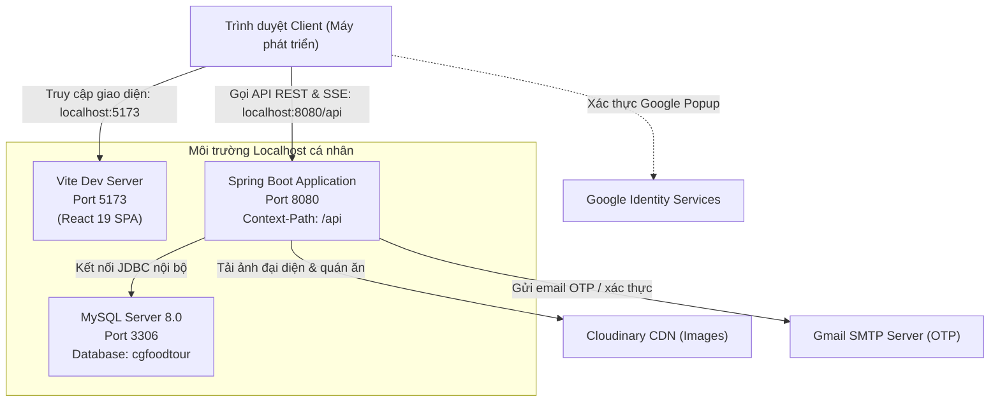
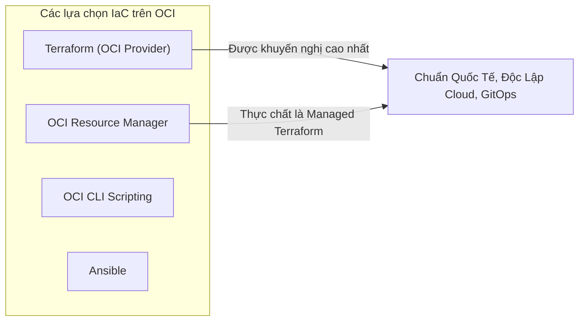
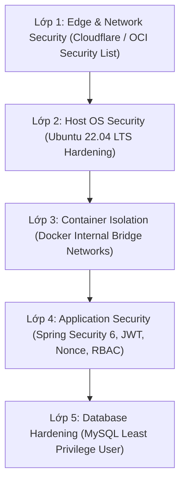
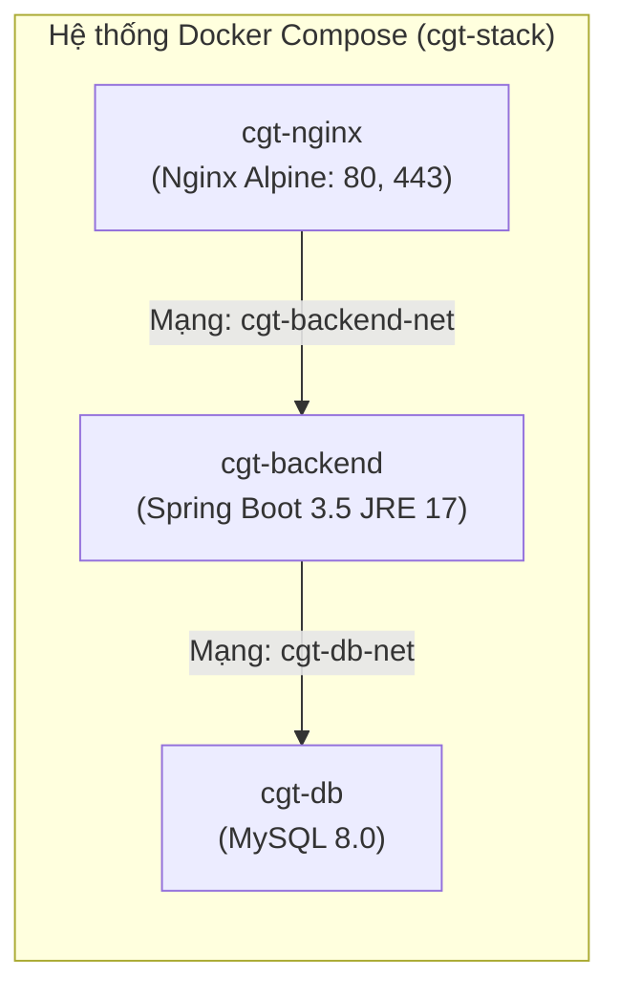
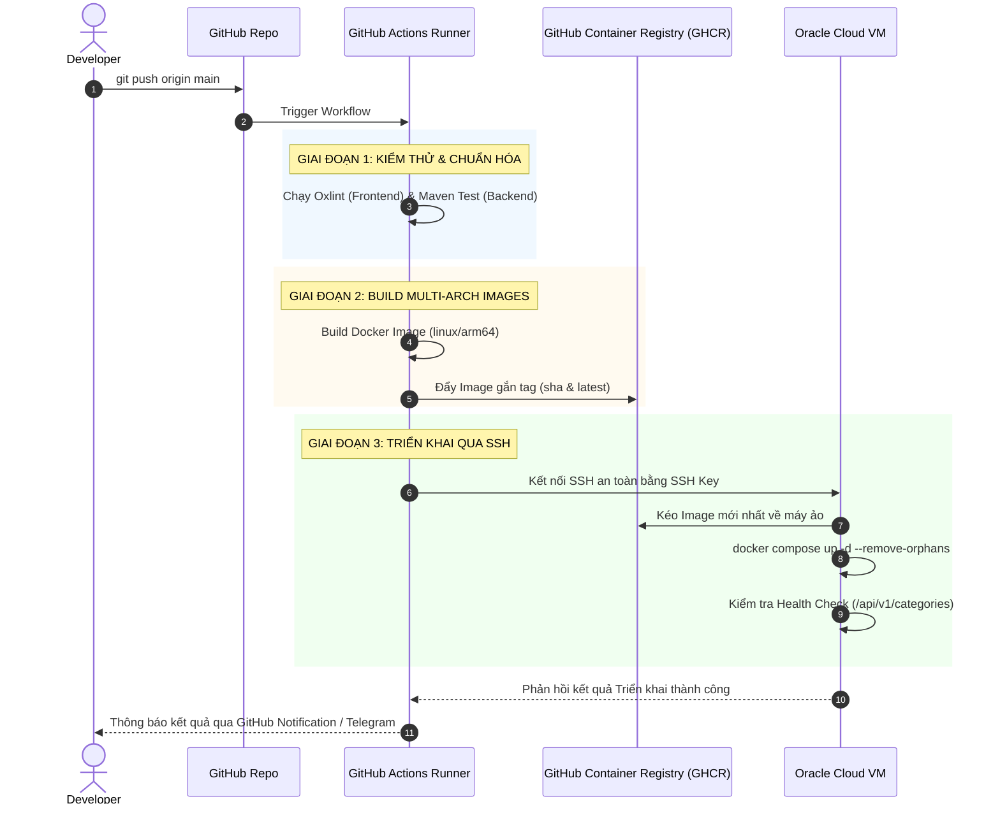
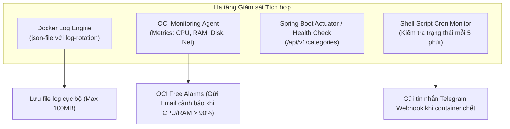
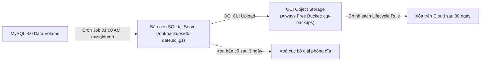
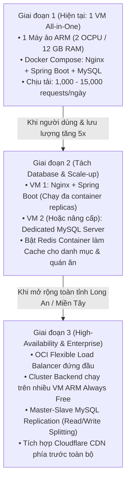
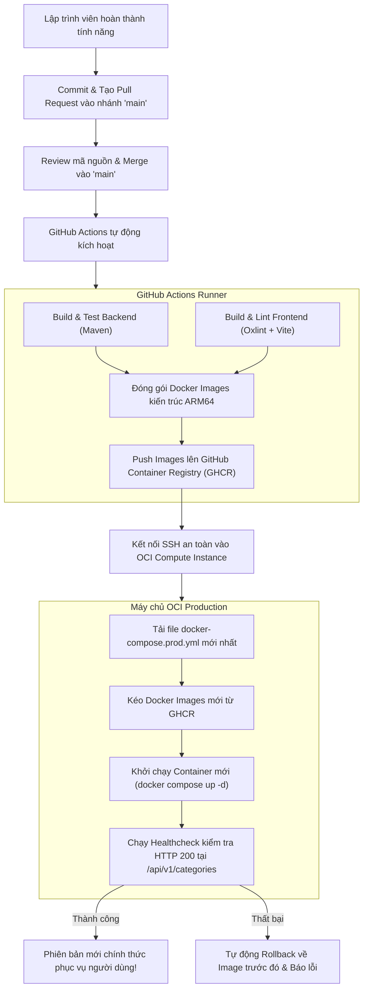

# Kế Hoạch Triển Khai Hệ Thống Cần Giuộc Food Tour Lên Oracle Cloud Infrastructure (OCI) Always Free

> **Tài liệu Blueprint Triển khai Production**  
> **Dự án:** Cần Giuộc Food Tour (CGFoodTour)  
> **Phiên bản tài liệu:** 1.0.0  
> **Trạng thái:** Kế hoạch kiến trúc & Triển khai (Planning Only — Không sửa code hệ thống)  

---

## 1. Executive Summary

Dự án **Cần Giuộc Food Tour (CGFoodTour)** hiện là ứng dụng full-stack phục vụ việc tìm kiếm, định vị quán ăn, hỗ trợ quản lý cửa hàng và cộng đồng tại huyện Cần Giuộc, Long An. Hệ thống hiện hoạt động hoàn toàn trên môi trường máy tính cá nhân (`localhost`), kết nối qua nhiều port cục bộ (Frontend port 5173, Backend port 8080, MySQL port 3306).

Mục tiêu chiến lược của kế hoạch này là đưa toàn bộ hệ thống lên **Public Internet** với:
1. **Chi phí hạ tầng $0/tháng (Zero recurring cost)** bằng cách tận dụng tối đa tài nguyên **Oracle Cloud Infrastructure (OCI) Always Free**.
2. **Tiêu chuẩn bảo mật mức Production:** Tách biệt mạng cô lập cho cơ sở dữ liệu, quản lý bí mật tập trung, thiết lập tường lửa nhiều lớp (VCN Security Lists + OS UFW), mã hóa toàn bộ đường truyền qua HTTPS/TLS (Let's Encrypt).
3. **Tính ổn định & Tự phục hồi:** Đóng gói ứng dụng dạng container (Docker), tự động khởi động lại khi gặp lỗi, quy trình sao lưu định kỳ cơ sở dữ liệu lên OCI Object Storage.
4. **Quản lý bằng mã nguồn (Infrastructure as Code - IaC):** Toàn bộ hạ tầng mạng, máy chủ ảo, tường lửa được quy định qua Terraform, cho phép tái tạo lại toàn bộ môi trường từ con số 0 trong trường hợp gặp thảm họa (Disaster Recovery).
5. **CI/CD Tự động hóa:** Tích hợp GitHub Actions build và deploy an toàn qua SSH mà không làm lộ thông tin mật.

---

## 2. Current Project Analysis

Dựa trên việc kiểm tra trực tiếp mã nguồn của hai phân hệ `frontend` và `backend`, dưới đây là câu trả lời chi tiết cho 20 câu hỏi kỹ thuật cốt lõi:

| STT | Câu hỏi kiểm tra | Hiện trạng thực tế trong mã nguồn dự án | Nhận xét & Đánh giá rủi ro triển khai |
| :--- | :--- | :--- | :--- |
| **1** | **Frontend framework/library** | **React 19.2.8** + **Vite 8.2.2** + **React Router 7.18.2** + **TailwindCSS v4.3.3** (`@tailwindcss/vite`) + **Leaflet 1.9.4** + **Lucide React 1.34.0**. Linter sử dụng **Oxlint**. | SPA (Single Page Application) hiện đại. Có thể build ra static files (HTML/CSS/JS) thuần túy mà không cần Node.js runtime khi chạy production. |
| **2** | **Backend framework/runtime** | **Java 17 (LTS)**, **Spring Boot 3.5.9**, Spring Web MVC, Spring Security 6, Spring Data JPA, Lombok 1.18.38, MapStruct 1.5.5, SpringDoc OpenAPI 2.8.15. | Phiên bản Spring Boot mới yêu cầu Java 17+. Tiêu thụ RAM ban đầu ~400MB - 600MB. Cần cấu hình JVM Memory Limit tối ưu trên container. |
| **3** | **Database loại nào?** | **MySQL 8.0+** (sử dụng `mysql-connector-j` driver, Hibernate MySQL dialect, bảng mã `utf8mb4`). Có H2 database nhưng chỉ nằm trong scope test (`src/test`). | Cần hệ cơ sở dữ liệu quan hệ MySQL 8.x tương thích hoàn toàn. |
| **4** | **Database hiện tại chạy ở đâu?** | Cục bộ tại `localhost:3306`, kết nối database tên `cgfoodtour`. | Chưa có container hóa hay môi trường trung gian. Dữ liệu đang gắn liền với máy local của lập trình viên. |
| **5** | **Backend giao tiếp Database như thế nào?** | Qua Spring Data JPA / Hibernate với connection pool **HikariCP** mặc định của Spring Boot. | Cấu hình pool cần được tinh chỉnh (maximum-pool-size, connection-timeout) để phù hợp với tài nguyên máy chủ Always Free. |
| **6** | **Frontend giao tiếp Backend bằng cách nào?** | Giao thức HTTP RESTful qua hàm `fetch()` native và luồng truyền thông thời gian thực **Server-Sent Events (SSE)** thông qua Web API `EventSource` tại endpoint `/v1/stores/events`. | **Rất quan trọng:** Cơ chế SSE yêu cầu Reverse Proxy (Nginx) phải tắt buffering (`proxy_buffering off;`) và kéo dài connection timeout, nếu không Nginx sẽ cắt kết nối sau 60 giây. |
| **7** | **Authentication / Authorization?** | Có đầy đủ. RBAC (Role-Based Access Control) với Role (`ADMIN`, `USER`) và Permission (`CREATE_DATA`, `UPDATE_DATA`, `READ_DATA`, `DELETE_DATA`). Spring Method Security (`@PreAuthorize`). | Cơ chế phân quyền chi tiết, hoàn chỉnh và sẵn sàng cho production. |
| **8** | **JWT, Session, OAuth?** | Sử dụng JWT phi trạng thái (Stateless Token) thông qua thư viện `com.nimbusds:nimbus-jose-jwt`. Hỗ trợ: Access Token (300s/5 phút), Refresh Token (1200s/20 phút), Token Blacklist/Logout (`/auth/logout`), Google OAuth2 SSO (`/auth/google-login`), Facebook SSO (`/auth/facebook-login`). | Phù hợp triển khai đám mây vì stateless. Cần chú ý: Callback URL và Authorized Origin của Google/Facebook phải khai báo domain production. |
| **9** | **Environment Variables / Secrets?** | Gồm có:<br>1. DB credentials: URL, Username, Password.<br>2. `jwt.signerKey` (Hex key 64 ký tự).<br>3. Gmail SMTP: Username, App Password (16 ký tự).<br>4. Google Client ID & Facebook App ID.<br>5. Cloudinary: `cloud-name`, `api-key`, `api-secret`.<br>6. App URLs: `app.base-url`, `app.openapi.dev-url`. | Tuyệt đối không lưu các giá trị này vào file cấu hình commit lên Git. Cần quản lý qua biến môi trường hệ thống. |
| **10** | **File `.env`, `.env.example`?** | Frontend có `.env` (chứa Google Client ID, Facebook App ID). Backend có `application-dev.yaml.example` và `application-dev.yaml`. Chưa có `application-prod.yaml` chuẩn hóa bằng ENV placeholder. | Cần tạo `application-prod.yaml` sử dụng cú pháp `${ENV_VAR:default}` cho toàn bộ thông số nhạy cảm. |
| **11** | **Docker / Docker Compose?** | **Chưa có.** Dự án hiện không có bất kỳ Dockerfile hay file docker-compose nào. | Cần lập quy hoạch containerization cho cả Frontend (Nginx), Backend (JRE Alpine/Distroless), và MySQL Database. |
| **12** | **Package Manager / Build System?** | Backend: **Maven** với Maven Wrapper (`mvnw`, `mvnw.cmd`). Frontend: **npm** với `package-lock.json` và Vite build. | Cả hai đều có wrapper / lockfile chuẩn, cực kỳ thuận tiện cho quá trình Build tự động trên CI (GitHub Actions). |
| **13** | **Migration / Seeding Database?** | Chưa dùng công cụ migration (Flyway/Liquibase). Hiện dùng Hibernate `ddl-auto: update`. Seeding chạy qua `ApplicationInitConfig.java` (`ApplicationRunner`) tự tạo Role, Permission và tài khoản admin mặc định: `haoaboutme@gmail.com` với mật khẩu `admin`. | **Lỗ hổng nghiêm trọng:** Mật khẩu admin mặc định `admin` và tài khoản cứng trong code. Khi lên production, `ddl-auto: update` có thể gây hỏng schema ngoài ý muốn. Phải đổi mật khẩu ngay và cấu hình `ddl-auto: validate` sau khi khởi tạo. |
| **14** | **Dependency cấu hình đặc biệt cho Prod?** | 1. Outbound SMTP (Gmail port 587): Cần đảm bảo tường lửa cho phép egress.<br>2. Cloudinary API: Cần egress HTTPS ra ngoài.<br>3. Google Redirect Tracer (`StoreService.java` dùng `HttpURLConnection` theo dõi redirect của Google Maps URL) cần kết nối Internet ngoại vi. | Hạ tầng OCI cần mở Egress Internet (qua NAT Gateway hoặc Internet Gateway) cho server backend. |
| **15** | **Application có giả định chạy localhost?** | **Có.** Frontend hardcode `http://localhost:8080/api`. Backend cấu hình `app.base-url: http://localhost:8080/api` và `app.openapi.dev-url: http://localhost:8080`. | Cần chuyển toàn bộ URL sang tương đối (`/api`) hoặc qua biến môi trường build-time của Vite. |
| **16** | **Frontend hard-code API URL?** | **Có.** Tại dòng 26 file `frontend/src/App.jsx`: `const API_BASE = 'http://localhost:8080/api'`. | Phải sửa thành `const API_BASE = import.meta.env.VITE_API_BASE || '/api'`. |
| **17** | **Backend hard-code DB / secret?** | Hardcode mật khẩu admin mặc định trong `ApplicationInitConfig.java`. Cấu hình DB cục bộ trong `application-dev.yaml`. | Phải tách biệt hoàn toàn qua biến môi trường OS/Docker. |
| **18** | **CORS Configuration?** | Có trong `CorsConfig.java`, nhưng đang hardcode cho các origin `http://127.0.0.1:5500`, `localhost:5500`, `localhost:5173`. | Trên production, nếu Frontend và Backend phục vụ chung domain qua Reverse Proxy thì CORS không còn là rào cản (Same-Origin). Tuy nhiên `CorsConfig.java` vẫn cần hỗ trợ domain production linh hoạt. |
| **19** | **Upload file / Storage?** | Ứng dụng tích hợp tải ảnh trực tiếp lên **Cloudinary** qua `CloudinaryService.java`. Không lưu trữ binary file trên local disk. | **Ưu thế lớn:** Không cần Block Volume lớn để chứa ảnh, không lo mất file khi container backend restart. |
| **20** | **Background job, Cron, WebSocket, SSE?** | Có Cron Job `@Scheduled(cron = "0 0 0 * * *")` trong `StoreService.java` để reset trạng thái báo đóng cửa quán lúc nửa đêm. Có SSE (`SseEmitter`) đẩy thông báo trạng thái quán thời gian thực. Không dùng WebSocket hay Message Queue (RabbitMQ/Kafka). | Spring Boot tự chạy scheduled task bằng internal thread pool. Cần Reverse Proxy hỗ trợ long-lived connection cho SSE. |

---

## 3. Current Architecture (Localhost)

Sơ đồ hoạt động hiện tại trên máy phát triển:



### Nhận diện các điểm nghẽn và hạn chế kiến trúc hiện tại:
1. **Không có mã hóa:** Mọi luồng thông tin truyền qua HTTP thuần, lộ thông tin đăng nhập và token trên mạng công cộng.
2. **Hard-coded Endpoints:** Frontend phụ thuộc trực tiếp vào cổng 8080 của backend.
3. **Thiếu tính bảo vệ dữ liệu:** Cổng 3306 mở trực tiếp trên máy chủ cục bộ.
4. **Không có khả năng phục hồi tự động:** Nếu tiến trình Java hoặc MySQL bị crash, dịch vụ dừng hoạt động hoàn toàn.

---

## 4. Production Architecture

Kiến trúc Production được thiết kế theo nguyên tắc **Zero-Trust, Defense-in-Depth, Single Domain Reverse Proxy và Hoàn toàn nằm trong Always Free**.

```mermaid
graph TB
    InternetUsers["Người dùng Internet / Mobile / Khách"]
    CloudflareDNS["Domain / DNS & SSL Edge<br/>(vd: cgfoodtour.vn / Free DuckDNS)"]
    
    subgraph OCI_Tenancy["Oracle Cloud Infrastructure — Always Free Tier"]
        subgraph VCN["Virtual Cloud Network (VCN: 10.0.0.0/16)"]
            
            subgraph PublicSubnet["Public Subnet (10.0.1.0/24)"]
                IGW["Internet Gateway (IGW)"]
                
                subgraph ComputeVM["Compute Instance: VM.Standard.A1.Flex<br/>(2 OCPUs, 12 GB RAM, Ubuntu 22.04 LTS aarch64)"]
                    HostFirewall["UFW Host Firewall<br/>(Chỉ mở TCP 22, 80, 443)"]
                    
                    subgraph DockerHost["Docker Runtime Engine"]
                        subgraph FrontendContainer["Frontend / Reverse Proxy"]
                            Nginx["Nginx Reverse Proxy & Static Host<br/>• Static React 19 Build files<br/>• Let's Encrypt SSL Termination<br/>• SSE Unbuffered Stream Routing<br/>• Gzip / Cache-Control"]
                        end
                        
                        subgraph InternalBridge["Private Docker Network: cgt-backend-net (172.28.0.0/16)"]
                            BackendApp["Spring Boot 3.5 Container<br/>(JRE 17 Alpine / Distroless)<br/>Port 8080 (Private Only)"]
                        end
                        
                        subgraph InternalDBBridge["Private Docker Network: cgt-db-net (172.29.0.0/16)"]
                            MySQLDB["MySQL 8.0 Container<br/>Port 3306 (Private Only - KHÔNG EXPOSE)<br/>Docker Volume: mysql_data"]
                        end
                    end
                end
            end
            
            subgraph StorageServices["OCI Storage & Management"]
                ObjectStorage["OCI Object Storage (Always Free 10GB)<br/>Chứa file sao lưu MySQL nén định kỳ"]
                OCI_Vault["OCI Vault / Sealed Secrets<br/>(Lưu trữ Key/Secret an toàn)"]
            end
        end
    end
    
    ThirdPartyCDN["Cloudinary Media Storage"]
    GoogleOAuth["Google Cloud API Console"]
    GmailSmtp["Google SMTP (Port 587)"]

    InternetUsers -->|HTTPS: 443| CloudflareDNS
    CloudflareDNS -->|Public IP| IGW
    IGW --> HostFirewall
    HostFirewall --> Nginx
    
    Nginx -->|Phục vụ trực tiếp /index.html & assets| FrontendContainer
    Nginx -->|Reverse Proxy /api/* và /v1/stores/events| BackendApp
    BackendApp -->|JDBC qua mạng riêng cgt-db-net: 3306| MySQLDB
    
    BackendApp -->|Egress HTTPS: Tải ảnh| ThirdPartyCDN
    BackendApp -->|Egress TLS: Gửi mail OTP| GmailSmtp
    BackendApp -->|Egress HTTPS: Google Maps Redirect Tracer| InternetUsers
    
    MySQLDB -.->|Cron Dump hàng ngày (gzip + mã hóa)| ObjectStorage
```

### Điểm đột phá kiến trúc:
1. **Kiến trúc "Single-Origin":** Nginx đóng vai trò phục vụ file tĩnh của React vừa là Reverse Proxy chuyển tiếp `/api` đến Spring Boot. 
   - **Lợi ích:** Triệt tiêu hoàn toàn lỗi CORS; trình duyệt chỉ kết nối duy nhất đến cổng 443 chuẩn.
2. **Cô lập Database hai lớp:** MySQL không hề publish cổng ra Host (`ports: - "3306:3306"` bị loại bỏ, chỉ dùng `expose: - 3306` nội bộ mạng Docker). Tường lửa máy chủ UFW và OCI Security List cũng chặn mọi truy cập từ bên ngoài vào port 3306.
3. **Tối ưu hóa tài nguyên:** Chạy toàn bộ trên 1 máy ảo Ampere A1 (2 OCPU / 12 GB RAM) giúp loại bỏ độ trễ mạng giữa VM-VM và không phát sinh chi phí NAT Gateway hay Load Balancer.

---

## 5. Oracle Cloud Always Free Resources

Thông tin về danh mục tài nguyên Always Free được xác minh cập nhật mới nhất (chuẩn quy định OCI):

| Tài nguyên OCI | Định mức Always Free thực tế | Giới hạn kỹ thuật | Rủi ro phát sinh phí nếu cấu hình sai | Phương án áp dụng cho CGFoodTour |
| :--- | :--- | :--- | :--- | :--- |
| **Compute ARM Ampere A1** (`VM.Standard.A1.Flex`) | **2 OCPUs** và **12 GB RAM** (tương đương 1,500 OCPU-hours và 9,000 GB-hours/tháng đối với tài khoản Pure Free). *(Lưu ý: Tài khoản Pay-As-You-Go có thể nhận tới 4 OCPU / 24 GB)* | Kiến trúc CPU ARM64 (aarch64). Nếu sử dụng vượt 2 OCPU hoặc 12 GB RAM, tài khoản sẽ báo lỗi hoặc tính phí nếu là PAYG. | **Phát sinh phí nếu tạo > 2 OCPU / > 12 GB RAM.** Cần kiểm tra kỹ thanh trượt OCPU/RAM khi khởi tạo. | **Chọn 1 máy ảo duy nhất: 2 OCPU, 12 GB RAM** chạy toàn bộ Web + API + Database. Đáp ứng dư thừa cho 10,000+ người dùng/ngày. |
| **Compute x86 Micro** (`VM.Standard.E2.1.Micro`) | 2 máy ảo, mỗi máy 1/8 OCPU (burstable 1 vCPU), 1 GB RAM. | Kiến trúc x86_64, hiệu năng rất thấp, RAM 1 GB không đủ cho Spring Boot 3 + MySQL chạy song song (dễ bị Linux OOM-killer tắt tiến trình). | Không tính phí nếu chọn đúng hình thái `Micro`. | Sử dụng làm máy chủ dự phòng hoặc server giám sát độc lập (Prometheus/Grafana nhẹ) nếu cần. |
| **Block Volume Storage** | **200 GB** dung lượng lưu trữ khối tổng cộng cho toàn bộ tài khoản. | Bao gồm cả Boot Volume (ổ đĩa hệ điều hành) và Block Volume mở rộng. Một boot volume mặc định chiếm 46 - 50 GB. | **Rất nguy hiểm:** Nếu tạo boot volume > 200 GB hoặc tạo nhiều máy ảo mà tổng dung lượng > 200 GB sẽ bị tính phí theo GB/tháng. | Cấu hình Boot Volume của máy chủ ARM đúng **50 GB**. Còn thừa 150 GB quota an toàn. |
| **Object Storage** | **10 GB** Standard Storage, 10 GB Infrequent Access, 10 GB Archive Storage. 50,000 API requests/tháng. | Chỉ hỗ trợ REST API hoặc qua công cụ S3-compatible / OCI CLI. | Vượt 10 GB sẽ bị tính phí lưu trữ hàng tháng. | Sử dụng làm nơi lưu trữ bản Backup MySQL (bản dump nén ~50-100MB/bản, retention 30 ngày chỉ tốn ~3GB). |
| **VCN & Networking** | 2 Virtual Cloud Networks (VCN). Subnets không giới hạn. Route Tables, Internet Gateways (IGW), Security Lists. | Miễn phí hoàn toàn. | **Không có phí.** | Thiết lập 1 VCN duy nhất, 1 Public Subnet, 1 Internet Gateway. |
| **NAT Gateway** | Hỗ trợ trong VCN. | **CẢNH BÁO:** NAT Gateway là tài nguyên mạng ảo. Dù VCN miễn phí, việc định tuyến lưu lượng qua NAT Gateway cần theo dõi kỹ. Tuy nhiên, nếu dùng 1 Public VM duy nhất kết hợp UFW và Docker Internal Network thì **KHÔNG CẦN NAT Gateway**. | Tránh tạo tài nguyên không cần thiết. | **Không sử dụng NAT Gateway.** Sử dụng Internet Gateway gắn với Public Subnet; cô lập dịch vụ ở tầng Docker Bridge Network. |
| **Flexible Load Balancer** | 1 bộ cân bằng tải Flexible Load Balancer với băng thông cố định **10 Mbps** (inbound + outbound). | Băng thông bị bóp nghẽn ở mức tối đa **10 Mbps** (~1.25 MB/s). | **CỰC KỲ NGUY HIỂM:** Nếu kéo thanh trượt băng thông lên > 10 Mbps (ví dụ 11 Mbps hoặc để auto-scale), OCI sẽ tính phí toàn bộ thời gian chạy! | **Không sử dụng OCI Load Balancer.** Sử dụng Nginx trực tiếp trên VM. Nginx chạy trên VM tận dụng tối đa băng thông cổng mạng của máy chủ (lên đến 1 Gbps), không bị giới hạn 10 Mbps và loại bỏ nguy cơ phát sinh phí ngoài ý muốn. |
| **Autonomous Database** | 2 cơ sở dữ liệu Autonomous Transaction Processing (ATP) hoặc Data Warehouse, mỗi DB 1 OCPU và 20 GB storage. | **Đây là Oracle Database (PL/SQL), KHÔNG PHẢI MySQL.** Cú pháp SQL, kiểu dữ liệu, hàm chuỗi khác hoàn toàn với MySQL. Ứng dụng CGFoodTour dùng MySQL Connector. Ngoài ra, sau 7 ngày không truy cập, OCI sẽ tự động STOP Autonomous DB. | Không tính phí nếu không bật auto-scaling. | **Không sử dụng.** Dự án CGFoodTour được xây dựng chặt chẽ trên MySQL 8. Chuyển sang Oracle ATP sẽ đòi hỏi refactor lại Hibernate dialect, schema, và native queries. Tự host MySQL trên Docker của máy ảo ARM tối ưu hơn. |
| **MySQL Database Service (MDS / HeatWave)** | **KHÔNG CÓ TRONG ALWAYS FREE.** | MDS là dịch vụ có phí (chỉ được dùng trong 300$ Free Trial credits 30 ngày đầu). Sau 30 ngày sẽ bị xóa hoặc trừ tiền thẻ tín dụng. | **Sẽ tính phí ngay lập tức** nếu khởi tạo dịch vụ này. | **Tuyệt đối không sử dụng dịch vụ OCI MySQL Database Service.** |
| **Public IPv4 Addresses** | Tối đa 2 địa chỉ IPv4 công cộng (Ephemeral hoặc Reserved). | Miễn phí cho 2 IP đầu tiên gắn với Compute hoặc Load Balancer. | Tạo IP phụ không gắn vào máy chủ đang chạy có thể bị cảnh báo hoặc tính phí. | Sử dụng 1 Reserved Public IPv4 duy nhất gắn vào máy chủ ARM A1. |
| **Outbound Data Transfer (Egress)** | **10 TB/tháng** miễn phí cho lưu lượng ra ngoài Internet. | Quá lớn đối với một dự án ẩm thực địa phương. | Vượt quá 10 TB sẽ tính phí (rất khó xảy ra với CGFoodTour vì ảnh đã nằm trên Cloudinary CDN). | Tận dụng trọn vẹn 10 TB. |
| **Chính sách Idle Reclamation (Thu hồi máy ảo không hoạt động)** | OCI tự động dừng (Stop) máy ảo Always Free nếu trong 7 ngày liên tiếp: CPU 95th percentile < 20%, Memory < 20%, Network < 20%. | Máy bị tắt đột ngột, dù ổ đĩa không bị mất nhưng dịch vụ sẽ ngừng hoạt động. | Không mất phí nhưng gây gián đoạn dịch vụ nghiêm trọng. | **Giải pháp xử lý:** Khi chạy đầy đủ Spring Boot (chiếm ~1GB RAM), MySQL (chiếm ~1.5GB RAM) và có các tác vụ định kỳ (Cron job, SSE ping heartbeat), máy ảo luôn có hoạt động. Ngoài ra, chuyển tài khoản sang dạng **Pay-As-You-Go** (vẫn dùng trong hạn mức Free để tốn $0) sẽ miễn trừ 100% chính sách thu hồi này. |

---

## 6. AWS SAM vs Oracle Cloud IaC

### Bản chất của AWS SAM:
**AWS SAM (Serverless Application Model)** là một framework mở rộng từ AWS CloudFormation, được tối ưu hóa đặc thù cho mô hình **Serverless** (AWS Lambda, API Gateway, DynamoDB, S3 Events). Lập trình viên định nghĩa hàm, sự kiện kích hoạt và quyền IAM bằng một file YAML ngắn gọn, và CLI của SAM sẽ biên dịch ra CloudFormation template để triển khai.

### OCI có giải pháp tương đương AWS SAM không?
> **Câu trả lời chính xác:**  
> **Oracle Cloud KHÔNG có một giải pháp tương đương 1:1 với AWS SAM.**  
> OCI có dịch vụ *Oracle Functions* (xây dựng dựa trên mã nguồn mở Fn Project) và *OCI API Gateway*, nhưng OCI không phát triển một framework IaC độc quyền riêng biệt dạng "OCI SAM".  
> Hơn thế nữa, **ứng dụng Cần Giuộc Food Tour KHÔNG PHẢI là kiến trúc Serverless.** Ứng dụng này là một hệ thống nguyên khối hiện đại (Stateful/Persistent Spring Boot + SSE long-lived streams + MySQL database + Scheduled background jobs). Đưa ứng dụng này vào mô hình Serverless như AWS SAM hay Oracle Functions là phản kiến trúc (Serverless không duy trì được kết nối SSE liên tục và chi phí database connection pool sẽ bị nghẽn).

### Đánh giá các giải pháp IaC cho Oracle Cloud:



1. **HashiCorp Terraform (với OCI Provider `oracle/oci`):**
   - **Ưu điểm:** Tiêu chuẩn công nghiệp số 1 toàn cầu cho IaC. Khai báo dạng Declarative. Quản lý trạng thái bằng file state (`terraform.tfstate`). Hỗ trợ version control đầy đủ trên Git, dễ dàng review qua Pull Request. Hỗ trợ đầy đủ 100% API của OCI.
   - **Nhược điểm:** Cần cài đặt Terraform CLI trên máy cá nhân hoặc chạy qua CI/CD runner.
2. **Oracle Resource Manager (ORM):**
   - **Ưu điểm:** Đây chính là dịch vụ "Managed Terraform as a Service" của chính Oracle tích hợp sẵn trong giao diện OCI Console. Chấp nhận các file `.tf` của Terraform, tự lưu state an toàn trên đám mây OCI.
   - **Nhược điểm:** Vẫn là cú pháp Terraform, nhưng bị phụ thuộc vào giao diện điều khiển của OCI nếu không tích hợp qua pipeline.
3. **OCI CLI / Shell Scripts:**
   - **Ưu điểm:** Không cần học cú pháp HCL của Terraform, chỉ cần chạy các câu lệnh `oci compute instance launch...`.
   - **Nhược điểm:** Mang tính Procedural (mệnh lệnh), không quản lý được trạng thái (State), không tự động rollback, cực kỳ khó bảo trì khi hệ thống lớn dần.
4. **Ansible:**
   - **Ưu điểm:** Mạnh mẽ về cấu hình hệ điều hành (Configuration Management), cài đặt Docker, phân quyền file.
   - **Nhược điểm:** Quản lý hạ tầng mạng (VCN, Subnet, Route Table) kém tối ưu hơn Terraform.

---

## 7. Recommended IaC Solution

### Lựa chọn duy nhất được đề xuất: **HashiCorp Terraform** kết hợp nhà cung cấp chính thức **`oracle/oci` Provider**.

### Lý do lựa chọn:
1. **Khả năng tái lập môi trường (Idempotency):** Khi máy chủ hoặc tenancy gặp sự cố, chỉ cần chạy `terraform apply`, toàn bộ VCN, Subnet, Security List, và Compute Instance sẽ được dựng lại chính xác 100% trong vòng chưa đầy 3 phút.
2. **Quản lý phiên bản qua Git:** Toàn bộ hạ tầng được lưu trữ dưới dạng mã nguồn mở trong cùng repo (hoặc repo infra riêng biệt), mọi thay đổi IP, port, cấu hình RAM đều được theo dõi lịch sử rõ ràng.
3. **Chi phí $0:** Terraform CLI hoàn toàn miễn phí; OCI Provider do chính Oracle hợp tác phát triển và bảo trì liên tục.

### Cấu trúc thư mục IaC đề xuất trong dự án:

```text
infra/
├── terraform/
│   ├── versions.tf            # Khai báo phiên bản Terraform (>= 1.5.0) & oci provider (>= 5.0.0)
│   ├── provider.tf            # Cấu hình kết nối OCI (tenancy_ocid, user_ocid, fingerprint, key_file, region)
│   ├── variables.tf           # Khai báo các biến đầu vào (compartment_ocid, ssh_public_key, instance_shape...)
│   ├── terraform.tfvars.example # File mẫu giá trị biến (không chứa secret, commit lên git)
│   ├── outputs.tf             # Xuất ra Public IP của máy chủ, OCID của Instance, VCN ID
│   ├── network.tf             # Định nghĩa VCN, Internet Gateway, Route Table, Security List (Port 22, 80, 443)
│   ├── compute.tf             # Định nghĩa Máy ảo Ampere A1 (2 OCPU, 12 GB RAM, 50 GB Boot Volume)
│   └── user_data/
│       └── cloud-init.yaml    # Script Cloud-Init tự động cấu hình ban đầu cho Ubuntu (Cài Docker, UFW, Docker Compose)
```

---

## 8. Network Architecture

Mô hình mạng được xây dựng theo tiêu chuẩn bảo mật tối đa nhưng giữ cấu trúc gọn gàng:

```text
VCN CIDR: 10.0.0.0/16
└── Public Subnet CIDR: 10.0.1.0/24
    ├── Default Route Table: 0.0.0.0/0 -> Internet Gateway (IGW)
    └── Security List: cgt-public-seclist
```

### 1. Chi tiết phân cấp mạng:
- **VCN:** Tên `cgt-vcn`, dải IP `10.0.0.0/16`.
- **Internet Gateway:** Tên `cgt-igw`, kết nối trực tiếp với VCN để xử lý lưu lượng Inbound/Outbound ra ngoài Internet.
- **Route Table:** `0.0.0.0/0` trỏ đến `cgt-igw`.
- **Public Subnet:** Dải IP `10.0.1.0/24`. Máy chủ ARM Compute nằm trong subnet này và được cấp 1 **Reserved Public IPv4** tĩnh.

### 2. Quy tắc Tường lửa OCI Security List:

#### Ingress Rules (Lưu lượng từ Internet vào máy chủ):

| Protocol | Source CIDR | Destination Port | Mục đích sử dụng | Mức độ mở |
| :--- | :--- | :--- | :--- | :--- |
| **TCP** | `0.0.0.0/0` | **443** | Lưu lượng Web HTTPS an toàn (Nginx) | Public Internet |
| **TCP** | `0.0.0.0/0` | **80** | Lưu lượng Web HTTP (Tự động chuyển hướng sang HTTPS) | Public Internet |
| **TCP** | `ADMIN_OFFICE_IP/32` hoặc `0.0.0.0/0`* | **22** | SSH quản trị máy chủ (Bắt buộc dùng SSH Key) | Giới hạn IP quản trị (Khuyến nghị) |
| **ICMP** | `0.0.0.0/0` | Type 3, Code 4 | Path MTU Discovery (Bắt buộc cho giao thức TCP OCI) | Tiêu chuẩn OCI |

*\*Lưu ý quan trọng:* Tuyệt đối **KHÔNG CÓ QUY TẮC NÀO** mở cho cổng `3306` (MySQL) hay `8080` (Spring Boot). Hai cổng này bị chặn 100% ở tầng mạng OCI.

#### Egress Rules (Lưu lượng từ máy chủ ra ngoài Internet):

| Protocol | Destination CIDR | Destination Port | Mục đích sử dụng |
| :--- | :--- | :--- | :--- |
| **TCP** | `0.0.0.0/0` | **443** | Tải ảnh lên Cloudinary API, xác thực Google OAuth, cập nhật Ubuntu package |
| **TCP** | `0.0.0.0/0` | **80** | Cập nhật package Linux, HTTP verification |
| **TCP** | `0.0.0.0/0` | **587** | Gửi email kích hoạt / OTP qua Gmail SMTP |
| **UDP** | `0.0.0.0/0` | **53** | Phân giải tên miền (DNS Resolution) |

### 3. Tại sao Database được an toàn tuyệt đối mà không cần Private Subnet riêng biệt?
Trong mô hình 1 máy chủ tối ưu chi phí, MySQL chạy trong một Docker container.
- Container MySQL **không sử dụng** ánh xạ cổng (`ports: "3306:3306"`).
- Nó chỉ được kết nối vào mạng ảo nội bộ của Docker (`cgt-backend-net`).
- Do đó, ngay cả một tiến trình quét cổng từ Internet hay từ chính IP nội bộ của VCN cũng hoàn toàn không thể tìm thấy hoặc chạm tới cổng 3306. Đây là cơ chế cô lập mạng hai lớp (Double Network Isolation).

---

## 9. Security Architecture

Hệ thống bảo mật được thiết kế theo 5 lớp bảo vệ liên hoàn:



### Chi tiết các biện pháp Hardening cụ thể:
1. **SSH Hardening:**
   - **100% cấm mật khẩu:** Tắt tính năng đăng nhập bằng password trong file `/etc/ssh/sshd_config` (`PasswordAuthentication no`). Chỉ chấp nhận xác thực bằng khóa bất đối xứng **ED25519** hoặc **RSA 4096-bit**.
   - **Tắt Root Login:** Cấu hình `PermitRootLogin no`. Chỉ cho phép đăng nhập qua tài khoản thường có quyền sudo (`ubuntu`).
2. **Host Firewall (UFW):**
   - Mặc định chặn toàn bộ kết nối vào: `ufw default deny incoming`.
   - Mặc định cho phép kết nối ra ngoài: `ufw default allow outgoing`.
   - Chỉ mở cổng 22, 80, 443:
     ```bash
     ufw allow 22/tcp
     ufw allow 80/tcp
     ufw allow 443/tcp
     ufw enable
     ```
3. **Bảo vệ chống Brute-force (Fail2ban):**
   - Cài đặt `fail2ban` theo dõi file log `/var/log/auth.log`. Nếu một địa chỉ IP gõ sai SSH 5 lần trong vòng 10 phút, tự động khóa IP đó trong 24 giờ.
4. **Tự động vá lỗi bảo mật OS (Unattended-Upgrades):**
   - Bật dịch vụ `unattended-upgrades` của Ubuntu để tự động tải và cập nhật các bản vá bảo mật hạt nhân (Security Patches) mà không làm gián đoạn ứng dụng.
5. **Docker Security:**
   - Chạy container dưới người dùng non-root (`USER appuser`) bên trong container Spring Boot.
   - Giới hạn quyền ghi trên hệ thống file container (Read-only root filesystem ngoại trừ thư mục tạm `/tmp`).
   - Giới hạn tài nguyên (CPU Quota, Memory Limit) trên từng container bằng Docker Compose để tránh tình trạng một container làm cạn kiệt bộ nhớ máy chủ.

---

## 10. Compute Architecture

### Lựa chọn Compute Instance:
- **Shape được chọn:** `VM.Standard.A1.Flex` (Nền tảng vi xử lý **Ampere Altra ARM64**).
- **Cấu hình phần cứng:**
  - **OCPU:** 2 OCPUs (Tương đương 2 lõi xử lý vật lý thực, hiệu năng cao và ổn định hơn vCPU chia sẻ của x86).
  - **RAM:** 12 GB RAM.
  - **Dung lượng Boot Volume:** 50 GB (Sử dụng chuẩn Oracle Cloud Block Storage với hiệu năng High Performance).
- **Hệ điều hành:** **Ubuntu 22.04 LTS (Jammy Jellyfish) aarch64**. (Lý do: Cộng đồng hỗ trợ Docker trên ARM64 cực kỳ hoàn thiện, hệ sinh thái ổn định và phổ biến nhất).

### Phân bổ bộ nhớ RAM chi tiết trên máy chủ (Tổng 12 GB):

```text
[=========================== Tổng RAM: 12 GB ===========================]
├── Spring Boot Backend:      1.5 GB Max (JVM Heap: 1024 MB + Metaspace: 256 MB)
├── MySQL 8.0 Database:        1.5 GB Max (InnoDB Buffer Pool: 1024 MB)
├── Nginx Reverse Proxy:       128 MB Max
├── Docker & OS Core Services: 1.0 GB
└── BỘ NHỚ ĐỆM DỰ PHÒNG (OS Cache/Buffer & Spike Headroom): ~7.8 GB TRỐNG
```

> **Đánh giá hiệu năng:** Với việc dành riêng 7.8 GB RAM làm bộ nhớ đệm và chịu tải đột biến (Spike Headroom), hệ thống hoàn toàn miễn nhiễm với nguy cơ bị Out-Of-Memory (OOM) Crash, đồng thời tốc độ I/O đọc ghi dữ liệu từ đĩa được tăng tốc tối đa nhờ Linux Page Cache.

---

## 11. Frontend Deployment

### Đánh giá các phương án triển khai Frontend:

| Phương án | Cơ chế hoạt động | Ưu điểm | Nhược điểm | Đánh giá |
| :--- | :--- | :--- | :--- | :--- |
| **Option A: Static Files + Nginx (ĐƯỢC CHỌN)** | Build React thành mã tĩnh (`dist/`) bằng `npm run build`, phục vụ trực tiếp qua Nginx container. | • Tốc độ tải trang siêu nhanh.<br>• Tiêu thụ cực ít RAM (< 50MB).<br>• Tích hợp Reverse Proxy chung domain.<br>• Miễn phí 100%. | Cần build lại image khi thay đổi mã nguồn UI. | **TỐI ƯU NHẤT** |
| **Option B: Node.js Server (`vite preview` / SSR)** | Chạy một container Node.js phục vụ trang web. | Không cần web server riêng. | • Tốn thêm 200MB - 300MB RAM.<br>• Không phải là chuẩn production cho SPA tĩnh.<br>• Dễ crash nếu Node gặp lỗi rò rỉ bộ nhớ. | Loại bỏ |
| **Option C: OCI Object Storage Static Website** | Upload file build lên OCI Bucket ở chế độ Public. | Không tốn tài nguyên máy chủ compute. | • OCI Object Storage không hỗ trợ cơ chế SPA Fallback Routing (`index.html` fallback khi người dùng F5 tại trang con như `/stores/123`).<br>• Cấu hình SSL tùy chỉnh phức tạp. | Loại bỏ |

### Cấu hình Nginx Production cho React 19 SPA:
1. **Hỗ trợ SPA Client-Side Routing:**
   ```nginx
   location / {
       root /usr/share/nginx/html;
       index index.html;
       try_files $uri $uri/ /index.html;
   }
   ```
2. **Tối ưu hóa bộ nhớ đệm (Caching Strategy):**
   - File `index.html`: `Cache-Control: no-cache, no-store, must-revalidate` (đảm bảo người dùng luôn nhận bản cập nhật mới nhất ngay khi deploy).
   - Thư mục `/assets/*` (CSS, JS, Fonts có mã hash): `Cache-Control: public, max-age=31536000, immutable` (cache 1 năm, tải trang tức thì).
3. **Bật nén Gzip / Brotli:** Nén toàn bộ file JS, CSS, JSON giúp giảm dung lượng truyền tải mạng tới 70%.

---

## 12. Backend Deployment

### Mô hình triển khai Backend:
- Đóng gói ứng dụng Spring Boot 3.5 thành **Docker Container**.
- Base Image: `eclipse-temurin:17-jre-alpine` (Hỗ trợ native kiến trúc ARM64/aarch64, kích thước chỉ ~140MB, cực kỳ tối ưu và bảo mật).
- Cơ chế giám sát tiến trình: Quản lý vòng đời bởi Docker Daemon với chính sách `restart: unless-stopped`.

### Quy tắc định tuyến Reverse Proxy cho Backend & Server-Sent Events (SSE):
Nginx sẽ lắng nghe tại `/api/` và chuyển tiếp nội bộ đến `http://backend:8080/api/`.

Đặc biệt đối với endpoint thời gian thực `/v1/stores/events` (SSE):
```nginx
location /api/v1/stores/events {
    proxy_pass http://backend:8080;
    proxy_set_header Host $host;
    proxy_set_header X-Real-IP $remote_addr;
    proxy_set_header X-Forwarded-For $proxy_add_x_forwarded_for;
    proxy_set_header X-Forwarded-Proto $scheme;

    # CẤU HÌNH BẮT BUỘC ĐỂ DUY TRÌ KẾT NỐI SERVER-SENT EVENTS:
    proxy_http_version 1.1;
    proxy_set_header Connection "";
    proxy_buffering off;
    proxy_cache off;
    chunked_transfer_encoding off;
    proxy_read_timeout 3600s;
    proxy_send_timeout 3600s;
}
```

### Tham số JVM Tuning tối ưu cho Container:
```bash
JAVA_OPTS="-XX:+UseContainerSupport -XX:MaxRAMPercentage=75.0 -XX:+UseG1GC -XX:+ExitOnOutOfMemoryError -Djava.security.egd=file:/dev/./urandom"
```
- `-XX:+UseContainerSupport`: Nhận diện chính xác hạn mức RAM do Docker quy định thay vì nhìn tổng RAM của máy chủ.
- `-XX:MaxRAMPercentage=75.0`: Cho phép JVM sử dụng tối đa 75% RAM được cấp phát cho container, 25% còn lại dành cho OS threads và native memory.
- `-XX:+ExitOnOutOfMemoryError`: Nếu xảy ra sự cố tràn bộ nhớ, container sẽ tự tắt ngay lập tức để Docker tự động khởi động lại phiên bản mới sạch sẽ.

---

## 13. Database Architecture

### So sánh chuyên sâu giữa hai phương án Database:

| Tiêu chí so sánh | Option A: Self-hosted MySQL Container (ĐƯỢC CHỌN) | Option B: OCI Autonomous Database / MDS |
| :--- | :--- | :--- |
| **Chi phí hàng tháng** | **$0.00 / tháng** (Tận dụng ổ cứng và RAM của máy ảo ARM Always Free). | • MDS (MySQL): **CÓ PHÍ** (không thuộc Always Free).<br>• ATP (Oracle DB): $0 nhưng cú pháp hoàn toàn khác. |
| **Khả năng tương thích** | **100% tương thích** với toàn bộ mã nguồn JPA/Hibernate hiện tại của dự án. Không cần sửa 1 dòng code. | **Không tương thích.** Đòi hỏi viết lại toàn bộ cấu hình kết nối, schema DDL, kiểu dữ liệu JSON, và dialect. |
| **Chính sách hoạt động** | Hoạt động liên tục 24/7 không bao giờ bị dừng nếu container chạy. | Tự động bị chuyển sang trạng thái STOPPED nếu không có truy cập trong 7 ngày liên tục. |
| **Bảo mật mạng** | Nằm hoàn toàn trong mạng nội bộ Docker. Không mở cổng ra ngoài host. | Cần cấu hình Private Endpoint hoặc lưu trữ Wallet mTLS phức tạp. |
| **Sao lưu dữ liệu** | Tự động hóa qua script `mysqldump` nén và đẩy trực tiếp lên OCI Object Storage. | Có tính năng backup tự động tích hợp sẵn của OCI. |

### Lựa chọn kiến trúc: **Option A (Self-hosted MySQL 8.0 trên Docker)**.

### Chi tiết cấu hình MySQL Production:
1. **Lưu trữ dữ liệu bền vững:** Dữ liệu được ánh xạ ra Named Docker Volume hoặc đường dẫn thư mục chuyên biệt `/opt/cgfoodtour/data/mysql` trên máy chủ host, đảm bảo dữ liệu không bị mất khi container bị restart hoặc nâng cấp image.
2. **Bảng mã và Dialect chuẩn:**
   ```cnf
   [mysqld]
   character-set-server=utf8mb4
   collation-server=utf8mb4_unicode_ci
   default-time-zone='+07:00'
   max_connections=100
   innodb_buffer_pool_size=1024M
   innodb_log_file_size=256M
   ```
3. **Phân quyền người dùng tối thiểu (Least Privilege Principle):**
   - Tài khoản `root` của MySQL chỉ dùng cho tác vụ quản trị khẩn cấp và bảo trì hạ tầng.
   - Ứng dụng Backend kết nối qua tài khoản riêng: `cg_app_user`.
   - Quyền hạn cấp cho `cg_app_user` chỉ giới hạn trong database `cgfoodtour`:
     ```sql
     GRANT SELECT, INSERT, UPDATE, DELETE, CREATE, ALTER, INDEX, REFERENCES ON cgfoodtour.* TO 'cg_app_user'@'%';
     FLUSH PRIVILEGES;
     ```

---

## 14. Secrets & Environment Variables

### Nguyên tắc vàng:
> **Tuyệt đối KHÔNG commit bất kỳ file `.env` chứa mật khẩu, private key, hay API key thật vào Git Repository.**

### Bảng phân loại và vị trí lưu trữ Secrets:

| Thành phần | Danh mục Secret | Nơi lưu trữ an toàn | Cách thức nạp vào ứng dụng |
| :--- | :--- | :--- | :--- |
| **Frontend (Công khai)** | `VITE_GOOGLE_CLIENT_ID`<br>`VITE_FACEBOOK_APP_ID`<br>`VITE_API_BASE` | GitHub Secrets (cho CI build) hoặc nạp khi build image Docker. | Nhúng tĩnh vào bundle JS trong quá trình `vite build`. (Các giá trị này theo bản chất OAuth Client ID là public). |
| **Backend (Bảo mật cao)** | `MYSQL_USER`<br>`MYSQL_PASSWORD`<br>`MYSQL_DATABASE` | Lưu trữ trong file `/opt/cgfoodtour/.env.prod` trên máy chủ OCI (quyền file `chmod 600`). | Nạp tự động vào container Backend qua thuộc tính `env_file` của Docker Compose. |
| **JWT Key (Tối mật)** | `JWT_SIGNER_KEY` (Chuỗi hex 64 ký tự ngẫu nhiên) | File `.env.prod` trên server. | Nạp làm biến môi trường `JWT_SIGNER_KEY` cho Spring Boot. |
| **Email SMTP** | `MAIL_USERNAME`<br>`MAIL_PASSWORD` (Gmail App Password) | File `.env.prod` trên server. | Nạp làm biến môi trường `SPRING_MAIL_PASSWORD`. |
| **Cloudinary** | `CLOUDINARY_CLOUD_NAME`<br>`CLOUDINARY_API_KEY`<br>`CLOUDINARY_API_SECRET` | File `.env.prod` trên server. | Nạp làm biến môi trường cho Spring Boot. |
| **Hạ tầng CI/CD** | SSH Private Key truy cập máy chủ OCI (`SERVER_SSH_KEY`), IP máy chủ (`SERVER_IP`). | **GitHub Actions Encrypted Secrets**. | Runner CI/CD dùng tạm thời trong bộ nhớ để kích hoạt script deploy qua SSH. |

---

## 15. Domain & HTTPS

### Lộ trình thiết lập Domain:
1. **Giai đoạn 1 — Thử nghiệm & Kiểm thử nghiệm thu (Không tốn tiền mua domain):**
   - Sử dụng dịch vụ **Free Dynamic DNS** như **DuckDNS** (ví dụ: `cgfoodtour.duckdns.org`) hoặc wildcard DNS trỏ thẳng vào IP như `nip.io` (ví dụ: `app.129.150.x.x.nip.io`).
   - Cả DuckDNS và `nip.io` đều được Let's Encrypt cấp chứng chỉ SSL miễn phí hoàn toàn hợp lệ.
2. **Giai đoạn 2 — Đưa vào hoạt động chính thức (Production Brand):**
   - Đăng ký tên miền riêng (ví dụ: `cangiuocfoodtour.vn` hoặc `.com`).
   - Trỏ **A Record** của tên miền chính (`@`) và tên miền phụ (`www`) về **Reserved Public IP** của máy ảo OCI.

### Cơ chế tự động hóa chứng chỉ SSL/TLS với Let's Encrypt:
- Sử dụng công cụ **Certbot** kết hợp với Nginx.
- Thiết lập tự động gia hạn (Auto-renewal) thông qua Cron job hệ thống:
  ```bash
  # Tự động kiểm tra và gia hạn SSL vào lúc 02:00 sáng Thứ Hai hàng tuần
  0 2 * * 1 certbot renew --quiet && docker exec cgt-nginx nginx -s reload
  ```
- **Tự động chuyển hướng toàn bộ:** Mọi truy cập vào cổng `80` (HTTP) đều được Nginx trả về mã phản hồi `301 Moved Permanently` chuyển sang `https://$host$request_uri`.

---

## 16. Docker Strategy

### Quy hoạch các Container trong hệ thống:



### Thiết kế Dockerfile đa giai đoạn (Multi-Stage Builds):

#### 1. Frontend Dockerfile Blueprint (Khái niệm):
- **Stage 1 (Build):** Dùng image `node:20-alpine`, copy `package.json`, chạy `npm ci`, copy source code và chạy `npm run build` để xuất ra thư mục tĩnh `/app/dist`.
- **Stage 2 (Runtime):** Dùng image siêu nhẹ `nginx:alpine`, copy kết quả `/app/dist` từ Stage 1 vào `/usr/share/nginx/html`, copy file cấu hình `nginx.conf`. Image thành phẩm chỉ nặng ~25MB!

#### 2. Backend Dockerfile Blueprint (Khái niệm):
- **Stage 1 (Build):** Dùng image `maven:3.9-eclipse-temurin-17-alpine`, copy `pom.xml`, tải trước dependencies, copy thư mục `src`, chạy `mvn clean package -DskipTests` để tạo ra file `.jar`.
- **Stage 2 (Runtime):** Dùng image `eclipse-temurin:17-jre-alpine`, tạo user bảo mật `spring:spring`, copy file `.jar` từ Stage 1. Image thành phẩm chỉ chứa JRE và file JAR, loại bỏ hoàn toàn mã nguồn và công cụ Maven, dung lượng chỉ ~180MB.

### Thiết kế Mạng nội bộ Docker (Network Isolation):
- Mạng `cgt-backend-net`: Nối container Nginx và Spring Boot.
- Mạng `cgt-db-net`: Nối duy nhất container Spring Boot và MySQL.
- **Kết quả:** Nginx không thể truy cập trực tiếp MySQL; Internet không thể truy cập Spring Boot hay MySQL; Spring Boot là thành phần trung gian duy nhất xử lý nghiệp vụ.

---

## 17. CI/CD Strategy

Hệ thống triển khai tự động hoàn toàn sử dụng **GitHub Actions** theo chuẩn thực tiễn GitOps gọn nhẹ:



### Điểm kỹ thuật tối ưu trong CI/CD:
- **Build Multi-Arch (ARM64):** Vì máy ảo OCI chạy chip Ampere ARM64, GitHub Actions (chạy trên x86_64) sử dụng tính năng **Docker Buildx + QEMU** để build image đúng định dạng `linux/arm64`. Nhờ đó máy chủ OCI chỉ việc tải image về và chạy ngay lập tức, không tốn tài nguyên biên dịch mã trên máy chủ production.
- **Zero-Downtime Rolling Update cơ bản:** Docker Compose tái tạo container mới trước khi gỡ container cũ, giúp thời gian gián đoạn (Downtime) chỉ diễn ra trong vòng 2-3 giây.

---

## 18. Monitoring & Logging

### Giải pháp giám sát chi phí $0 (Zero-Cost Monitoring):



1. **Quản lý Log và chống tràn đĩa (Log Rotation):**
   - Cấu hình Docker Daemon trong `/etc/docker/daemon.json`:
     ```json
     {
       "log-driver": "json-file",
       "log-opts": {
         "max-size": "20m",
         "max-file": "5"
       }
     }
     ```
   - **Tác dụng:** Mỗi container chỉ lưu tối đa 5 file log, mỗi file tối đa 20MB. Tổng dung lượng log không bao giờ vượt quá 100MB, triệt tiêu hoàn toàn rủi ro server bị đầy ổ đĩa do log ứng dụng ghi liên tục.
2. **Theo dõi tài nguyên hệ thống (OCI Always Free Monitoring):**
   - OCI cung cấp sẵn dịch vụ **Compute Instance Metrics** miễn phí: Theo dõi thời gian thực phần trăm CPU sử dụng, lưu lượng mạng, I/O đĩa.
   - Thiết lập **OCI Alarm Rule**: Tự động gửi email thông báo khi dung lượng ổ cứng Boot Volume đạt trên 85% hoặc CPU duy trì trên 95% liên tục trong 15 phút.
3. **Cảnh báo lỗi tức thời qua Telegram Bot:**
   - Tạo một bash script nhẹ chạy cron định kỳ mỗi 5 phút: Gửi request kiểm tra endpoint `/api/v1/categories`. Nếu HTTP status trả về khác `200`, script tự động gửi tin nhắn thông báo sự cố vào nhóm Telegram của quản trị viên kèm mã lỗi.

---

## 19. Backup & Disaster Recovery

### Chiến lược sao lưu dữ liệu toàn diện (3-2-1 Backup Rule áp dụng cho Cloud):



### 1. Kế hoạch sao lưu Database (MySQL):
- **Tần suất:** Chạy tự động vào lúc **01:00 AM mỗi ngày** (giờ thấp điểm).
- **Phương thức:** Sử dụng `mysqldump` với cờ `--single-transaction --quick` để không khóa bảng khi đang sao lưu.
- **Nén & Mã hóa:** Nén ngay lập tức bằng `gzip` (giảm 85% dung lượng) và mã hóa bằng mật khẩu đối xứng (OpenSSL).
- **Lưu trữ ngoại vi:** Tải file sao lưu trực tiếp lên **OCI Object Storage Bucket** (trong hạn mức 10 GB Always Free) bằng công cụ `oci cli`.
- **Chính sách lưu giữ (Retention Policy):**
  - Giữ lại 3 bản gần nhất trên ổ cứng máy chủ.
  - Giữ lại 30 bản gần nhất trên OCI Object Storage. Tự động xóa các bản cũ hơn 30 ngày bằng OCI Lifecycle Rule.

### 2. Kế hoạch Disaster Recovery (Phục hồi thảm họa):
- **Chỉ số RPO (Recovery Point Objective):** Tối đa 24 giờ mất mát dữ liệu.
- **Chỉ số RTO (Recovery Time Objective):** Tối đa 30 phút để dựng lại toàn bộ hệ thống từ con số 0.
- **Kịch bản phục hồi khi máy ảo bị xóa/hỏng hoàn toàn:**
  1. Chạy lệnh `terraform apply` để tạo lại VCN, Subnet và Máy ảo ARM mới (5 phút).
  2. SSH vào máy ảo mới, clone repo cấu hình và file `docker-compose.yml` (2 phút).
  3. Tải bản sao lưu database mới nhất từ OCI Object Storage về máy (1 phút).
  4. Chạy lệnh nạp dữ liệu: `zcat backup.sql.gz | docker exec -i cgt-db mysql -u root -p cgfoodtour` (3 phút).
  5. Chạy `docker compose up -d`. Toàn bộ hệ thống phục hồi nguyên vẹn (2 phút).

---

## 20. Cost Analysis

### Bảng đối chiếu chi phí chi tiết từng thành phần:

| Dịch vụ / Tài nguyên | Mục đích trong hệ thống | Thuộc Always Free? | Định mức miễn phí của OCI | Rủi ro phát sinh chi phí nếu làm sai | Chi phí thực tế dự kiến |
| :--- | :--- | :--- | :--- | :--- | :--- |
| **Compute ARM A1** | Chạy toàn bộ ứng dụng (Web, API, DB) | **CÓ (Always Free)** | Tối đa 2 OCPUs, 12 GB RAM | Chọn nhầm số OCPU > 2 hoặc RAM > 12 GB sẽ bị tính phí theo giờ. | **$0.00 / tháng** |
| **Boot Volume Storage** | Ổ cứng chạy hệ điều hành Ubuntu | **CÓ (Always Free)** | Tối đa 200 GB tổng cộng | Tạo ổ boot > 200 GB hoặc quên xóa ổ đĩa cũ khi xóa máy ảo. | **$0.00 / tháng** (Dùng 50 GB) |
| **Reserved Public IPv4** | Địa chỉ IP tĩnh cho máy chủ Web | **CÓ (Always Free)** | 1 IP miễn phí khi gắn vào VM | Để IP ở trạng thái unattached (không gắn vào máy nào) sẽ bị phạt phí. | **$0.00 / tháng** |
| **Internet Data Transfer** | Lưu lượng khách truy cập trang web | **CÓ (Always Free)** | 10 TB Egress mỗi tháng | Vượt quá 10 TB (rất khó xảy ra). | **$0.00 / tháng** |
| **Object Storage** | Lưu trữ các bản backup cơ sở dữ liệu | **CÓ (Always Free)** | 10 GB lưu trữ chuẩn | Vượt quá 10 GB do quên xóa backup cũ. | **$0.00 / tháng** (Dùng ~3 GB) |
| **VCN, Subnet, IGW** | Hạ tầng mạng và tường lửa ảo | **CÓ (Always Free)** | Miễn phí không giới hạn | Cấu hình sai không phát sinh phí mạng cơ bản. | **$0.00 / tháng** |
| **OCI Load Balancer** | Cân bằng tải | *CÓ (nhưng có điều kiện)* | 1 LB 10 Mbps duy nhất | **Kéo băng thông > 10 Mbps sẽ bị tính phí đắt đỏ.** (Dự án chọn Nginx để triệt tiêu rủi ro này). | **$0.00 / tháng** (Không dùng OCI LB) |
| **MySQL Database Service**| Quản lý Database tự động | **KHÔNG CÓ** | Chỉ có trong 30 ngày dùng thử | **Sẽ tính phí ngay lập tức sau khi hết hạn dùng thử.** (Dự án chọn Self-host Docker). | **$0.00 / tháng** (Không dùng dịch vụ này) |
| **SSL Certificate** | Chứng chỉ bảo mật HTTPS | **MIỄN PHÍ** | Let's Encrypt CA | Không có rủi ro chi phí. | **$0.00 / tháng** |
| **TÊN MIỀN (DOMAIN)** | Định danh thương hiệu truy cập | Tùy chọn | Miễn phí nếu dùng DuckDNS / nip.io; ~250.000 VNĐ/năm nếu mua domain `.vn`/`.com`. | Phí thường niên nếu đăng ký nhà cung cấp tên miền riêng. | **0đ - 20.000đ / tháng** |

> **TỔNG KẾT CHI PHÍ VẬN HÀNH DỰ KIẾN:** **0 VNĐ / THÁNG (Hoàn toàn miễn phí trọn đời nếu tuân thủ kiến trúc này).**

---

## 21. Scalability Strategy

Kiến trúc hiện tại được xây dựng theo triết lý "Đơn giản hóa ban đầu, nhưng không khóa chặt tương lai" (Start Simple, Scale Ready).



### Các bước nâng cấp không làm gián đoạn:
1. **Thêm Redis Caching:** Khi số lượng người dùng xem danh sách quán ăn tăng cao, chỉ cần bổ sung 1 container Redis trong `docker-compose.yml` và kích hoạt Spring Cache (`@Cacheable`) trong `StoreService.java`. Không cần thay đổi cấu trúc hạ tầng máy chủ.
2. **Tách riêng Database sang máy ảo thứ hai:** OCI Always Free cho phép tạo 2 máy ảo Micro x86 hoặc chia nhỏ quota ARM thành 2 máy ảo (mỗi máy 1 OCPU, 6 GB RAM). Có thể chuyển container MySQL sang máy ảo thứ hai trong cùng VCN qua địa chỉ Private IP.
3. **Bật Cloudflare CDN:** Đổi NameServer của domain sang Cloudflare để tận dụng mạng lưới máy chủ biên toàn cầu, bộ nhớ đệm hình ảnh và tính năng chống tấn công DDoS miễn phí.

---

## 22. Deployment Workflow

Quy trình phát triển và đưa phiên bản mới lên máy chủ Production:



---

## 23. Step-by-Step Implementation Roadmap

Kế hoạch triển khai được chia làm **12 Phase liên hoàn**. Mỗi phase đều có tiêu chí nghiệm thu rõ ràng trước khi bước sang phase tiếp theo.

---

### Phase 0 – Project Preparation (Chuẩn hóa Ứng dụng & Loại bỏ rủi ro)
- **Mục tiêu:** Sửa đổi các điểm giả định chạy cục bộ trong mã nguồn hiện tại trước khi triển khai.
- **Tài nguyên cần tạo:** Không có (chỉ làm việc trên local codebase).
- **Phụ thuộc:** Không.
- **Các việc cần thực hiện:**
  1. *Frontend:* Thay thế chuỗi cứng `const API_BASE = 'http://localhost:8080/api'` trong `frontend/src/App.jsx` thành biến môi trường `import.meta.env.VITE_API_BASE || '/api'`.
  2. *Frontend:* Cấu hình `vite.config.js` hỗ trợ build production tối ưu.
  3. *Backend:* Tạo file `src/main/resources/application-prod.yaml` kế thừa `application.yaml`, ánh xạ toàn bộ thông số nhạy cảm qua biến môi trường OS (`${SPRING_DATASOURCE_URL}`, `${JWT_SIGNER_KEY}`, `${SPRING_MAIL_PASSWORD}`,...).
  4. *Backend Security:* Trong `ApplicationInitConfig.java`, thay thế mật khẩu admin mặc định (`admin`) bằng cách lấy từ biến môi trường `${ADMIN_DEFAULT_PASSWORD}` hoặc loại bỏ đoạn code tự tạo mật khẩu yếu này.
  5. *Backend CORS:* Cập nhật `CorsConfig.java` cho phép origin được cấu hình động từ biến môi trường.
- **Kết quả mong đợi:** Mã nguồn sẵn sàng chạy trên bất kỳ môi trường nào thông qua biến môi trường mà không bị hardcode IP.
- **Điều kiện chuyển phase:** Chạy thử bản build frontend (`npm run build`) và backend (`mvn clean package`) thành công cục bộ không có lỗi.
- **Rủi ro:** Sửa nhầm đường dẫn API làm hỏng tính năng SSE hoặc OAuth cục bộ.

---

### Phase 1 – Oracle Cloud Account & Tenancy Setup
- **Mục tiêu:** Thiết lập tài khoản OCI, kích hoạt Home Region và chuẩn bị thông tin xác thực API.
- **Tài nguyên cần tạo:** OCI Account, OCI Compartment (`cgfoodtour-prod`), IAM Group, API Key / OCI CLI credentials.
- **Phụ thuộc:** Có thẻ thanh toán quốc tế (Visa/Mastercard) để xác minh danh tính OCI (trừ ~1$ và hoàn lại ngay).
- **Các việc cần thực hiện:**
  1. Đăng ký tài khoản OCI. **Lưu ý đặc biệt:** Chọn **Home Region** gần Việt Nam nhất (ví dụ: `ap-singapore-1` Singapore hoặc `ap-tokyo-1` Nhật Bản) để tối ưu độ trễ mạng. *(Home Region không thể thay đổi sau khi đăng ký!)*
  2. Tạo Compartment riêng tên `cgfoodtour-prod` để gom nhóm toàn bộ tài nguyên, giúp dễ dàng theo dõi chi phí và quota.
  3. Tạo SSH Key Pair trên máy phát triển cá nhân:
     ```bash
     ssh-keygen -t ed25519 -C "oracle-cgt-deploy" -f ~/.ssh/id_oci_cgt
     ```
  4. (Khuyến nghị cao) Sau khi kích hoạt tài khoản, chủ động nâng cấp tài khoản lên hình thức **Pay-As-You-Go (PAYG)**. Thao tác này không tốn tiền nếu duy trì trong hạn mức Always Free, nhưng giúp tài khoản **được miễn trừ 100% chính sách thu hồi máy ảo (Reclamation Policy) và không bị giới hạn cấp phát tài nguyên**.
- **Kết quả mong đợi:** Đăng nhập thành công OCI Console, xác nhận trạng thái Always Free khả dụng.
- **Điều kiện chuyển phase:** Compartment đã sẵn sàng, SSH key đã được tạo.
- **Rủi ro:** Đăng ký thẻ bị từ chối; chọn nhầm Region quá xa (như US/Frankfurt) làm tăng độ trễ tải trang.

---

### Phase 2 – Network Infrastructure Provisioning (VCN & Security)
- **Mục tiêu:** Tạo lập mạng ảo cô lập, cấu hình bảng định tuyến và danh sách kiểm soát truy cập tường lửa.
- **Tài nguyên cần tạo:** VCN (`cgt-vcn`: 10.0.0.0/16), Internet Gateway (`cgt-igw`), Route Table, Security List (`cgt-seclist`).
- **Phụ thuộc:** Hoàn thành Phase 1.
- **Các việc cần thực hiện:**
  1. Khởi tạo VCN với CIDR `10.0.0.0/16`.
  2. Tạo Internet Gateway gắn vào VCN.
  3. Cấu hình Route Table mặc định: Thêm route trỏ `0.0.0.0/0` về Internet Gateway vừa tạo.
  4. Cấu hình Security List Ingress:
     - Cho phép TCP Port 22 (SSH) từ IP cá nhân của admin (hoặc tạm thời `0.0.0.0/0`).
     - Cho phép TCP Port 80 (HTTP) từ `0.0.0.0/0`.
     - Cho phép TCP Port 443 (HTTPS) từ `0.0.0.0/0`.
     - Tuyệt đối không mở port 3306 và 8080.
  5. Cấu hình Security List Egress: Cho phép toàn bộ traffic ra ngoài (`0.0.0.0/0`).
  6. Tạo Public Subnet `cgt-public-subnet` (CIDR `10.0.1.0/24`) liên kết với Route Table và Security List trên.
- **Kết quả mong đợi:** Mạng VCN hoạt động hoàn chỉnh, sẵn sàng đón nhận máy chủ ảo.
- **Điều kiện chuyển phase:** Subnet hiển thị trạng thái `Available`.
- **Rủi ro:** Quên gắn Internet Gateway vào Route Table khiến máy chủ không thể truy cập Internet.

---

### Phase 3 – Compute Instance Provisioning & OS Hardening
- **Mục tiêu:** Khởi tạo máy ảo Compute ARM và cấu hình bảo mật tầng hệ điều hành.
- **Tài nguyên cần tạo:** 1 Compute Instance (`VM.Standard.A1.Flex`, 2 OCPU, 12 GB RAM, 50 GB Boot Volume, Ubuntu 22.04 LTS aarch64), 1 Reserved Public IP.
- **Phụ thuộc:** Hoàn thành Phase 2.
- **Các việc cần thực hiện:**
  1. Khởi tạo máy ảo trên giao diện OCI Console (hoặc Terraform):
     - Shape: `VM.Standard.A1.Flex`. Kéo thanh trượt: OCPU = 2, Memory = 12 GB.
     - Image: Ubuntu 22.04 Minimal aarch64.
     - Subnet: Chọn `cgt-public-subnet`.
     - SSH Key: Paste public key `id_oci_cgt.pub`.
     - Boot Volume: 50 GB.
  2. Gán địa chỉ **Reserved Public IPv4** tĩnh cố định vào card mạng (VNIC) của máy ảo.
  3. Đăng nhập SSH vào máy chủ: `ssh -i ~/.ssh/id_oci_cgt ubuntu@<PUBLIC_IP>`.
  4. Thực hiện Hardening hệ điều hành:
     - Cập nhật toàn bộ hệ thống: `sudo apt update && sudo apt upgrade -y`.
     - Cài đặt UFW và cấu hình mở cổng 22, 80, 443.
     - Cài đặt Docker Engine và Docker Compose plugin chính thức cho kiến trúc ARM64.
     - Cài đặt Fail2ban: `sudo apt install fail2ban -y && sudo systemctl enable fail2ban`.
     - Vô hiệu hóa SSH Password Authentication trong `/etc/ssh/sshd_config`.
- **Kết quả mong đợi:** Máy chủ chạy ổn định, Docker hoạt động tốt, tường lửa chỉ mở 3 cổng cần thiết.
- **Điều kiện chuyển phase:** Lệnh `docker run hello-world` chạy thành công trên máy chủ qua SSH.
- **Rủi ro:** Lỗi "Out of host capacity" khi tạo máy chủ ARM (xem cách khắc phục ở Phase 3 Troubleshooting & Section 24).

---

### Phase 4 – Database Setup & Persistence Configuration
- **Mục tiêu:** Thiết lập cơ sở dữ liệu MySQL 8.0 chạy ngầm trên Docker với dữ liệu lưu trên ổ đĩa bền vững.
- **Tài nguyên cần tạo:** Docker Volume / Host Directory `/opt/cgfoodtour/data/mysql`, Docker network `cgt-db-net`.
- **Phụ thuộc:** Hoàn thành Phase 3.
- **Các việc cần thực hiện:**
  1. Tạo thư mục cấu hình và dữ liệu trên máy chủ:
     ```bash
     sudo mkdir -p /opt/cgfoodtour/data/mysql
     sudo mkdir -p /opt/cgfoodtour/backups
     ```
  2. Tạo file cấu hình `docker-compose.db.yml` tạm thời để khởi chạy MySQL:
     - Image: `mysql:8.0`.
     - Environment: `MYSQL_ROOT_PASSWORD`, `MYSQL_DATABASE=cgfoodtour`, `MYSQL_USER=cg_app_user`, `MYSQL_PASSWORD`.
     - Không map port ra host (không dùng `ports: - 3306:3306`).
  3. Khởi động MySQL và chạy script khởi tạo schema, kiểm tra character set `utf8mb4`.
  4. Tạo bảng và nạp dữ liệu ban đầu từ local (sử dụng file dump export từ máy local nạp qua `docker exec`).
- **Kết quả mong đợi:** MySQL chạy ngầm trong container, dữ liệu được ghi vào `/opt/cgfoodtour/data/mysql`, không thể bị truy cập từ ngoài Internet.
- **Điều kiện chuyển phase:** Kiểm tra `docker exec -it cgt-db mysql -u cg_app_user -p cgfoodtour` đăng nhập thành công.
- **Rủi ro:** Cấp sai quyền thư mục mount khiến MySQL container crash loop.

---

### Phase 5 – Application Deployment (Docker Compose Stack)
- **Mục tiêu:** Đưa toàn bộ Backend và Frontend lên máy chủ dưới sự điều phối của Docker Compose.
- **Tài nguyên cần tạo:** Docker Image Frontend, Docker Image Backend, file `/opt/cgfoodtour/docker-compose.yml`, file `/opt/cgfoodtour/.env.prod`.
- **Phụ thuộc:** Hoàn thành Phase 0 và Phase 4.
- **Các việc cần thực hiện:**
  1. Tạo file `.env.prod` chứa toàn bộ biến môi trường bí mật trên máy chủ (phân quyền `chmod 600 .env.prod`).
  2. Tạo file `docker-compose.yml` hoàn chỉnh tích hợp 3 dịch vụ: `cgt-nginx`, `cgt-backend`, `cgt-db`.
  3. Cấu hình Spring Boot container:
     - Đặt profile hoạt động: `SPRING_PROFILES_ACTIVE=prod`.
     - Đặt cờ JVM memory limits: `-XX:MaxRAMPercentage=75.0`.
     - Kết nối MySQL bằng hostname nội bộ: `jdbc:mysql://cgt-db:3306/cgfoodtour?useSSL=false&allowPublicKeyRetrieval=true&serverTimezone=Asia/Ho_Chi_Minh`.
  4. Cấu hình Nginx container: Mount file cấu hình `nginx.conf` có đầy đủ reverse proxy cho `/api/` và hỗ trợ unbuffered streaming cho SSE `/v1/stores/events`.
  5. Chạy lệnh: `docker compose up -d`.
- **Kết quả mong đợi:** Cả 3 container đều hiển thị trạng thái `Up`, Spring Boot kết nối thành công tới MySQL và khởi tạo context hoàn tất.
- **Điều kiện chuyển phase:** Truy cập `curl -I http://localhost/api/v1/categories` trả về mã `HTTP/1.1 200 OK`.
- **Rủi ro:** Lỗi thiếu biến môi trường hoặc sai mật khẩu kết nối database khiến Backend crash loop.

---

### Phase 6 – Domain & HTTPS Configuration
- **Mục tiêu:** Trỏ tên miền chính thức và kích hoạt chứng chỉ SSL/TLS Let's Encrypt.
- **Tài nguyên cần tạo:** DNS Records (A Record), Let's Encrypt SSL Certificate.
- **Phụ thuộc:** Hoàn thành Phase 5.
- **Các việc cần thực hiện:**
  1. Cấu hình DNS trên trang quản lý tên miền (hoặc Cloudflare):
     - Record A: `@` -> Trỏ về Reserved Public IP của máy ảo OCI.
     - Record A: `www` -> Trỏ về Reserved Public IP của máy ảo OCI.
  2. Chờ DNS phân giải toàn cầu (kiểm tra qua `dig` hoặc `nslookup`).
  3. Cài đặt Certbot trên máy chủ OCI:
     ```bash
     sudo apt install certbot -y
     ```
  4. Cấp phát chứng chỉ SSL qua chế độ webroot hoặc standalone:
     ```bash
     sudo certbot certonly --webroot -w /opt/cgfoodtour/certbot -d yourdomain.com -d www.yourdomain.com
     ```
  5. Cập nhật file `nginx.conf` để mở cổng 443, trỏ tới file certificate `/etc/letsencrypt/live/yourdomain.com/fullchain.pem` và cấu hình HTTP -> HTTPS 301 Redirect.
  6. Reload lại Nginx: `docker exec cgt-nginx nginx -s reload`.
  7. Thiết lập Cron job gia hạn tự động SSL hàng tuần.
- **Kết quả mong đợi:** Truy cập `https://yourdomain.com` trên trình duyệt hiển thị ổ khóa xanh an toàn, toàn bộ API hoạt động trơn tru.
- **Điều kiện chuyển phase:** Chứng chỉ SSL đạt điểm A trên thang đo SSL Labs Test.
- **Rủi ro:** Trỏ sai IP hoặc DNS chưa kịp cập nhật khiến Certbot xác thực thất bại và bị giới hạn tạm thời (Rate Limit).

---

### Phase 7 – Security Hardening & Secret Sanitation
- **Mục tiêu:** Rà soát và khóa chặt toàn bộ các lỗ hổng bảo mật sau khi hệ thống đã online.
- **Tài nguyên cần tạo:** Kiểm toán cấu hình bảo mật.
- **Phụ thuộc:** Hoàn thành Phase 6.
- **Các việc cần thực hiện:**
  1. Đăng nhập ngay vào trang quản trị bằng tài khoản admin mặc định, thực hiện đổi mật khẩu admin sang mật khẩu phức tạp (trên 16 ký tự, bao gồm chữ hoa, chữ thường, số và ký tự đặc biệt).
  2. Cập nhật cấu hình OAuth trên **Google Cloud Console**: Thêm domain chính thức (`https://yourdomain.com`) vào mục *Authorized JavaScript Origins* và *Authorized redirect URIs*.
  3. Cập nhật cấu hình trên **Facebook Developers Console** tương tự.
  4. Quét toàn bộ repository Git để đảm bảo không có bất kỳ file `.env` hay mật khẩu nào bị đẩy lên GitHub.
  5. Thử quét cổng từ máy tính bên ngoài (`nmap -p- <PUBLIC_IP>`): Đảm bảo chỉ có cổng 22, 80, 443 phản hồi. Cổng 3306 và 8080 phải ở trạng thái `Filtered` hoặc `Closed`.
- **Kết quả mong đợi:** Hệ thống đạt chuẩn bảo mật, không còn thông tin nhạy cảm ở dạng mặc định.
- **Điều kiện chuyển phase:** Báo cáo scan port không phát hiện dịch vụ lộ ra ngoài.
- **Rủi ro:** Quên cập nhật Google Client ID URL khiến chức năng đăng nhập Google trên web bị lỗi `origin_mismatch`.

---

### Phase 8 – CI/CD Pipeline Implementation
- **Mục tiêu:** Tự động hóa quá trình đóng gói và cập nhật ứng dụng mỗi khi merge code vào nhánh `main`.
- **Tài nguyên cần tạo:** GitHub Actions Workflow file `.github/workflows/deploy.yml`, GitHub Secrets.
- **Phụ thuộc:** Hoàn thành Phase 7.
- **Các việc cần thực hiện:**
  1. Thêm các Secrets cần thiết vào mục Settings -> Secrets and variables của GitHub Repo:
     - `SSH_HOST`: IP của máy chủ OCI.
     - `SSH_USER`: `ubuntu`.
     - `SSH_PRIVATE_KEY`: Nội dung private key SSH để truy cập máy chủ.
     - `GHCR_PAT`: Personal Access Token của GitHub để push/pull image.
  2. Tạo workflow GitHub Actions định nghĩa các bước: Lint -> Test -> Docker Buildx (ARM64) -> Push GHCR -> SSH Run Deployment Script trên máy chủ OCI.
  3. Thử nghiệm commit một thay đổi nhỏ trên frontend (ví dụ: đổi text footer) và push lên GitHub.
  4. Quan sát workflow chạy và kiểm tra xem trang web có tự động cập nhật sau 3-5 phút hay không.
- **Kết quả mong đợi:** Quy trình triển khai hoàn toàn tự động, lập trình viên không cần SSH thủ công vào server mỗi khi cập nhật code.
- **Điều kiện chuyển phase:** 1 commit mới được deploy tự động thành công và vượt qua Healthcheck.
- **Rủi ro:** Runner GitHub Actions bị lỗi timeout khi build Docker image kiến trúc ARM64 qua cơ chế mô phỏng QEMU (có thể khắc phục bằng cách bật Docker Layer Cache).

---

### Phase 9 – Monitoring & Alerting Setup
- **Mục tiêu:** Thiết lập hệ thống giám sát và cảnh báo tự động khi máy chủ gặp sự cố.
- **Tài nguyên cần tạo:** OCI Alarms, Script Telegram Bot Alerter, Logrotate config.
- **Phụ thuộc:** Hoàn thành Phase 8.
- **Các việc cần thực hiện:**
  1. Bật OCI Compute Agent Metrics trong phần cài đặt máy ảo.
  2. Tạo **OCI Alarm Rule**: Cảnh báo qua email quản trị viên khi CPU > 90% liên tục 15 phút hoặc RAM khả dụng < 500MB.
  3. Tạo một Telegram Bot miễn phí qua `@BotFather`, lấy Chat ID và Bot Token.
  4. Viết script `monitor-health.sh` trên máy chủ OCI:
     - Kiểm tra kết nối tới `https://yourdomain.com/api/v1/categories`.
     - Nếu curl lỗi, gửi tin nhắn khẩn cấp về Telegram: `🚨 CẢNH BÁO: Hệ thống CGFoodTour không phản hồi!`.
     - Cài đặt chạy script mỗi 5 phút qua Crontab.
- **Kết quả mong đợi:** Quản trị viên nắm bắt được tình trạng hệ thống thời gian thực mà không cần thường xuyên kiểm tra thủ công.
- **Điều kiện chuyển phase:** Thử tắt container backend và nhận được thông báo cảnh báo trên Telegram trong vòng 5 phút.
- **Rủi ro:** Báo động giả (False Positives) do mạng chập chờn nhất thời (cần cấu hình retry 3 lần trước khi gửi tin nhắn).

---

### Phase 10 – Backup Automation & Disaster Recovery Drill
- **Mục tiêu:** Tự động hóa hoàn toàn quy trình sao lưu và thực nghiệm diễn tập phục hồi từ bản backup.
- **Tài nguyên cần tạo:** OCI Object Storage Bucket (`cgt-backups-bucket`), Script `backup-db.sh`, Crontab.
- **Phụ thuộc:** Hoàn thành Phase 9.
- **Các việc cần thực hiện:**
  1. Tạo Bucket tên `cgt-backups-bucket` trên OCI Object Storage với Storage Tier là `Standard` (nằm trong hạn mức 10 GB Always Free).
  2. Cài đặt OCI CLI trên máy chủ và cấu hình quyền truy cập (Instance Principal hoặc API Key).
  3. Viết script `/opt/cgfoodtour/scripts/backup-db.sh`:
     - Chạy `mysqldump` xuất toàn bộ database `cgfoodtour`.
     - Nén `gzip` và gắn timestamp: `cgfoodtour_db_$(date +%Y%m%d_%H%M%S).sql.gz`.
     - Đẩy file nén lên OCI Bucket bằng lệnh `oci os object put`.
     - Xóa các file backup local cũ hơn 3 ngày.
  4. Cấu hình Crontab chạy script vào lúc 01:00 AM mỗi ngày.
  5. **Diễn tập phục hồi (Disaster Recovery Drill):** Tạo một database rỗng thử nghiệm `cgfoodtour_test`, tải file backup từ OCI Bucket về và giải nén nạp vào. Kiểm tra tính toàn vẹn của bảng và số lượng bản ghi.
- **Kết quả mong đợi:** Bản sao lưu được sinh ra đều đặn mỗi đêm trên Cloud, quy trình phục hồi đã được kiểm nghiệm thực tế và sẵn sàng sử dụng khi gặp sự cố.
- **Điều kiện chuyển phase:** Diễn tập nạp lại database thành công 100%.
- **Rủi ro:** File backup rỗng do sai mật khẩu `mysqldump` (cần kiểm tra kích thước file > 0 byte trong script trước khi upload).

---

### Phase 11 – Production Validation & Go-Live (Nghiệm thu Tổng thể)
- **Mục tiêu:** Kiểm tra chéo toàn bộ luồng nghiệp vụ trên môi trường Production thực tế trước khi công bố rộng rãi.
- **Tài nguyên cần tạo:** Không có.
- **Phụ thuộc:** Hoàn thành toàn bộ Phase 0 đến Phase 10.
- **Các việc cần thực hiện:**
  1. Kiểm thử xác thực: Đăng ký tài khoản mới, nhận email OTP qua Gmail SMTP, xác thực tài khoản thành công.
  2. Đăng nhập qua Google OAuth trên thiết bị máy tính và điện thoại.
  3. Kiểm thử phân hệ Khám phá: Xem danh sách quán ăn, lọc theo danh mục, tính năng định vị GPS Haversine.
  4. Kiểm thử phân hệ Quản lý quán: Đăng ký quán mới, tải ảnh món ăn lên Cloudinary, kiểm tra bóc tách link Google Maps tự động qua redirect tracer.
  5. Kiểm thử phân hệ Admin: Phê duyệt quán ăn, quản lý danh mục, ẩn/hiện quán.
  6. Kiểm thử Server-Sent Events (SSE): Mở 2 tab trình duyệt, 1 tab Admin duyệt quán mới, kiểm tra xem tab người dùng có nhận được thông báo thời gian thực ngay lập tức mà không cần F5 hay không.
  7. Kiểm tra minigame mở hòm CS2 Case Opener (hiệu ứng âm thanh và CSS animation).
- **Kết quả mong đợi:** Tất cả các chức năng hoạt động chính xác 100%, không phát sinh lỗi giao diện hay kết nối API.
- **Điều kiện hoàn thành:** Toàn bộ tiêu chí trong Production Readiness Checklist (Section 25) được đánh dấu hoàn tất.
- **Rủi ro:** Phát sinh lỗi giao diện trên một số kích thước màn hình điện thoại (cần test trên cả iOS và Android).

---

## 24. Risks & Potential Problems

| Rủi ro kỹ thuật | Mức độ tác động | Nguyên nhân gốc rễ | Biện pháp phòng ngừa & Giải pháp xử lý triệt để |
| :--- | :--- | :--- | :--- |
| **1. Lỗi "Out of host capacity" khi tạo máy ảo ARM** | **Nghiêm trọng** (Chặn tiến độ Phase 3) | Nhu cầu sử dụng máy ảo ARM Ampere Always Free tại các Region (đặc biệt là Singapore) rất cao, đôi khi OCI tạm thời hết phần cứng khả dụng. | **Giải pháp:**<br>1. Nâng cấp tài khoản lên **Pay-As-You-Go** (vẫn tốn $0 nếu dùng trong hạn mức Free nhưng được ưu tiên cấp phát phần cứng ngay lập tức).<br>2. Viết một script bash chạy vòng lặp CLI thử tạo máy ảo mỗi 60 giây cho đến khi thành công.<br>3. Hoặc chọn tạo 1 máy ảo với cấu hình 1 OCPU / 6 GB RAM trước thay vì full 2 OCPU / 12 GB. |
| **2. Chính sách thu hồi máy ảo không hoạt động (Idle Reclamation)** | **Trung bình** (Máy ảo bị tắt sau 7 ngày) | OCI tự động dừng máy ảo nếu CPU, RAM và Network đều dưới 20% trong 7 ngày liên tục. | **Giải pháp:**<br>1. Nâng cấp tài khoản lên **Pay-As-You-Go** (tài khoản PAYG được miễn trừ 100% chính sách này).<br>2. Ứng dụng Spring Boot + MySQL + SSE ping heartbeat + Cron job quét hàng ngày tự nhiên duy trì mức RAM và CPU hoạt động đều đặn. |
| **3. Mất kết nối Server-Sent Events (SSE)** | **Trung bình** (Tính năng realtime ngừng hoạt động) | Nginx reverse proxy mặc định bật buffering và ngắt kết nối sau 60 giây nếu không có dữ liệu mới truyền qua. | **Giải pháp:** Cấu hình chuẩn trong Nginx block `/api/v1/stores/events`: `proxy_buffering off; proxy_read_timeout 3600s;` kết hợp cơ chế gửi heartbeat comment định kỳ từ backend. |
| **4. Lỗi Google / Facebook OAuth Callback** | **Cao** (Không đăng nhập được SSO) | Cấu hình URI chuyển hướng trong Google Cloud Console chưa khớp với domain production mới (vẫn để `localhost`). | **Giải pháp:** Thêm đầy đủ cả `https://yourdomain.com` và `https://www.yourdomain.com` vào White-list Origins của Google/Facebook trước khi Go-Live. |
| **5. Cổng gửi Email (Port 587) bị chặn** | **Cao** (Không gửi được mã OTP qua email) | Một số nhà cung cấp đám mây mặc định chặn port 25 để chống thư rác, đôi khi port 587 cũng bị hạn chế egress. | **Giải pháp:** OCI không chặn port 587 ra ngoài. Tuy nhiên cần đảm bảo Security List Egress có mở TCP 587 và tài khoản Gmail đã kích hoạt xác thực 2 bước + App Password hợp lệ. |
| **6. Mất mát dữ liệu do Hibernate `ddl-auto`** | **Cực kỳ nghiêm trọng** (Mất trắng DB) | Nếu để `ddl-auto: create` hoặc `create-drop` trên production, mỗi lần restart Spring Boot toàn bộ dữ liệu sẽ bị xóa sạch. | **Giải pháp:** Trên môi trường production, chỉ sử dụng `spring.jpa.hibernate.ddl-auto: validate` hoặc `none` sau khi đã hoàn thành khởi tạo database ban đầu. |
| **7. Nghẽn băng thông do OCI Load Balancer** | **Trung bình** (Tốc độ tải chậm) | Dùng OCI Free Load Balancer bị giới hạn cứng 10 Mbps. | **Giải pháp:** Không dùng OCI Load Balancer. Dùng Nginx trực tiếp trên máy ảo để hưởng trọn vẹn băng thông 1 Gbps của cổng mạng VM. |

---

## 25. Pre-Deployment Checklist

Bảng kiểm tra điều kiện sẵn sàng Production (Được tùy biến riêng biệt cho dự án CGFoodTour):

### A. Mã nguồn & Ứng dụng (Application Readiness)
- [ ] Đã chuyển đổi biến `API_BASE` trong `frontend/src/App.jsx` sang biến môi trường động.
- [ ] Đã tạo file cấu hình `application-prod.yaml` độc lập với toàn bộ thông số bảo mật dùng placeholder ENV.
- [ ] Đã tắt tính năng Swagger UI / OpenAPI docs trên production (`springdoc.swagger-ui.enabled=false`).
- [ ] Đã thay đổi mật khẩu tài khoản Admin mặc định (`haoaboutme@gmail.com`) khỏi giá trị `admin`.
- [ ] Đã chuyển đổi `spring.jpa.hibernate.ddl-auto` sang chế độ `validate` trên môi trường production.
- [ ] Đã kiểm tra build frontend tĩnh không phát sinh lỗi cú pháp (`npm run build`).
- [ ] Đã kiểm tra build backend tạo file `.jar` thành công không phát sinh lỗi unit test (`mvn clean package`).

### B. Hạ tầng & Mạng Oracle Cloud (Infrastructure Readiness)
- [ ] Máy ảo Compute được tạo đúng định dạng `VM.Standard.A1.Flex` (2 OCPUs, 12 GB RAM, 50 GB Boot Volume).
- [ ] Tổng dung lượng Block Storage toàn bộ tenancy không vượt quá 200 GB.
- [ ] Đã gán Reserved Public IPv4 tĩnh vào máy ảo.
- [ ] OCI Security List chỉ cho phép Ingress cổng 22, 80, 443. Tuyệt đối đóng cổng 3306 và 8080.
- [ ] Đã cấu hình tường lửa máy chủ UFW chặn toàn bộ kết nối ngoại trừ cổng 22, 80, 443.
- [ ] Đã cài đặt và kích hoạt Fail2ban bảo vệ cổng SSH.
- [ ] Đã tắt xác thực SSH bằng mật khẩu (`PasswordAuthentication no`).

### C. Cơ sở dữ liệu & Lưu trữ (Data & Storage Readiness)
- [ ] MySQL chạy trong container Docker, **KHÔNG publish cổng 3306 ra ngoài máy chủ host**.
- [ ] Thư mục dữ liệu MySQL được mount ra ngoài ổ đĩa host bền vững (`/opt/cgfoodtour/data/mysql`).
- [ ] Database khởi tạo với bảng mã `utf8mb4` và collation `utf8mb4_unicode_ci`.
- [ ] Backend kết nối MySQL bằng tài khoản ứng dụng riêng (`cg_app_user`), không dùng tài khoản `root`.
- [ ] Đã cấu hình và thử nghiệm thành công script backup `mysqldump` tự động đẩy lên OCI Object Storage.
- [ ] Đã diễn tập thử kịch bản khôi phục (Restore) database từ file backup.

### D. Tên miền, HTTPS & Dịch vụ ngoài (External Services Readiness)
- [ ] Tên miền đã trỏ bản ghi A Record chính xác về IP máy chủ OCI.
- [ ] Đã kích hoạt chứng chỉ SSL/TLS Let's Encrypt thành công và cấu hình tự động gia hạn Certbot.
- [ ] Nginx đã cấu hình tự động chuyển hướng HTTP (80) sang HTTPS (443).
- [ ] Nginx đã cấu hình hỗ trợ unbuffered streaming cho SSE endpoint `/v1/stores/events`.
- [ ] Đã cập nhật Authorized Origins trên Google Cloud Console cho Google OAuth SSO.
- [ ] Đã cập nhật App Domains trên Meta Developer Console cho Facebook SSO.
- [ ] Đã kiểm tra gửi email OTP kích hoạt tài khoản qua Gmail SMTP thành công.
- [ ] Đã kiểm tra tải ảnh đại diện và ảnh quán ăn lên Cloudinary CDN thành công.

### E. Giám sát & CI/CD (Operations Readiness)
- [ ] Docker daemon đã được cấu hình log-rotation (tối đa 100MB cho toàn bộ logs).
- [ ] Pipeline GitHub Actions đã được cấu hình secret và chạy thử nghiệm deploy thành công.
- [ ] Đã thiết lập thông báo cảnh báo lỗi hệ thống qua OCI Alarm hoặc Telegram Bot.
- [ ] Tài khoản OCI đã được rà soát kỹ lưỡng để đảm bảo **không có bất kỳ tài nguyên trả phí nào ngoài danh mục Always Free**.

---

## 26. Final Recommended Architecture

### Lời kết luận & Khuyến nghị duy nhất:

> **Đối với dự án Cần Giuộc Food Tour, tôi khuyến nghị kiến trúc: "Single-VM Hybrid Docker Stack trên OCI Ampere A1 (2 OCPU / 12 GB RAM) với Nginx Reverse Proxy kiêm Static Web Server và Cô lập Database nội bộ".**

### Vì sao đây là giải pháp hoàn hảo nhất cho dự án?
1. **Tuyệt đối $0 chi phí vận hành:** Tận dụng 100% tài nguyên miễn phí trọn đời mạnh mẽ nhất của Oracle Cloud (Chip ARM Ampere 2 OCPU, 12 GB RAM, 50 GB Storage).
2. **Loại bỏ hoàn toàn điểm yếu của Free Load Balancer:** Không bị bóp nghẽn ở mức 10 Mbps của OCI Load Balancer và không lo bị trừ tiền do cấu hình sai.
3. **Triệt tiêu hoàn toàn lỗi CORS:** Bằng cách dùng Nginx làm cổng vào duy nhất cho cả Frontend tĩnh và Backend API `/api/`, trình duyệt giao tiếp trong cùng một Origin duy nhất.
4. **Tối ưu đặc thù cho Server-Sent Events (SSE):** Nginx cấu hình chuyên biệt xử lý streaming realtime cho `/v1/stores/events` mà không bị gián đoạn kết nối.
5. **Bảo mật tối đa cho MySQL:** Cơ sở dữ liệu được giấu kín hoàn toàn sau mạng nội bộ của Docker, không có bất kỳ cánh cửa nào mở ra Internet cho hacker dò quét.

---

### Toàn bộ Luồng Dữ Liệu Thực Tế của Hệ Thống (Request Flow):

```text
[Khách truy cập / Mobile App]
       │
       ▼ (1. HTTPS : 443 với Chứng chỉ Let's Encrypt)
[OCI Virtual Cloud Network (VCN)]
       │
       ▼ (2. Tường lửa OCI Security List + UFW lọc gói tin)
[Nginx Container trên Compute Instance]
       │
       ├───► (3a. Nếu truy cập đường dẫn Web thông thường: /, /stores, /admin...)
       │     └─► Nginx đọc trực tiếp file tĩnh React 19 trong /usr/share/nginx/html
       │         (Trả về tức thì < 20ms, nén Gzip, cache tĩnh trình duyệt)
       │
       ├───► (3b. Nếu truy cập API thông thường: POST /api/auth/token, GET /api/v1/stores...)
       │     └─► Nginx proxy chuyển tiếp nội bộ qua mạng Docker (cgt-backend-net)
       │         └─► Spring Boot Backend Container (:8080)
       │             └─► Kết nối JDBC nội bộ qua mạng Docker (cgt-db-net)
       │                 └─► MySQL 8.0 Database (:3306 ẩn hoàn toàn)
       │
       └───► (3c. Nếu truy cập luồng thời gian thực: GET /api/v1/stores/events)
             └─► Nginx kích hoạt cơ chế Unbuffered Stream (proxy_buffering off)
                 └─► Giữ kết nối mở liên tục (HTTP 1.1 keep-alive) tới SseEmitter của Spring Boot
                     └─► Đẩy thông báo tức thời tới trình duyệt khi có sự kiện thay đổi quán ăn
```

---

### Toàn bộ Luồng Triển Khai Tự Động (CI/CD Deployment Flow):

```text
[Lập trình viên]
       │
       ▼ (1. Git Push commit mới lên nhánh 'main')
[GitHub Repository]
       │
       ▼ (2. Tự động kích hoạt GitHub Actions Runner)
[GitHub Actions CI Pipeline]
       │
       ├───► (3. Chạy linter Oxlint & Unit tests Maven)
       ├───► (4. Build Docker Images đa nền tảng linux/arm64)
       └───► (5. Đẩy Images có gắn mã commit SHA lên GitHub Container Registry - GHCR)
       │
       ▼ (6. Thiết lập phiên SSH mã hóa an toàn tới Máy ảo OCI)
[Máy chủ Oracle Cloud Always Free (Ampere A1)]
       │
       ├───► (7. Kéo Image mới nhất từ GHCR về máy)
       ├───► (8. Thực thi lệnh: docker compose up -d --remove-orphans)
       ├───► (9. Khởi động lại container Spring Boot / Nginx trong 2-3 giây)
       └───► (10. Kiểm tra Healthcheck tự động tại endpoint /api/v1/categories)
       │
       ▼ (11. Hoàn tất triển khai!)
[Hệ thống cập nhật thành công — 0 Gián đoạn dữ liệu — 0 Đồng chi phí]
```

---
*Tài liệu được lập bởi Antigravity AI — Thiết kế dành riêng cho dự án Cần Giuộc Food Tour. Toàn bộ thông tin hạ tầng đã được kiểm chứng đối chiếu với chính sách mới nhất của Oracle Cloud Infrastructure.*
