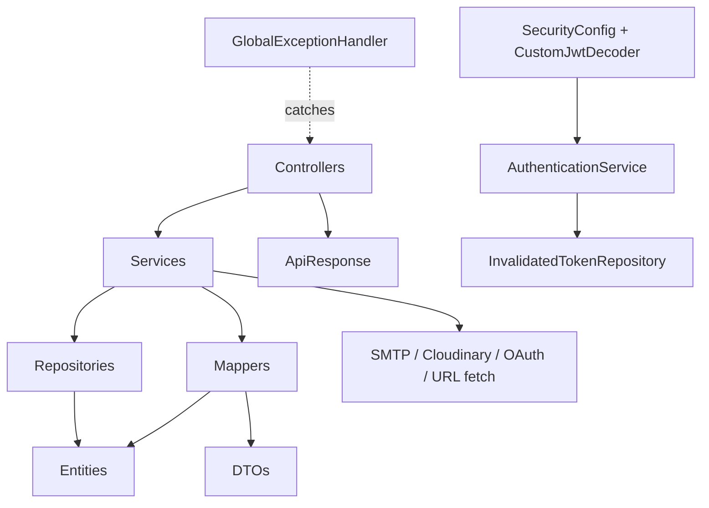
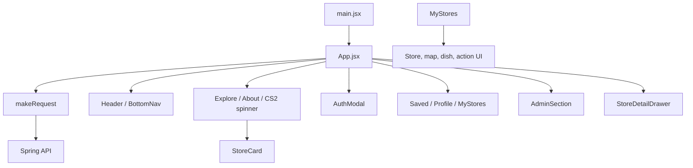
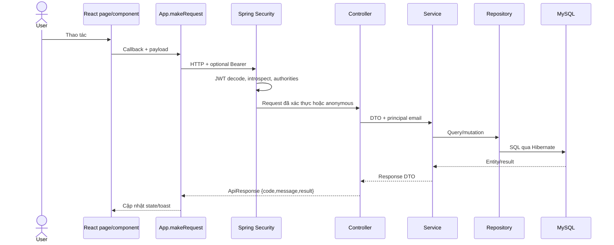

# Kiến trúc hệ thống

## Cập nhật P1 — 18/10/2026

- Session dùng refresh cookie `HttpOnly` + CSRF double-submit; access token chỉ sống trong React memory. Nhiều tab đồng bộ sự kiện không chứa token và serialize refresh bằng Web Locks.
- Google/Facebook SDK tiếp tục tải trực tiếp từ `frontend/index.html`; không dùng lazy-loader.
- `StoreTransitionPolicy` là boundary chung cho moderation state; rating/save serialize bằng pessimistic lock trên store.
- `Clock` business dùng zone cấu hình `Asia/Ho_Chi_Minh`; cleanup và reconciliation là các scheduled service idempotent/bounded.
- Public filter/distance được xử lý backend trước khi tạo page; frontend chỉ render `distanceKm` từ contract.
- Route quán dùng ID làm định danh và slug chỉ để đọc/canonical. `frontend/nginx.conf` cung cấp reverse proxy, CSP và SPA fallback mẫu.

## 1. Bản đồ repository

```text
.
├── backend/
│   ├── pom.xml                         # Maven/Spring Boot manifest
│   ├── src/main/java/.../cgfoodtour/
│   │   ├── configuration/              # Security, CORS, JWT, Cloudinary, seed, OpenAPI
│   │   ├── controller/                 # HTTP/SSE adapters
│   │   ├── service/                    # Business rules và external integrations
│   │   ├── repository/                 # Spring Data JPA
│   │   ├── entity/                     # JPA model
│   │   ├── dto/{request,response}/     # Wire contracts
│   │   ├── mapper/                     # MapStruct entity/DTO mapping
│   │   ├── exception/, validator/      # Error envelope và Bean Validation
│   │   └── CgFoodTourApplication.java  # Entry point, async, scheduling
│   ├── src/main/resources/             # Master/prod config, dev template, legacy static console
│   ├── src/test/resources/             # H2 test config; không có test class
│   └── documents/                      # Tài liệu cũ, có contract không còn khớp
├── frontend/
│   ├── package.json, vite.config.js
│   └── src/
│       ├── main.jsx                    # React root + BrowserRouter
│       ├── App.jsx                     # App state, manual routing, API orchestration
│       ├── pages/                      # Feature sections
│       ├── components/                 # Cards, modal, drawer, map, dev console
│       ├── layouts/                    # Header/BottomNav
│       └── utils/timeUtils.js
├── .github/modernize/                  # Tool hooks, không phải CI workflow
├── scripts/                            # Untracked lúc phân tích; giữ nguyên
├── README.md, ProjectDaily.md           # Tài liệu tổng quan/nhật ký
└── ORACLE_CLOUD_DEPLOYMENT_PLAN.md      # Kế hoạch, chưa phải implementation
```

Không thấy Dockerfile, Compose, Terraform, workflow CI/CD, SQL schema hay migration.

## 2. Khởi tạo runtime

### Backend

1. `CgFoodTourApplication.main()` khởi Spring context; `@EnableAsync` và `@EnableScheduling` bật email async và cron.
2. `application.yaml` chọn profile `${SPRING_PROFILES_ACTIVE:dev}`, context path `/api`, port 8080 mặc định.
3. Bean security dựng stateless resource server JWT; CORS bean được gắn vào filter chain; CSRF tắt.
4. JPA tạo/validate mapping tùy profile. `ApplicationInitConfig.applicationRunner()` đảm bảo 4 permission, role `ADMIN`/`USER`, và có thể tạo admin mặc định.
5. Store report cleanup giữ retention 30 ngày và chạy theo business zone `Asia/Ho_Chi_Minh`; các security artifact/media task có cleanup lifecycle riêng.

**Khoảng trống:** checkout sạch không có `application-dev.yaml`; profile mặc định có thể không khởi động nếu không cung cấp đủ datasource/mail/JWT/Cloudinary properties. Không chạy để xác minh vì build/test bị sandbox từ chối.

### Frontend

1. `main.jsx` mount `<App/>` trong `StrictMode` và `BrowserRouter`.
2. `App.jsx` phục hồi session từ refresh cookie, giữ access token trong memory, đồng bộ tab/route từ `location.pathname` và tải categories/stores.
3. Pages lớn `AdminSection`, `MyStoresSection`, `CS2CaseOpener`, `DevConsole` được lazy-load.
4. `makeRequest()` tạo request, đính Bearer, parse JSON/text, refresh-on-401 rồi retry một lần.
5. Một `EventSource` public nghe `/v1/stores/events`; `STORES_UPDATED` kích hoạt reload.

`BrowserRouter` điều phối tab và route canonical `/quan/{id}/{slug}`; `frontend/nginx.conf` cung cấp SPA fallback mẫu cho reload trực tiếp.

## 3. Dependency direction



Không có domain module độc lập; services có thể phụ thuộc nhiều repository. `StoreService` là aggregate/orchestrator lớn nhất và phối hợp 8 repository, email, 2 mapper, network parsing.

## 4. Module backend

| Module | HTTP adapter | Core service | Persistence |
|---|---|---|---|
| Auth | `AuthenticationController` | `AuthenticationService`, `EmailService` | User, role, invalid token, OTP |
| User | `UserController` | `UserService` | User, role, verification token |
| Store/community | `StoreController` | `StoreService`, `SseNotificationService` | Store + rating/report/save/audit/food/category/user |
| Food | `FoodItemController` | `FoodItemService` | FoodItem, Store, User |
| Category | `CategoryController` | `CategoryService` | Category |
| RBAC | `RoleController`, `PermissionController` | Role/Permission service | Role, Permission |
| Media | `UploadController` | `CloudinaryService` | External Cloudinary |

## 5. Kiến trúc frontend



State không được tách theo feature. Hệ quả đã xác minh:

- `App.jsx` khoảng 2.000 dòng, sở hữu auth, data, form state, API, toasts và admin actions.
- `MyStoresSection.jsx` khoảng 2.120 dòng và `AdminSection.jsx` khoảng 1.952 dòng.
- API call sites tập trung ở `App.jsx`, ngoại trừ Photon fetch trong `MapPicker.jsx`.
- Frontend state chỉ là in-memory hooks; token là phần duy nhất persist qua reload.

## 6. Request lifecycle



Success hầu hết trả HTTP 200; `ApiResponse.code` mặc định 1000. Error dùng HTTP status từ `ErrorCode`, ngoại trừ runtime chung bị trả 400 dù mã nội bộ nói uncategorized/server error.

## 7. Security boundaries

- Filter-chain: xác thực Bearer và coarse endpoint policy.
- Method-level: role admin ở category/RBAC/user admin/store moderation.
- Object-level: `StoreService` và `FoodItemService` tự kiểm owner/admin.
- Database constraints: uniqueness cho username/email/category/rating/report/save và FK do JPA mapping/schema thực tế tạo.
- Frontend guards chỉ là UX; `/admin` trực tiếp vẫn render access-denied sau khi profile cho thấy không phải admin.

Các vùng cần hardening: public URL fetch, OTP endpoints, generic upload, public owner email, DB error response và token storage/logging.

## 8. Data/event consistency

- Store rating counters và bookmark count được denormalize trong `Store`; cập nhật bằng read-count-write, không có optimistic locking.
- SSE là best-effort trong một JVM; emitter không được chia sẻ giữa instance và event không durable.
- Email async không nằm trong transaction outcome; caller không biết send thất bại.
- Hard delete thủ công xóa child rows; audit log cũng bị xóa.
- Daily report reset xóa toàn bộ rows lúc midnight, dù query đã scope bằng `reportDate`.

## 9. Architectural facts vs proposals

**Đã tồn tại:** monorepo SPA/API, MySQL, Cloudinary, SMTP, OAuth, SSE.

**Chỉ là kế hoạch:** OCI VM, Nginx, Docker/Compose, Terraform, GitHub Actions, backup/monitoring trong `ORACLE_CLOUD_DEPLOYMENT_PLAN.md`.

**Đề xuất trước khi production:** thêm migration versioned, explicit timezone, rate limiting, SSRF defense, structured audit retention, tests và tách API client/state theo feature. Đây chưa phải quy ước hiện hành.

