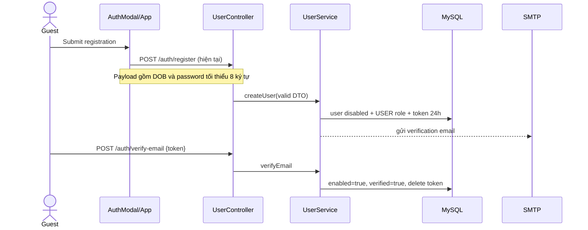

# Business Flows End-to-End

## Cập nhật P1 — 18/10/2026

- Login thành công đặt refresh cookie + CSRF cookie và trả access token; reload gọi refresh cookie để phục hồi access token memory.
- Refresh/logout yêu cầu CSRF cookie/header và Origin nằm trong allowlist; logout một tab phát sự kiện để các tab khác xóa access token.
- Approve/reject chỉ hợp lệ từ `PENDING`; owner sửa `APPROVED`/`REJECTED` đưa quán về `PENDING`; sửa `HIDDEN` không tự khôi phục.
- Rating/save khóa store, ghi bảng nguồn, flush và đếm lại counter trước commit.
- “Gần tôi” gửi GPS thật cho backend; nếu người dùng từ chối GPS thì không dùng tọa độ trung tâm giả.
- Mở chi tiết quán chuyển sang `/quan/{id}/{slug}`; reload route fetch detail theo ID. Quán APPROVED được xem công khai; quán chưa public chỉ owner/admin đã xác thực xem được.

## 1. Đăng ký và kích hoạt email

**Mục đích:** tạo USER disabled, gửi link 24h, enable sau xác minh.



**Trạng thái:** frontend/backend đã đồng bộ endpoint, payload và validation; vẫn cần browser E2E với SMTP thật.

## 2. Login, request được bảo vệ, refresh và logout

1. UI POST `/auth/token`; service match BCrypt + account flags; trả access JWT và đặt refresh/CSRF cookie.
2. Client giữ access JWT trong memory; GET `/users/me` dựng `currentUser`. Reload gọi refresh cookie để phục hồi access token.
3. Request sau gắn Bearer; `CustomJwtDecoder` introspect signature/expiry/blacklist rồi Spring tạo authorities từ scope.
4. Khi 401, client gọi `/auth/refresh` với refresh cookie + CSRF header; backend blacklist refresh JTI cũ, rotate cookie, trả access JWT mới rồi client retry request.
5. UI logout gọi backend bằng Bearer + cookie + CSRF, xóa memory và phát `LOGOUT` qua `BroadcastChannel`.

**Giới hạn còn lại:** cookie HTTPS và refresh race nhiều tab cần browser E2E trên domain triển khai thật.

## 3. Quên mật khẩu

```mermaid
sequenceDiagram
  actor U
  participant UI as AuthModal/App
  participant A as AuthenticationController
  participant S as AuthenticationService
  participant DB
  participant Mail
  U->>UI: Nhập email
  UI->>A: POST /auth/forgot-password
  A->>S: forgotPassword
  S->>DB: delete old OTP; insert raw 6-digit OTP/5m
  S-->>Mail: async email
  U->>UI: Nhập OTP
  UI->>A: POST /auth/verify-otp
  A->>DB: lookup unused/unexpired
  U->>UI: Nhập password mới
  UI->>A: POST /auth/reset-password
  A->>S: validate OTP; BCrypt password; mark OTP used
```

Không có rate limit, lockout, attempt count hay generic anti-enumeration response.

## 4. Khám phá quán

`ExploreSection` → `App.loadGlobalData` → GET categories và stores → Security permits public GET → `StoreService.getStores` → JPA store list → visibility filter → per-store food/report/save enrichment → client chỉ giữ APPROVED và filter/search/sort local.

Authenticated request có Bearer ngay cả endpoint public, nên backend có thể thêm owner/non-public records và `isSaved`; owner records sau đó bị `ExploreSection` loại nếu không approved nhưng vẫn dùng cho MyStores từ cùng `stores` state.

## 5. Đề xuất quán và món

```mermaid
sequenceDiagram
  actor O as Authenticated owner
  participant UI as MyStoresSection
  participant App
  participant Sec
  participant SC as StoreController
  participant SS as StoreService
  participant DB
  O->>UI: 3-step form + optional uploads
  UI->>App: handleCreateStore
  App->>Sec: POST /v1/stores + JWT
  Sec->>SC: authenticated
  SC->>SS: request + principal email
  SS->>DB: category/user; insert PENDING store
  SC-->>App: StoreResponse
  SC-->>UI: SSE STORES_UPDATED (qua connection riêng)
  UI->>App: add dish
  App->>Sec: POST /v1/food-items/store/{storeId}
  Sec->>DB: FoodItemService owner/admin check; insert item
```

Upload Cloudinary xảy ra trước store/item mutation và không được rollback cùng DB.

## 6. Kiểm duyệt store

- Admin route tải GET `/users` và GET `/v1/stores`; JWT admin khiến service trả toàn bộ store.
- Approve: POST `/{id}/approve` → `APPROVED`, verified, clear rejection.
- Reject: POST `/{id}/reject` reason required → `REJECTED`, unverified.
- Hide: chỉ APPROVED; admin reason bắt buộc → HIDDEN + hiddenByAdmin + audit + email.
- Owner hide: APPROVED → HIDDEN, reason optional, `hiddenByAdmin=false`.
- Owner recover self-hidden: HIDDEN → APPROVED.
- Owner không thể recover admin-hidden; gửi request-recovery reason. Admin recover hoặc reject request.
- Hard delete owner/admin: authorization + admin reason, email optional, delete children/store. Audit hard-delete bị xóa trong cùng flow.

Không có state transition guard cho approve/reject (admin có thể approve hidden/rejected trực tiếp).

## 7. Cập nhật store

Owner/Admin PUT full `StoreRequest` → ownership check → category lookup → MapStruct update. Owner update store không HIDDEN đặt PENDING/unverified và clear rejection. Owner update HIDDEN giữ trạng thái/hiddenByAdmin; UI giải thích phải dùng recovery flow.

## 8. Rating

User chọn enum trong drawer → POST `/{id}/rate` → lookup user/store → upsert unique rating → chạy ba COUNT → set total và `% VERY_SATISFIED` → response → UI toast/reload.

Không giới hạn status store; concurrency counters chưa được lock. Rating thay đổi được phép.

## 9. Báo đóng cửa hôm nay

User cung cấp GPS → backend Haversine ≤100 m → unique report/day → response `isReportedClosed` khi count≥3. Frontend open status ưu tiên warning report. Cron midnight xóa mọi report.

Client hiện dùng state lat/lng mặc định trong `App.jsx`, không tự động lấy geolocation trong drawer flow; người dùng có thể sửa. Server chỉ so tọa độ client khai báo, không có attestation thiết bị.

## 10. Bookmark

POST `/{id}/save` toggle unique `UserSavedStore` + denormalized `savedCount`; response cập nhật store arrays/active drawer, rồi reload saved list. GET `/saved` lọc chỉ approved. Không có atomic counter/locking.

## 11. Random/ranking/spinner

- Backend random/ranking có endpoint và App handlers.
- Explore hiện nhận các handler nhưng lint cho thấy không dùng.
- CS2 spinner chọn random hoàn toàn client-side từ `stores`, hỗ trợ nhiều mode/open-only và animation; không ghi DB.

## 12. Realtime updates

Browser EventSource public → `SseNotificationService.subscribe`. Store/category moderation mutation broadcast `STORES_UPDATED` → App reload global data và, khi token có mặt, gọi load admin pending (kể cả user thường; backend store list vẫn owner-filter). Rating/report/save/food changes không broadcast.

SSE state nằm trong JVM, không scale ngang và không replay.

## 13. File upload

- Avatar: profile → multipart PATCH `/users/me/avatar` → validate empty/2MiB/image MIME → delete old → upload `avatars` → save URLs.
- Store/food: generic multipart POST `/v1/upload/image?folder=` → any authenticated user → Cloudinary → URL đưa vào form rồi lưu trong Store/FoodItem sau.

Generic flow không gắn asset với owner/entity và không cleanup orphan.

