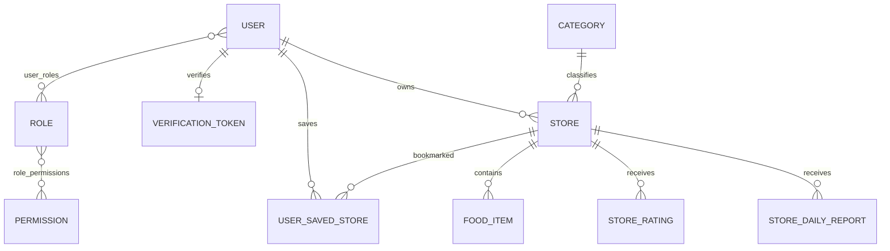

# Database Reference

## 1. Công nghệ và lifecycle schema

- Runtime/production: MySQL qua `mysql-connector-j`; URL production mặc định trỏ database `cgfoodtour` (`application-prod.yaml`).
- Test: H2 in-memory, `MODE=MySQL`, `ddl-auto=update` (`src/test/resources/application.yaml`).
- Dev template: MySQL, `ddl-auto=update`.
- Production: `ddl-auto=validate`.
- Schema production được quản lý bằng Flyway tại `backend/src/main/resources/db/migration`; `V1` tạo baseline và `V2` bổ sung Owner store history. Production dùng `ddl-auto=validate`, không dựa vào Hibernate để tự đổi schema.

Do đó, bảng dưới đây mô tả model JPA chứ không khẳng định schema production thật.

## 2. Data model

`StoreAuditLog`, `PasswordResetOtp`, `InvalidatedToken` chủ yếu lưu scalar ID/email/JTI; audit log không map FK đến Store/User.

## 3. Entity catalog

### User

`entity/User.java`: UUID string PK; `username` và `email` unique; password BCrypt; profile/avatar/Facebook ID; `enabled`, `emailVerified`; many-to-many roles; `createdAt` tại `@PrePersist`.

Lưu ý: entity không đánh `nullable=false` cho username/email/password/date; tính bắt buộc phần lớn dựa vào DTO/service. `facebookId` không có unique constraint trong annotation dù repository tìm một record.

### Role / Permission

- `Role.name` và `Permission.name` là string PK.
- Role many-to-many Permission; User many-to-many Role.
- Init seed: permissions `CREATE_DATA`, `UPDATE_DATA`, `READ_DATA`, `DELETE_DATA`; ADMIN có tất cả, USER rỗng.
- Authorization thực tế chủ yếu dùng role, không thấy `hasAuthority` cho bốn permission nghiệp vụ.

### VerificationToken

UUID PK; raw token string; eager one-to-one User qua `user_id`; tạo lúc persist và hết hạn sau 24 giờ. Token column không được annotation unique. Repository có `findByToken` và `findByUserId` trả `Optional`, ngầm kỳ vọng duy nhất.

### PasswordResetOtp

UUID PK; email; raw OTP 6 ký tự; expiry sau 5 phút; `isUsed`; timestamps. Không thấy index/unique/rate-limit counter.

### InvalidatedToken

JTI string PK và `expiryTime`; dùng blacklist logout/refresh. Không có scheduled cleanup, nên row hết hạn tích lũy.

### Category

Integer identity PK; name non-null, unique, max 50; icon URL; `displayOrder` mặc định 0. Service tạo order bằng `count()+1`, có race/gap khi xóa.

### Store

String PK tự tạo: normalized category name + 12 ký tự hex UUID. FK lazy đến Category (non-null) và User owner (nullable). Trường chính: contact/address/GPS/map/time/price/banner; status `PENDING|APPROVED|REJECTED|HIDDEN`; moderation/recovery reasons; denormalized rating/bookmark counters; timestamps.

Không có check constraint cho lat/lng, price range, time range hay nonnegative counters trong annotations.

### FoodItem

Long identity PK; lazy non-null FK Store; name non-null max 150; price non-null; optional image/description; `isSignature`; created timestamp.

### StoreRating

Long identity PK; scalar `userId`; lazy FK Store; enum rating; timestamps. Unique `(user_id, store_id)` đảm bảo một rating/user/store.

### StoreDailyReport

Long identity PK; scalar `userId`; lazy FK Store; `reportDate`; timestamps. Unique `(user_id, store_id, report_date)`.

### UserSavedStore

UUID PK; lazy FK User và Store; saved timestamp. Unique `(user_id, store_id)`.

### StoreAuditLog

Long identity PK; scalar store/owner/actor snapshot, role, action type, reason, trạng thái trước/sau, cờ `ownerVisible` và timestamp. Không có FK để giữ tombstone sau khi Store bị xóa. API Owner chỉ truy vấn `ownerIdSnapshot` của principal và không serialize entity/PII của actor. Khi hard-delete User, owner snapshot và actor PII liên quan được anonymize.

## 4. Repository queries

| Repository | Query đáng chú ý |
|---|---|
| Category | sort displayOrder/name; case-insensitive uniqueness |
| Store | filter category; ranking `totalVotes>=min` sort satisfaction/total |
| FoodItem | find/delete by store ID |
| Rating | find unique user/store; count by store/level; delete by store |
| DailyReport | find unique per day; count store/day; delete by store |
| SavedStore | exists/find user/store; list by savedAt desc; count/delete |
| Audit | list by store newest; specification phân trang/filter theo Owner; anonymize actor/owner snapshot |
| OTP | valid by email+OTP+unused+expiry; delete all by email |
| User | unique lookups username/email/facebookId |

Không có custom JPQL/native query, entity graph, pagination hoặc locking.

## 5. Transaction boundaries

- Auth: forgot/reset/social login transactional; verify OTP read-only. Login/refresh/logout không annotation transaction.
- User: email verify/resend/avatar transactional; create/update/change/delete không annotation explicit.
- Store: mọi mutation và reset report transactional; reads không read-only transaction.
- Food/category mutations transactional; RBAC services không explicit transaction.

Spring Data repository methods tự có transaction semantics, nhưng multi-step operations chỉ atomic khi service có `@Transactional`.

## 6. Consistency rules và risks

1. Rating counters được tính qua ba COUNT rồi lưu Store. Concurrent requests có thể lost update; không có `@Version`/lock.
2. Bookmark counter increment/decrement riêng với unique save row; concurrent toggle có thể conflict hoặc lệch counter.
3. Hard delete xóa child theo thứ tự thủ công và giữ audit/tombstone không có FK; cần duy trì chính sách retention và cleanup riêng khi được phê duyệt.
4. Category delete không cascade được mô tả; store FK có thể chặn và handler hiện có thể lộ DB root cause.
5. User delete không dọn owner/save/role join/verification data trong code; kết quả phụ thuộc FK/cascade schema chưa xác minh.
6. `InvalidatedToken` và OTP cũ/used không có cleanup job.
7. Daily report job xóa toàn bộ table lúc midnight theo timezone JVM; nếu nhiều instance cùng chạy sẽ lặp.
8. Lazy relations được map ngoài explicit read transaction; mặc định Open EntityManager in View của Spring Boot có khả năng giữ session, nhưng chưa xác minh runtime config.

## 7. Query efficiency

`StoreService.toStoreResponse` gọi riêng:

- `foodItemRepository.findByStoreId`
- `countByStoreIdAndReportDate`
- có thể `userRepository.findByEmail`
- có thể `existsByUserIdAndStoreId`

Do đó list N store phát sinh ít nhất 2N query phụ, và có thể 4N cộng lazy category/owner. `getSavedStoresForUser` còn duyệt lazy store. Đây là N+1 có bằng chứng trực tiếp, chưa benchmark.

## 8. Quy tắc khi thay đổi database

- Trước thay đổi entity, xác minh schema MySQL thực và tạo migration versioned; không dựa vào `ddl-auto=update` cho production.
- Giữ đồng bộ Entity ↔ Repository query ↔ DTO/Mapper ↔ service rules ↔ frontend payload/types.
- Đánh giá cascade/delete cho Category, User và Store; bảo toàn audit.
- Nếu thêm counter/version, xử lý concurrency bằng atomic update/locking và test transaction.
- Không ghi secret/token/OTP thật trong seed, migration, docs hay log.

