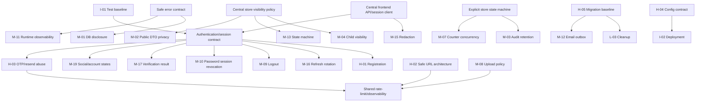

# CG FoodTour — Known Issues Remediation Blueprint

> Trạng thái blueprint: planning baseline, xác minh tĩnh theo repository ngày 16/10/2026. Đây là **single source of truth** cho các lượt sửa lỗi tiếp theo. Tài liệu này không xác nhận hành vi production nếu chưa có runtime test, schema thật hoặc hạ tầng thật.

## 1. Executive Summary

Source hiện tại vẫn còn các vấn đề trọng yếu đã ghi trong `KNOWN_ISSUES.md`. Không có issue ưu tiên nào đã được sửa hoàn toàn. Project đang ở **local development**, chưa có hosting/production database/public Internet exposure và chưa có nhu cầu multi-instance. Vì vậy tài liệu tách hai trục:

- **Severity:** mức thiệt hại nếu issue có thể bị khai thác hoặc xảy ra trong môi trường phù hợp.
- **Current Implementation Priority:** thời điểm CG FoodTour thực tế cần xử lý ở maturity stage hiện tại; priority thấp hơn không làm giảm severity hay release gate tương lai.

Rủi ro chính tập trung ở năm cụm:

1. Registration và vòng đời session không có một contract thống nhất giữa frontend/backend.
2. Endpoint parse Google Maps tạo primitive SSRF công khai.
3. OTP, reset password và resend verification thiếu kiểm soát abuse và chống enumeration.
4. Visibility/state transition của store và resource con chưa được cưỡng chế tập trung.
5. Repository chưa có development bootstrap và database migration có thể tái lập.

Remediation phải đi theo workstream và dependency, không vá từng symptom. Bốn timing group là:

- **NOW:** functionality/auth/session/development correctness đang chặn hoặc làm nền cho development tiếp theo.
- **BEFORE PUBLIC:** bắt buộc hoàn tất trước khi backend được expose ra Internet; không phải production incident hiện tại.
- **BEFORE PRODUCTION DATA:** bắt buộc trước production database/user thật hoặc destructive migration.
- **SCALE-DEPENDENT / LATER:** chỉ kích hoạt khi hosting, topology, traffic hoặc SLA tương ứng tồn tại.

Không có bằng chứng đủ để nâng issue nào lên CRITICAL. H-02 vẫn HIGH về security architecture nhưng urgency hiện tại là BEFORE PUBLIC, không phải emergency containment. Network/metadata reachability chỉ cần kiểm khi chuẩn bị môi trường public.

## Architectural Decision Register

Quy ước:

- **DECIDED:** requirement/source đã đủ rõ; implementation phải tuân theo outcome, dù chi tiết kỹ thuật nhỏ vẫn có thể thay đổi.
- **RECOMMENDED:** lựa chọn mặc định của blueprint; Agent chỉ được chọn phương án khác khi ghi deviation, trade-off và bằng chứng constraint.
- **DECISION REQUIRED:** chưa được phép code phần phụ thuộc cho đến khi câu hỏi ở cột cuối được trả lời và status ADR được cập nhật.
- **CONDITIONAL:** chỉ áp dụng khi trigger topology/SLA được xác nhận; không được thêm infrastructure trước trigger.

| ID | Decision | Status | Needed When | Recommended Choice | Why / Blocking Issues | Confirmation Needed |
|---|---|---|---|---|---|---|
| ADR-01 | Tách access và refresh credential | RECOMMENDED | NOW | JWT access ngắn hạn + refresh credential riêng | Root cause M-16; foundation M-09/M-10 | Client ngoài SPA/backward compatibility? |
| ADR-02 | Refresh token representation | RECOMMENDED | NOW | Opaque random token; chỉ lưu hash server-side | Rotation/revoke sạch cho M-09/M-10/M-16 | Force logout hay dual-support legacy? |
| ADR-03 | Server-side session registry | RECOMMENDED | NOW | Bảng session tối thiểu: `sid`, user, hash, expiry, revoke metadata | Cần server authority cho logout/password/disable | Chấp nhận schema change và DB lookup? |
| ADR-04 | Refresh family/reuse detection | RECOMMENDED | NOW | Atomic rotation; reuse revoke family; design đơn giản một replacement chain | Fix refresh replay/race M-16; không cần service riêng | UX multi-tab/concurrent refresh? |
| ADR-05 | Browser refresh storage | RECOMMENDED | NOW; cookie flags verified BEFORE PUBLIC | HttpOnly cookie; access token chỉ memory | Loại long-lived localStorage credential | Same-site/cross-site chỉ cần khóa trước public hosting |
| ADR-06 | CSRF model cho cookie auth | DECISION REQUIRED | BEFORE PUBLIC | SameSite + exact Origin; CSRF token nếu cross-site | Cookie refresh/logout cần CSRF protection | Hosting origin/TLS topology chưa tồn tại |
| ADR-07 | Account state separation | DECIDED | NOW | Verification tách administrative disable; enum representation RECOMMENDED | H-01/M-10/M-19 đang trộn nghĩa | Chốt tên state/re-enable semantics |
| ADR-08 | OAuth linking policy | DECISION REQUIRED | NOW | Verified provider email + approved policy; otherwise explicit link | Tránh tự re-enable/takeover M-19 | Development provider behavior và UX linking |
| ADR-09 | Canonical registration endpoint | RECOMMENDED | NOW | `POST /auth/register`; `/users` alias deprecated nếu cần | Fix H-01/M-17 contract | Có client nào ngoài SPA không? |
| ADR-10 | Google Maps URL architecture | RECOMMENDED | BEFORE PUBLIC | Bỏ arbitrary server fetch; dùng coordinates/place ID/official API | Loại primitive SSRF H-02 | Short-link expansion có bắt buộc không? |
| ADR-11 | OTP challenge persistence | RECOMMENDED | BEFORE PUBLIC | Purpose-scoped HMAC-hashed challenge, attempts/cooldown/consume | Fix lifecycle/enumeration H-03 | UX cooldown, pepper/key management |
| ADR-12 | Distributed/shared limiter technology | CONDITIONAL | SCALE-DEPENDENT | Single instance: DB atomic state; multi-instance: Redis/DB/gateway shared state | Redis không cần cho local/single instance | Revisit khi chọn hosting/topology/traffic |
| ADR-13 | Migration framework | RECOMMENDED | NOW trước schema-bearing batch; hard gate BEFORE PRODUCTION DATA | Flyway versioned migrations | H-05 và session/OTP/asset schema | Tool standard; baseline numbering |
| ADR-14 | Database baseline strategy | DECISION REQUIRED | BEFORE PRODUCTION DATA | Greenfield baseline nếu chưa có production DB; reconcile từ authoritative schema nếu sau này có DB thật | Không có production DB hiện tại | Chốt source schema/version trước dữ liệu thật |
| ADR-15 | Counter concurrency strategy | RECOMMENDED | NOW khi sửa M-07 | Pessimistic per-store lock hoặc atomic aggregate trong transaction | Correctness không cần distributed lock | Local concurrency test/lock tolerance |
| ADR-16 | Counter reconciliation | RECOMMENDED | BEFORE PRODUCTION DATA | Bounded manual/job reconciliation + drift metric | Repair legacy/operational drift | Scheduler chỉ cần khi có persistent workload |
| ADR-17 | Reliable email side effects | CONDITIONAL | LATER; BEFORE PUBLIC nếu API cam kết delivery | Simple observable retry now; transactional outbox only for durable guarantee | Tránh over-engineer M-12 | Product delivery SLA/volume |
| ADR-18 | Realtime store updates | CONDITIONAL | SCALE-DEPENDENT / LATER | Single instance bounded SSE hoặc polling; broker only multi-instance | M-14 không cần broker ở local | Hosting, concurrency, realtime SLA |
| ADR-19 | Upload ownership model | RECOMMENDED | BEFORE PUBLIC | Asset record owner/purpose/state, hoặc lean domain-owned record nếu lifecycle thật sự đơn giản | M-08 ownership/quota/cleanup | Upload/draft/retention model |
| ADR-20 | Cloudinary lifecycle | DECISION REQUIRED | BEFORE PUBLIC | TEMP→ATTACHED→REPLACED/DELETED, idempotent cleanup | Provider/orphan semantics M-08 | Development account quota/delete behavior |
| ADR-21 | Audience-specific store DTO | DECIDED | NOW | Tách public, owner và admin response/projection | M-02/M-04 và future API safety | Chốt exact public fields |

### Future deployment assumptions / verification required

Hiện **không** có production server/database, public DNS, reverse proxy, WAF, Redis, broker, Kubernetes/multi-instance topology hay TLS termination được xác nhận. Blueprint không coi các thành phần đó là hiện hữu. Chúng chỉ là future release gates khi chuẩn bị hosting.

### Infrastructure necessity and over-engineering guard

| Capability | Classification | Lean default for current repository | Trigger for stronger infrastructure |
|---|---|---|---|
| Server session table | Required now nếu ADR-01/02 được chọn | MySQL table + indexed hash/expiry | Cache chỉ khi measured DB overhead |
| Refresh-family detection | Required now, simple | Một family/replacement chain trong session table | Dedicated token service chỉ khi auth tách service |
| Redis rate limiter | Scale-dependent; not for current local stage | DB atomic limiter cho security-critical flow; memory chỉ cho non-security local behavior | Redis/equivalent khi multi-instance/high rate cần shared low-latency counters |
| WAF/reverse proxy/TLS/egress policy | Before public, infrastructure-dependent | Document application assumptions; không dựng local infrastructure giả | Configure/test khi target hosting được chọn |
| Transactional outbox | Conditional/later | Chỉ dùng khi API cam kết durable delivery; trước đó outcome phải trung thực/observable | Queue/broker khi volume/SLA vượt DB worker |
| SSE broker | Scale-dependent/later | Bounded single-instance SSE hoặc polling/version endpoint | Redis pub/sub/broker khi multi-instance hoặc realtime SLA được xác nhận |
| Asset lifecycle table | Before public nếu generic upload tiếp tục | Bảng tối thiểu hoặc domain-owned metadata | Workflow/media service riêng khi measured complexity đòi hỏi |
| Reconciliation scheduler | Before production data nếu giữ denormalized counters | Manual/bounded DB reconciliation; scheduler không bắt buộc local | Scheduled/streaming repair khi persistent volume xuất hiện |
| Flyway | Before first persistent schema change | Flyway + reviewed greenfield baseline | Production rehearsal chỉ khi có target database |
| CI/test artifacts | NOW tối thiểu | Reproducible test commands/harness | Hosted CI khi repository workflow được chọn |
| Container/deployment artifacts | Later/before hosting | Runbook/config contract trước | IaC/orchestrator theo target platform; không giả định Kubernetes |

## 2. Verified Issue Matrix

| Issue | Severity | Current Implementation Priority | Verification | Status | Main Area | Dependency | Recommended Step |
|---|---:|---|---|---|---|---|---:|
| H-01 Registration contract | HIGH | NOW | Confirmed | PLANNED | API integration/Auth | ADR-07, ADR-09, M-05, M-17 | 1A |
| H-02 Public SSRF | HIGH | BEFORE PUBLIC | Confirmed primitive; not currently Internet-exposed | PLANNED | Security | ADR-10; future network policy | 4 |
| H-03 OTP/resend abuse | HIGH | BEFORE PUBLIC | Confirmed in application; no public exposure now | PLANNED | Security/Auth | ADR-11; ADR-12 only when topology requires | 4 |
| H-04 Clean checkout config | HIGH | NOW (development portion) | Confirmed statically | PLANNED | Configuration | Secret contract, smoke tests | 0/5 |
| H-05 Deterministic schema | HIGH | BEFORE PRODUCTION DATA | Confirmed | BLOCKED | Database | ADR-13, ADR-14 | DB-A/5 |
| M-01 DB detail disclosure | MEDIUM | BEFORE PUBLIC | Confirmed | PLANNED | Error handling/Security | M-11 | 4 |
| M-02 Public owner email | MEDIUM | BEFORE PUBLIC | Confirmed exposure; public fields need product decision | PLANNED | Privacy/API | ADR-21 | 3/4 gate |
| M-03 Hard-delete removes audit | MEDIUM | BEFORE PRODUCTION DATA | Confirmed | PLANNED | Audit/Data | State machine, migration | 3/5 gate |
| M-04 Food visibility bypass | MEDIUM | NOW | Confirmed | PLANNED | Authorization | Central visibility policy | 3 |
| M-05 Validation inconsistent | MEDIUM | NOW (auth/domain correctness) | Confirmed | PLANNED | API/Business | H-01 then domain DTOs | 1A/3 |
| M-06 Store-list N+1/unbounded payload | MEDIUM | SCALE-DEPENDENT / LATER | Confirmed pattern; impact needs profiling | DEFERRED | Performance/DB | ADR-21, measured dataset | 6 |
| M-07 Counter races | MEDIUM | NOW (integrity design) | Likely under concurrency | PLANNED | Database/Concurrency | ADR-15; ADR-16 before real data | 3 |
| M-08 Generic upload abuse/ownership | MEDIUM | BEFORE PUBLIC | Confirmed missing app guards; provider policy unknown | BLOCKED | Security/Media | ADR-19, ADR-20 | 4 |
| M-09 UI logout does not revoke | MEDIUM | NOW | Confirmed | PLANNED | Auth | ADR-01–ADR-06 | 1B |
| M-10 Password changes keep sessions | MEDIUM | NOW | Confirmed | PLANNED | Auth | ADR-03, ADR-07 | 1B |
| M-11 Runtime error semantics | MEDIUM | BEFORE PUBLIC | Confirmed | PLANNED | Observability/API | M-01 | 4/6 |
| M-12 Async email outcome | MEDIUM | SCALE-DEPENDENT / LATER | Confirmed semantics; delivery needs runtime test | DEFERRED | Reliability | ADR-17 | 6 |
| M-13 Missing transition guards | MEDIUM | NOW | Confirmed code; intended transitions need product confirmation | BLOCKED | Business | State machine/visibility | 3 |
| M-14 In-memory SSE scalability | MEDIUM | SCALE-DEPENDENT / LATER | Confirmed design; no multi-instance requirement now | DEFERRED | Reliability | ADR-18, future topology | 6 |
| M-15 DevConsole secrets | MEDIUM | BEFORE PUBLIC | Confirmed | PLANNED | Frontend Security | Central API client | 4 |
| M-16 Refresh rotation mismatch | MEDIUM | NOW | Confirmed | BLOCKED | Auth/API integration | ADR-01–ADR-06 | 1B |
| M-17 Verify email false success | MEDIUM | NOW | Confirmed | PLANNED | Auth/API integration | ADR-09, H-01, error contract | 2 |
| M-18 Invalid pre-authorization expression | MEDIUM | NOW | Likely; requires method-security test | PLANNED | Authorization | Principal ownership helper | 3 |
| M-19 Social login re-enables disabled account | MEDIUM | NOW | Confirmed auto-enable; provider behavior needs test | BLOCKED | Auth/Security | ADR-07, ADR-08 | 2 |
| L-01 Stale README contracts | LOW | SCALE-DEPENDENT / LATER | Confirmed | DEFERRED | Documentation | Changed contracts | 6 |
| L-02 Node requirement mismatch | LOW | NOW (developer reproducibility) | Confirmed | PLANNED | Tooling | Toolchain decision | 0/5 |
| L-03 No expired-token/OTP cleanup | LOW | BEFORE PRODUCTION DATA | Confirmed | PLANNED | Data lifecycle | Session/OTP schema | 5 |
| L-04 Timezone implicit | LOW | BEFORE PRODUCTION DATA | Confirmed config gap | PLANNED | Business/Operations | Scheduling strategy | 5 |
| L-05 Dynamic HTML not escaped | LOW | BEFORE PUBLIC | Confirmed sinks; exploitability input-dependent | PLANNED | Security | Template/email work | 4/6 |
| L-06 Frontend warnings | LOW | SCALE-DEPENDENT / LATER | Confirmed: 61 lint warnings | DEFERRED | Frontend quality | Component/API-client refactor | 6 |
| I-01 No automated tests | INFORMATIONAL | NOW (enabler) | Confirmed | PLANNED | Testing | Every phase | 0 |
| I-02 Deployment only planned | INFORMATIONAL | SCALE-DEPENDENT / LATER | Confirmed; no hosting target | DEFERRED | Delivery | H-04/H-05, hosting choice | 6 |

### Issue status workflow

- `OPEN`: issue đã ghi nhận nhưng chưa có remediation plan đủ dùng.
- `PLANNED`: có plan, dependencies và acceptance criteria; có thể vẫn chờ một gate không chặn toàn issue.
- `IN_PROGRESS`: một implementation batch đang thực hiện.
- `BLOCKED`: batch đầu tiên không thể code an toàn vì ADR/gate chưa được quyết định.
- `IMPLEMENTED`: code/migration đã hoàn thành nhưng chưa đáp ứng toàn bộ verification.
- `VERIFIED`: acceptance criteria, automated tests, security negative tests và runtime verification bắt buộc đều pass.
- `DEFERRED`: có quyết định trì hoãn, owner/trigger/review date rõ.
- `NOT_APPLICABLE`: bằng chứng mới chứng minh issue không áp dụng, kèm rationale.

`IMPLEMENTED` không được tự động chuyển thành `VERIFIED`. Status ở bảng là trạng thái toàn issue; batch con phải có status/evidence riêng.

### Priority adjustments for local-development maturity

- H-01, M-09, M-10, M-16, M-17, M-19 và auth portion M-05 là **NOW** vì flow chức năng hiện không nhất quán; severity không quyết định thứ tự này.
- H-02/H-03/M-01/M-08/M-15 chuyển thành **BEFORE PUBLIC**. Chúng vẫn giữ severity và test target, nhưng không được mô tả như incident production đang xảy ra.
- H-05/M-03/L-03/L-04 là gate **BEFORE PRODUCTION DATA**; migration framework có thể phải được kéo sớm hơn nếu auth/domain batch thay schema.
- Redis, broker, distributed limiter/lock, multi-instance SSE, rolling deployment và production load tuning là **SCALE-DEPENDENT / LATER**.
- H-04 có development portion là NOW (clone/run/test reproducibly); production secret/deploy behavior được deferred đến Step 5/6.

### Priority groups at current stage

- **NOW:** H-01; H-04 development bootstrap; M-04; M-05; M-07 correctness design; M-09; M-10; M-13; M-16; M-17; M-18; M-19; L-02; I-01. M-07/M-13 may remain decision-blocked, but their business-integrity workstream follows auth rather than waiting for traffic.
- **BEFORE PUBLIC:** H-02; H-03; M-01; M-02 public-data gate; M-08; M-11 safe error portion; M-15; L-05; ADR-06 and hosting-specific security controls.
- **BEFORE PRODUCTION DATA:** H-05; M-03; ADR-16 reconciliation readiness; L-03; L-04; backup/restore and destructive-migration safeguards. ADR-13 is pulled earlier only when a NOW batch needs schema.
- **SCALE-DEPENDENT / LATER:** M-06 optimization; M-12 advanced delivery/outbox; M-14 distributed realtime; L-01 final documentation sweep; L-06 warning cleanup; I-02 production deployment artifacts. Their correctness/safety sub-parts can be pulled forward when another batch directly depends on them.

## 3. Dependency Map



Thứ tự bắt buộc trong auth: chốt DTO/session/account-state trước, sau đó mới sửa từng endpoint và UI. Store visibility phải được định nghĩa trước khi sửa food endpoint. Migration framework/versioning phải tồn tại trước schema mới như session; full production baseline/rehearsal chỉ là gate trước production data.

## Decision Gates Before Implementation

Gate phải được ghi owner, ngày quyết định, bằng chứng và ADR cập nhật. Một câu trả lời giả định trong PR không mở gate.

### Before Step 1 / Authentication

- Có client nào ngoài React SPA đang dùng `/users`, auth response hoặc token hiện tại không?
- Có chấp nhận force logout toàn bộ session legacy không, hay cần dual-support có thời hạn?
- Target browser contract có dùng HttpOnly refresh cookie ngay trong local development không? Hosting same-site/cross-site, TLS/cookie domain/reverse proxy chưa tồn tại và chỉ block public release settings/ADR-06.
- Account `enabled=false` hiện được dùng cho pending verification, administrative disable hay cả hai? Có lịch sử/audit để migrate không?
- Password/age policy chính thức là gì?
- Google/Facebook credentials hiện là development hay production; có existing linked accounts cần giữ không?
- Product chọn policy OAuth auto-link hay explicit authenticated linking?

**Blocking ADRs:** ADR-08 blocks social linking; ADR-01–ADR-05/09 phải được accept hoặc có approved deviation trước P1-B. ADR-06 không block local auth correctness nhưng block public exposure.

### Before Step 4 / Pre-public security

- **Resolved for this planning pass:** backend/frontend chưa Internet-accessible, chưa có hosting/production. Không có emergency hotfix superseding Step 1.
- Endpoint parse-gmaps có usage bắt buộc và short-link requirement không?
- Khi chọn hosting: có reverse proxy/WAF/egress firewall/rate limit nào ngoài repository không?
- **Current assumption:** initial deployment có thể single-instance. Re-evaluate trusted proxy/client IP and shared limiter only before public deployment.
- Cloudinary quota, upload policy, delete semantics và orphan inventory là gì?
- Generic upload có cần tồn tại, hay mỗi domain flow có thể dùng endpoint purpose-specific?

**Blocking ADRs:** ADR-10 cho final SSRF architecture, ADR-19/20 cho upload lifecycle. ADR-12 chỉ block deployment design nếu multi-instance/gateway requirements xuất hiện; Redis không block local implementation.

### Before Step 3 / Domain integrity

- Product chấp nhận transition nào cho REJECTED, owner-hidden, admin-hidden và hard-delete?
- Owner có được hard-delete mọi state không? Reason/retention requirements là gì?
- Owner email có phải public business contact có consent hay là PII nội bộ?
- Expected concurrent rating/save load và tolerance cho DB row lock là gì?
- Audit retention, admin access và privacy deletion requirements là gì?

**Blocking decisions:** transition matrix của M-13; public field set của ADR-21. ADR-15/16 là default recommended nếu không có measured constraint tốt hơn.

### Before DB-A or any schema-changing batch

- **Resolved for this planning pass:** chưa có production database/data thật. Baseline có thể được thiết kế greenfield; verify local/test MySQL version/edition/collation/timezone.
- Có schema dump không chứa data/secret, migration history hoặc DDL authoritative không?
- Hiện không có production data phải preserve. Trước khi production data xuất hiện, xác nhận lại và inventory duplicate/null/drift.
- Backup/restore rehearsal, maintenance/lock window chỉ block production-data rollout, không block local migration harness.
- Tổ chức có bắt buộc Liquibase hoặc migration tool khác không?

**Blocking ADRs:** ADR-13 trước schema-bearing local work; ADR-14 phải được khóa trước production data. Không tạo conflicting version numbers trước khi greenfield baseline convention được chọn.

### Before Step 6 / Hosting and scale work

- Target hosting/container/orchestrator, instance count, autoscaling và secret manager là gì?
- Email delivery là best-effort hay có business guarantee?
- Realtime SLA là polling-acceptable hay cần cross-instance event delivery?
- Observability, backup, CI/CD và security scan services nào đã tồn tại ngoài repository?

**Blocking ADRs:** ADR-17/ADR-18 chỉ được activate khi SLA/topology trigger xảy ra; không thêm outbox broker/Redis/SSE broker cho local development mặc định.

## Assumptions and Unknowns

### Verified from repository

- Backend Spring Boot + JPA/MySQL, frontend React/Vite; context path `/api`.
- Auth hiện phát hành một JWT và dùng lại JWT cho refresh; frontend có hai storage keys nhưng backend không trả refresh token riêng.
- `dev` là default profile nhưng tracked repository chỉ có template dev; prod dùng `ddl-auto=validate` và không có migration.
- parse-gmaps thực hiện outbound `HttpURLConnection` theo URL/redirect do caller ảnh hưởng.
- OTP 6 số lưu plaintext, không có attempt/cooldown/rate-limit state trong application source.
- SSE giữ emitter trong memory; repository không có automated test source hoặc deployment artifacts thực thi.

### Confirmed project stage (user-provided)

- Project đang local development; backend/frontend chưa public Internet.
- Chưa có hosting, production deployment hoặc production database/user data.
- Hiện không cần multi-instance/high-traffic optimization.
- Các fact này điều chỉnh timing, không xóa release gates trước public/production data.

### Inferred

- Bảng session + opaque refresh là thiết kế nhỏ nhất giải quyết sạch revoke/rotation; đây vẫn là recommendation cho tới khi compatibility gate đóng.
- Pessimistic per-store lock phù hợp quy mô hiện tại hơn distributed/event counter; cần concurrency measurement để xác nhận.
- Tách DTO theo audience ít rủi ro hơn field filtering động và là outcome đã quyết định, nhưng exact public field set chưa quyết định.

### Requires runtime verification

- SSRF reachability, egress/DNS behavior và future proxy/WAF controls khi chọn public hosting; Internet exposure hiện đã xác nhận là không có.
- Future production schema/data/indexes; external provider configuration/quota và SMTP failure behavior.
- Query latency/count under representative data, SSE concurrency và frontend runtime profile.

### Requires product decision

- Account state meanings, password/age rules, OAuth linking, transition matrix, public owner contact, audit/email/realtime SLA.

### Requires infrastructure decision

- Future same-site/cross-site hosting model, shared limiter technology, broker/outbox/secret manager/CI platform. Current local/single-instance stage không mặc định cần Redis/broker.

Không assumption nào trong section này được coi là fact để mở một Decision Gate.

## 4. Target Architecture / Target Behavior

### 4.1 Authentication và session lifecycle

**Decision references:** ADR-01–ADR-04 `RECOMMENDED`; ADR-05–ADR-06 `DECISION REQUIRED`; ADR-07 `DECIDED`; ADR-08 `DECISION REQUIRED`; ADR-09 `RECOMMENDED`. Nội dung dưới đây là target nếu các ADR recommended được chấp thuận, không phải implementation đã tồn tại.

Contract đích:

- **Access token:** JWT sống ngắn (khuyến nghị 5–15 phút), có `sub`, `sid`, roles/permissions, `iat`, `exp`, `jti`; dùng cho Bearer API.
- **Refresh token:** opaque random credential, không phải access JWT; chỉ lưu hash ở server trong bảng session. Rotate ở mọi refresh, quản lý theo token family và phát hiện reuse.
- **Browser storage:** access token chỉ ở memory; refresh token trong cookie `HttpOnly; Secure; SameSite=Lax/Strict` trên same-site production. Không đưa refresh token vào React state, `localStorage`, DevConsole hay response body ở browser contract cuối.
- **CSRF:** refresh/logout dùng cookie phải kiểm `Origin`/CSRF token; CORS `allowCredentials` chỉ cho exact trusted origins.
- **Login/refresh response:** JSON ổn định `{ accessToken, tokenType, expiresIn, user }`; refresh cookie được set/rotate bằng header. Không có field lúc có lúc không.
- **Session record:** `id/sid`, `user_id`, refresh hash, family id, issued/expiry/revoked timestamps, replacement/reuse metadata, client metadata tối thiểu. Không lưu plaintext refresh token.
- **Refresh:** transaction/row lock hoặc compare-and-swap; token cũ revoked và token mới được tạo atomically. Reuse token cũ revoke toàn family.
- **Concurrent refresh:** frontend dùng single-flight promise; các request 401 chờ cùng một refresh rồi retry tối đa một lần.
- **Reload/multi-tab:** reload gọi refresh-cookie endpoint để bootstrap session. Đồng bộ logout qua `BroadcastChannel`/storage event không chứa credential.
- **Logout current session:** revoke `sid`/family hiện tại và clear cookie idempotently. **Logout all:** revoke mọi session user và tăng `tokenVersion` nếu dùng.
- **Password change:** revoke các session khác; quyết định giữ session hiện tại bằng session rotation. **Password reset:** revoke tất cả session và bắt đăng nhập lại.
- **Request authorization:** decoder/session validator kiểm account ACTIVE và session không revoked. Chỉ dựa vào JWT signature là không đủ cho administrative disable/revocation tức thời.

Account state đích:

- Dùng trạng thái rõ (`PENDING_VERIFICATION`, `ACTIVE`, `ADMIN_DISABLED`) hoặc trường `adminDisabled` tách khỏi `emailVerified`.
- Verify email chỉ thay đổi verification/activation hợp lệ; không bao giờ gỡ administrative disable.
- Google/Facebook login chỉ được link khi provider token đúng issuer/audience/app identity và email assurance phù hợp. Google bắt buộc `email_verified=true`. Facebook phải xác minh token thuộc app cấu hình bằng provider-supported token inspection, không chỉ gọi `/me`.
- Automatic linking theo email chỉ thực hiện khi email đã được provider xác minh và policy đã được duyệt; nếu không, yêu cầu user đang đăng nhập xác nhận link.

Registration đích:

- Canonical endpoint: `POST /auth/register`. Có thể giữ `POST /users` làm alias deprecated trong một release nếu có client khác.
- Payload thống nhất: `username`, `email`, `firstname`, `lastname`, `password`, `dateOfBirth`.
- Một password policy duy nhất ở backend và shared UI text; backend là authority.
- Email link mở frontend route; frontend gọi JSON confirm endpoint. HTML landing và JSON API không dùng chung success semantics.
- E2E bắt buộc: register → confirm email → login.

### 4.2 SSRF protection target

**Timing:** `BEFORE PUBLIC`. Backend hiện local-only nên đây không phải production incident/emergency. Không được expose backend ra Internet trước khi target này và security tests hoàn tất.

**Decision references:** ADR-10 `RECOMMENDED`; ADR-12 `CONDITIONAL`. Nếu short-link expansion là requirement bắt buộc, application safe-fetch controls là required; nếu không, loại server fetch là target ưu tiên.

Phương án ưu tiên: **loại bỏ server-side arbitrary URL fetch**. Client gửi place identifier/toạ độ hoặc backend gọi official Google Maps/Places API bằng endpoint cố định do server sở hữu. Short-link expansion chỉ giữ nếu có yêu cầu sản phẩm bắt buộc.

Nếu vẫn phải fetch:

- Chỉ `https`, không user-info, fragment hoặc non-default port nếu không cần.
- Parse bằng `URI`; hostname normalize IDNA và lowercase; allowlist exact host và subdomain bằng label boundary (`host == allowed` hoặc `host.endsWith("." + allowed)`), tuyệt đối không substring.
- Resolve toàn bộ A/AAAA; từ chối loopback, unspecified, multicast, link-local, site-local/RFC1918, carrier-grade NAT, IPv4-mapped IPv6 và dải metadata/provider đặc biệt.
- Mỗi redirect phải parse, allowlist và resolve lại; giới hạn redirect thấp; từ chối downgrade/scheme change.
- Tránh DNS rebinding bằng client cho phép pin địa chỉ đã kiểm tra tới connection trong khi vẫn verify TLS/SNI với hostname. Nếu thư viện không bảo đảm điều này, không triển khai generic fetcher.
- Giới hạn connect/read/overall timeout, response bytes, redirect count, concurrency và content type; stream có hard byte cap.
- Egress firewall, cloud metadata reachability probe, reverse-proxy policy và network-level private-range blocking là **BEFORE PUBLIC / INFRASTRUCTURE-DEPENDENT**. Chúng là defense-in-depth sau khi chọn hosting, không phải requirement để developer chạy local và không thay application validation.
- Endpoint có rate limit, metrics và safe logs; không log query token/full untrusted URL nếu chứa secret.

### 4.3 OTP và verification lifecycle

**Timing:** OTP correctness có thể được phát triển/test local; toàn bộ application abuse controls là gate `BEFORE PUBLIC`. Distributed controls chỉ kích hoạt theo deployment.

**Decision references:** ADR-11 `RECOMMENDED`, ADR-12 `CONDITIONAL`. Redis không mặc định bắt buộc.

- Tạo `AuthChallenge`/`OtpChallenge` có purpose, user/email canonical, OTP HMAC hash với server pepper và challenge salt/id, expiry, attempt count, max attempts, resend timestamp, consumed/revoked state và optimistic version.
- Không lưu/log plaintext OTP. Chỉ một challenge active cho mỗi account+purpose; resend revoke challenge cũ atomically.
- **Required in application before public:** attempt limit, resend cooldown, per-account/email protection, generic response, hashed storage, expiry, atomic single-use/invalidation và audit-safe cleanup.
- Per-IP limiter có thể dùng DB atomic state ở initial single-instance deployment. In-memory limiter chỉ chấp nhận cho non-security local development và không được dùng làm bằng chứng pre-public.
- **Deployment-dependent:** multi-instance yêu cầu Redis, database atomic shared state hoặc external gateway; WAF/gateway throttling và trusted-proxy client-IP handling chỉ cấu hình khi hosting topology tồn tại.
- Cooldown resend; max attempts; expiry ngắn; consume atomically với password update.
- Forgot/resend luôn trả cùng HTTP/status/message cho email tồn tại và không tồn tại; thực hiện dummy/constant-shape work hợp lý để giảm enumeration.
- Khi vượt giới hạn trả client-safe `429` và `Retry-After`; server audit bằng email/IP hash, purpose và correlation ID.
- Cleanup challenge/token hết hạn bằng scheduled batch có metrics; không xóa record cần giữ cho security audit trước retention.

### 4.4 Store visibility và state machine

**Decision references:** ADR-21 `DECIDED`. Các transition chi tiết của M-13 vẫn cần product decision; bảng dưới là recommended target, không phải rule đã được xác nhận toàn bộ.

Tạo một policy dùng chung, ví dụ `StoreAccessPolicy`, được controller/service gọi cho store và resource con:

| State | Anonymous/normal user | Owner | Admin |
|---|---|---|---|
| APPROVED | Read store/menu; authenticated user rate/report/save | Read/update/hide | Full moderation |
| PENDING | No read/menu/action | Read/update | Read/approve/reject |
| REJECTED | No read/menu/action | Read/update/resubmit per product rule | Read/moderate |
| HIDDEN | No public read/menu/action | Read; recover only if owner-hidden, request recovery if admin-hidden | Read/recover/delete |
| DELETED | Not addressable | Not addressable | Audit snapshot only |

List, detail, food item, save, rate, report, random, ranking và SSE-derived refresh phải dùng cùng policy. Endpoint không được suy ra quyền chỉ từ việc UI ẩn nút.

### 4.5 Error handling target

Mọi error trả envelope ổn định gồm `code`, `message`, `requestId/correlationId`, optional field violations; HTTP status đúng loại. Constraint/FK/unique details chỉ vào structured server log với request ID, không vào response. Validation là 400/422 theo contract; conflict có thể là 409; unexpected exception là 500. Log phải redact credentials và tránh PII không cần thiết.

### 4.6 Database migration target

**Decision references:** ADR-13 `RECOMMENDED`, ADR-14 `DECISION REQUIRED` before production data. Không implementation Agent nào được áp production migration trước inventory/rehearsal gate.

- Chọn Flyway để phù hợp Spring Boot/SQL migrations đơn giản của dự án.
- `ddl-auto=validate` cho production và CI; không dùng `update` như migration strategy.
- Vì chưa có production database, target trước mắt là greenfield baseline từ schema repository/local đã xác minh. Nếu production database xuất hiện trước khi baseline được khóa, dừng và reconcile từ authoritative schema thật; không suy đoán rồi áp thẳng.
- Database mới chạy `V1__baseline.sql` và toàn bộ versioned migrations deterministically.
- Future database hiện hữu phải được backup, dry-run/staging verify; `baselineOnMigrate` chỉ dùng có kiểm soát một lần với version/checksum được ghi nhận.
- Migrations schema/data/index/constraint tách rõ, forward-compatible; rollback theo restore/forward-fix, không hứa rollback DDL tự động nếu chưa test.
- CI kiểm clean migrate, migrate từ baseline snapshot, `validate`, checksum drift và application startup.

## 5. Detailed Remediation Plan per Issue

### [H-01] — Frontend registration không tương thích backend

#### Current behavior

`frontend/src/App.jsx:705-745` gọi `/auth/register`, không gửi `regDob`, kiểm password tối thiểu 6; backend chỉ public `POST /users` tại `UserController.java:26-32`, DTO yêu cầu password 8 và DOB validator tại `UserCreationRequest.java:29-33`.

#### Root cause

Frontend/backend phát triển contract độc lập; không có integration/contract test.

#### Desired behavior

Canonical `POST /auth/register`, payload và validation thống nhất; flow register → verify → login hoạt động end-to-end.

#### Files/components likely affected

`AuthenticationController.java`, `UserController.java`, `UserService.java`, `UserCreationRequest.java`, validators, `SecurityConfig.java`, `frontend/src/App.jsx`, `AuthModal.jsx`, API client mới, auth tests và docs.

#### Implementation steps

1. Chốt request/response và password/age policy với product; khuyến nghị giữ min password 8 và xác nhận age rule duy nhất.
2. Thêm canonical controller; giữ alias `/users` có deprecation nếu cần.
3. Normalize email/username ở một backend boundary; enforce DB uniqueness.
4. Gửi `dateOfBirth` từ UI, đồng bộ validation/error fields.
5. Tách JSON verification endpoint theo target architecture.
6. Thêm contract + E2E integration tests trước khi bỏ alias.

#### Security considerations

Backend luôn validate; response registration không lộ account existence quá mức; không log password/token.

#### Backward compatibility

Alias một release hoặc coordinated frontend/backend deploy. Không đổi password policy im lặng cho client cũ.

#### Tests required

Success, duplicate/case-normalized identity, missing DOB, boundary age, password 7/8 ký tự, invalid fields, verify valid/expired/used, login before/after verify.

#### Acceptance criteria

Một test tự động chứng minh toàn chuỗi; frontend không có rule khác backend; OpenAPI/docs khớp.

#### Regression risks

Existing client dùng `/users`, account chưa verify và dữ liệu DOB cũ.

#### Dependencies

ADR-07/ADR-09, M-05, M-17; thực hiện ở P1-A/P1-C. Không tự chọn endpoint hoặc state model ngoài ADR register.

### [H-02] — Public SSRF qua Google Maps parser

#### Current behavior

GET public `/v1/stores/parse-gmaps` (`SecurityConfig.java:30-37`, `StoreController.java:45-50`) đưa URL trực tiếp vào `HttpURLConnection`, theo tối đa 10 redirect và đọc HTML (`StoreService.java:661-730`) mà không kiểm host/IP.

#### Root cause

Server được dùng như generic URL expander thay vì integration cố định với provider.

#### Desired behavior

Không còn arbitrary server fetch; nếu short-link fetch bắt buộc thì dùng safe fetcher theo mục 4.2 và defense-in-depth egress.

#### Files/components likely affected

`StoreController.java`, `StoreService.java` hoặc service integration mới, `SecurityConfig.java`, frontend `MyStoresSection.jsx` và tests. Deployment network policy chỉ thuộc future hosting checklist.

#### Implementation steps

1. Xác nhận có thể bỏ endpoint và dùng direct coordinates/official API; đây là phương án mặc định.
2. Trong thời gian chuyển tiếp, yêu cầu authentication + rate limit và allowlist exact Google Maps hosts.
3. Nếu giữ fetch, triển khai URI/IDNA validation, IP classification IPv4/IPv6, redirect revalidation, DNS pinning, byte/content/time/concurrency caps.
4. Trước public hosting, chặn private/metadata egress ở host/container/network nếu platform hỗ trợ; không dựng hạ tầng này chỉ cho local development.
5. Thêm security metrics và test suite bắt buộc.

#### Security considerations

Không dùng `contains`, regex hostname mơ hồ, trust redirect đầu tiên, resolve-once rồi connect-by-name, hoặc chỉ dựa firewall.

#### Backward compatibility

Endpoint cũ nên trả deprecation rồi bị loại; frontend chuyển sang contract mới trước khi disable.

#### Tests required

Toàn bộ URL matrix ở mục 6, bao gồm DNS rebinding bằng test resolver và redirect public→private.

#### Acceptance criteria

Không request nào tới non-allowlisted/private address; size/timeout/rate cap có test; phương án bỏ fetch thì không còn outbound theo URL user.

#### Regression risks

Google thay host redirect; short link cũ; proxy/TLS/SNI; false positive IPv6.

#### Dependencies

ADR-10; ADR-12/network controls chỉ khi future topology kích hoạt. Target fix P2-A là gate trước public; H02-A chỉ dùng nếu preview exposure đi trước P2-A.

### [H-03] — OTP/reset/resend thiếu chống abuse

#### Current behavior

Các endpoint không yêu cầu authentication (dù server hiện chỉ local); OTP 6 số/5 phút lưu plaintext (`PasswordResetOtp.java:23-43`), không attempt cap/rate limit/cooldown; forgot/resend trả lỗi khác nhau cho account tồn tại (`AuthenticationService.java:254-323`, `UserService.java:235-261`).

#### Root cause

OTP được mô hình như record dữ liệu, không phải security challenge có lifecycle và abuse controls.

#### Desired behavior

Challenge hashed, single-use, atomic, rate-limited, generic response và observable như mục 4.3.

#### Files/components likely affected

Auth controllers/services, `PasswordResetOtp`/`VerificationToken` hoặc entity challenge mới, repositories, rate-limit store, email service, error codes, migrations, frontend forgot/verify UI.

#### Implementation steps

1. Định nghĩa challenge/purpose/state và normalization.
2. Thêm HMAC hash, attempt/cooldown/expiry/consumed fields qua migration.
3. Atomic create/resend/verify/consume; lock/CAS chống double reset.
4. Áp IP+account limits và generic responses cho forgot/resend.
5. Thêm audit/alert/cleanup; không ghi OTP/token.

#### Security considerations

IP spoofing qua forwarded header chỉ tin trusted proxy; hash IP/email cho telemetry; chống timing/enumeration; rate limit phải shared khi multi-instance.

#### Backward compatibility

Invalidate OTP/verification token cũ khi cutover hoặc hỗ trợ verification cũ trong cửa sổ ngắn có audit.

#### Tests required

OTP matrix mục 6, concurrent verify/reset, resend invalidates old challenge. Two-instance shared-limit test chỉ bắt buộc nếu deployment topology sau này là multi-instance.

#### Acceptance criteria

Không brute-force quá max attempts, không phân biệt account qua response, plaintext không có trong DB/log, reset consume atomically.

#### Regression risks

Mail delay vượt expiry, NAT/shared IP, retry UX và clock skew.

#### Dependencies

ADR-11, auth/account-state contract, M-01/M-11, L-03 và DB-A nếu thay schema; P2-B. ADR-12 chỉ khi deployment topology cần distributed state.

### [H-04] — Clean checkout không khởi chạy backend mặc định

#### Current behavior

`application.yaml:3-4` mặc định `dev`, nhưng chỉ có `application-dev.yaml.example`; required datasource/JWT/mail/Cloudinary properties không có safe runnable default.

#### Root cause

Không có configuration contract và smoke test cho checkout sạch.

#### Desired behavior

Một local profile có tài liệu/env template không secret, fail-fast với message rõ; smoke test chạy bằng test/container dependencies.

#### Files/components likely affected

`application*.yaml`, env example, `DEVELOPMENT_GUIDE.md`, Maven/test profile, future Compose/Testcontainers artifact.

#### Implementation steps

1. Liệt kê required/optional env và validation constraints.
2. Chọn local bootstrap: Docker Compose MySQL hoặc Testcontainers; không commit credential thật.
3. Tạo safe example và startup validation; tách dev/test/prod rõ.
4. CI chạy context-load/config smoke test.

#### Security considerations

Không có default production secret/admin password; log không in secrets.

#### Backward compatibility

Giữ env names hiện tại khi có thể; mapping/deprecation nếu đổi.

#### Tests required

Checkout sạch documented setup, missing required prod env fail-fast, test profile context load.

#### Acceptance criteria

Developer mới dựng local theo tài liệu; CI smoke test; prod không dùng dev defaults.

#### Regression risks

IDE profile khác CLI, Windows/Linux env syntax.

#### Dependencies

Development bootstrap portion is NOW; H-05 production-data readiness and I-02 hosting artifacts follow in Phase 4/5.

### [H-05] — Production schema không thể dựng deterministically

#### Current behavior

Prod dùng `ddl-auto=validate` (`application-prod.yaml:16-19`) nhưng repository không có migration/schema baseline.

#### Root cause

Schema lifecycle nằm ngoài version control.

#### Desired behavior

Flyway greenfield baseline + versioned migrations cho DB rỗng hiện tại; giữ documented future path cho DB hiện hữu như mục 4.6.

#### Files/components likely affected

`pom.xml`, `db/migration/**`, JPA entities, prod/test config, CI, deployment/runbook.

#### Implementation steps

1. Xác nhận lại chưa có production DB/data; inventory local/test schema, indexes, collation và constraints read-only.
2. Sinh/review greenfield baseline từ schema/JPA hiện tại. Nếu production DB xuất hiện trước khi hoàn tất, dừng và reconcile từ schema authoritative.
3. Thêm Flyway và clean-bootstrap test.
4. Trước production data, lập clean bootstrap/backup-restore rehearsal; existing-DB baseline marker chỉ cần nếu tình trạng thực tế thay đổi.
5. Mọi schema change sau đó qua migration immutable.

#### Security considerations

Migration credential least privilege; không đưa data/secret production vào repo.

#### Backward compatibility

Expand/migrate/contract cho breaking schema; backend version N phải chạy được trong rollout window.

#### Tests required

Empty DB, checksum drift, failed migration recovery và JPA validate. Existing-baseline upgrade test chỉ trở thành required nếu một persistent DB tồn tại trước baseline cutover.

#### Acceptance criteria

DB rỗng dựng được và CI validate. Nếu sau này có snapshot hiện hữu thì upgrade phải pass; future production startup không tự sửa schema.

#### Regression risks

Baseline lệch production, long locks, non-transactional MySQL DDL.

#### Dependencies

ADR-13/ADR-14 và Phase 0D. DB-A phải đi trước schema-bearing feature batches; P4-B vẫn là production release gate.

### [M-01] — DB root cause bị trả về client

#### Current behavior

`GlobalExceptionHandler.java:92-102` ghép root-cause message vào API response.

#### Root cause

Server diagnostic và client contract dùng chung message.

#### Desired behavior

Safe error envelope mục 4.5; root cause chỉ trong structured server log.

#### Files/components likely affected

`GlobalExceptionHandler.java`, `ErrorCode.java`, `ApiResponse.java`, request-ID filter, frontend error adapter.

#### Implementation steps

Map known unique/FK cases thành code an toàn; thêm correlation ID; log exception server-side; fallback 500.

#### Security considerations

Redact SQL values/PII/secrets; không gửi schema/constraint/driver text.

#### Backward compatibility

Giữ envelope keys hiện dùng, thêm `requestId` additive; client dùng `code`, không parse raw message.

#### Tests required

Unique, FK, validation, malformed JSON, unexpected exception; assert response không chứa tên table/SQL.

#### Acceptance criteria

Không raw cause ra client; status/code đúng; request ID nối được log.

#### Regression risks

Client đang dựa vào message text.

#### Dependencies

M-11; core ở Phase 2.

### [M-02] — Public StoreResponse lộ owner email

#### Current behavior

`StoreMapper.java:18-24` map owner email vào DTO dùng cho public list/detail.

#### Root cause

Một DTO phục vụ public, owner và admin views.

#### Desired behavior

Tách `StorePublicSummary/Detail`, `StoreOwnerView`, `StoreAdminView`; public không chứa email nếu product chưa có consent rõ.

#### Files/components likely affected

Store response DTOs, mapper/service/controller, frontend store cards/detail/admin/my-stores.

#### Implementation steps

Inventory consumer; xác nhận privacy requirement; tạo projection theo audience; contract-test field absence.

#### Security considerations

Không dựa vào frontend để bỏ field; tránh cache private response dưới public key.

#### Backward compatibility

Field removal là breaking; version/deprecation hoặc coordinated release.

#### Tests required

Anonymous/user/owner/admin serialization matrix.

#### Acceptance criteria

Public JSON không có owner PII; owner/admin vẫn đủ nghiệp vụ.

#### Regression risks

Frontend xác định `myStores` hiện fallback theo `ownerEmail` (`App.jsx:1615-1621`); phải chuyển sang owner ID/private endpoint.

#### Dependencies

ADR-21 và central visibility policy; P3-A.

### [M-03] — Hard-delete xóa audit vừa tạo

#### Current behavior

`StoreService.java:397-418` save `HARD_DELETE` rồi `deleteByStoreId`, xóa chính record đó.

#### Root cause

Cleanup theo store ID không phân biệt operational child data và immutable audit.

#### Desired behavior

Audit giữ detached snapshot sau store deletion, có retention policy; không FK cascade về store.

#### Files/components likely affected

`StoreService.java`, `StoreAuditLog`, repository, migration/index, audit read API/runbook.

#### Implementation steps

Giữ `storeId/storeName/actor/action/reason/timestamp`; không delete audit; thêm retention/index; ghi audit cùng transaction hoặc reliable event; cân nhắc tombstone.

#### Security considerations

Audit append-only, admin access, PII retention/minimization và tamper monitoring.

#### Backward compatibility

Existing lost logs không thể phục hồi từ code; ghi rõ data gap.

#### Tests required

Hard delete owner/admin, rollback, audit survives, unauthorized read, retention.

#### Acceptance criteria

Store và operational children biến mất nhưng HARD_DELETE audit còn đầy đủ.

#### Regression risks

Storage growth và privacy retention.

#### Dependencies

Product audit-retention/FK decision, M-13, ADR-13/ADR-14 và DB-A; P3-C.

### [M-04] — Food-item read bỏ qua store visibility

#### Current behavior

GET food public; `FoodItemService.java:58-68` chỉ kiểm tồn tại, không policy theo store state/caller.

#### Root cause

Visibility chỉ nằm trong `StoreService`, không phải domain policy dùng chung.

#### Desired behavior

Áp matrix mục 4.4 cho store, food và mọi child resource.

#### Files/components likely affected

`FoodItemController/Service`, `StoreController/Service`, policy component, repositories/query predicates, security tests.

#### Implementation steps

Tạo policy theo caller+store; truyền principal vào read methods; lọc tại query khi list; tránh load rồi filter cho pagination.

#### Security considerations

Không phân biệt 403/404 theo cách lộ resource private; policy server-side.

#### Backward compatibility

Direct links tới menu non-approved sẽ thành 404/403 theo contract.

#### Tests required

Visibility matrix mục 6 cho store/list/food/detail.

#### Acceptance criteria

Không anonymous/normal user đọc child của non-approved store; owner/admin đúng quyền.

#### Regression risks

Admin/owner preview và lazy JPA access.

#### Dependencies

ADR-21 và central visibility trước M-13; P3-A.

### [M-05] — Validation không kích hoạt/không nhất quán

#### Current behavior

`UserController.java:66-88` thiếu `@Valid`; creation/admin update dùng age 5, self update age 18; frontend registration min password 6; store coordinates/prices thiếu boundary/order constraints.

#### Root cause

Validation phân tán theo DTO/UI, không có domain policy/test matrix.

#### Desired behavior

Backend validation thống nhất theo use case; UI mirror để UX, không là trust boundary.

#### Files/components likely affected

Request DTOs, validators, controllers, mapper null strategy, frontend forms, error adapter.

#### Implementation steps

Chốt rules; thêm `@Valid`; dùng create/patch DTO riêng và explicit null semantics; validate coordinate ranges, prices/order, strings/phone/time; field-level errors.

#### Security considerations

Mass assignment phải explicit; không map security fields như roles/isVerified từ public DTO.

#### Backward compatibility

Payload từng được chấp nhận có thể bị từ chối; audit dữ liệu trước enforcement.

#### Tests required

Boundary/null/blank/oversize, partial update, invalid enum/time/coordinates/prices.

#### Acceptance criteria

Một rule backend cho mỗi use case; frontend messages khớp; không null-wipe ngoài ý muốn.

#### Regression risks

MapStruct default null mapping và dữ liệu legacy.

#### Dependencies

Registration phần Phase 1; domain phần Phase 3.

### [M-06] — N+1 và payload store list không giới hạn

#### Current behavior

`StoreService.java:100-125` load toàn bộ store; `toStoreResponse:611-635` query food/report/user/save cho từng store; list trả cả food items.

#### Root cause

Summary/detail DTO không tách; enrichment thực hiện per entity.

#### Desired behavior

Paginated summary query/projection; batch aggregate report/save; food chỉ ở detail hoặc batch endpoint.

#### Files/components likely affected

Store repositories/service/DTO/mapper/controllers, frontend pagination/infinite load, indexes/migrations.

#### Implementation steps

Đo query count/baseline; thêm pageable filtered query; projection/batch counts; query saved IDs một lần/user; detail fetch graph có kiểm soát; index theo status/category/ranking.

#### Security considerations

Filtering visibility phải ở query, không sau pagination.

#### Backward compatibility

Version hoặc coordinated migration nếu response list bỏ `foodItems`.

#### Tests required

Query-count test theo 1/10/100 stores, pagination correctness, visibility, load benchmark trước/sau.

#### Acceptance criteria

Query count không tăng tuyến tính theo số store; response bounded; latency đo lại, không dùng số giả định.

#### Regression risks

Sorting/ranking, owner/admin list và frontend infinite scroll.

#### Dependencies

ADR-21 và visibility/DTO split; P5-A.

### [M-07] — Rating/bookmark counters có race

#### Current behavior

`rateStore:451-477` save rating, chạy ba COUNT rồi ghi Store; `toggleSaveStore:560-592` read-modify-write `savedCount`; Store không version/lock.

#### Root cause

Denormalized counters cập nhật không có serialization strategy.

#### Desired behavior

Cho quy mô hiện tại: lock pessimistic theo store trong transaction, upsert/delete unique relation, aggregate authoritative rồi update counters; thêm reconciliation job. Khi tải tăng mới cân nhắc atomic SQL/event aggregation.

#### Files/components likely affected

Store/rating/saved repositories, `StoreService`, Store entity/index/migration, scheduled reconciliation, tests.

#### Implementation steps

Thêm `findByIdForUpdate`; lock store trước mutation; giữ unique constraints; aggregate sau flush; retry deadlock hữu hạn; reconciliation metrics. Không dùng `savedCount +/- 1` từ stale entity.

#### Security considerations

Chỉ APPROVED được thao tác; idempotency/retry không double increment.

#### Backward compatibility

Recompute existing counters một lần; API fields giữ nguyên.

#### Tests required

N threads rate/update cùng store, concurrent save/unsave, retries, reconciliation repairs deliberately corrupted counters.

#### Acceptance criteria

Counters bằng authoritative rows sau concurrent tests; không negative/lost update.

#### Regression risks

Lock contention/deadlock và transaction length.

#### Dependencies

ADR-15/ADR-16, M-13 policy và DB-A nếu schema/index đổi; P3-D.

### [M-08] — Generic upload thiếu giới hạn và ownership

#### Current behavior

`UploadController.java:27-50` chỉ check empty, nhận arbitrary `folder`; mọi authenticated user upload bytes, publicId trả client; không quota/cleanup/ownership.

#### Root cause

Upload là utility endpoint tách khỏi domain asset lifecycle.

#### Desired behavior

Asset service có purpose enum, size/content policy, owner, state (`TEMP/ATTACHED/DELETED`), quota/rate limit và cleanup.

#### Files/components likely affected

Upload controller/service, Cloudinary service, asset entity/repository/migration, store/food/avatar flows, frontend uploader.

#### Implementation steps

1. Giới hạn multipart ở server và endpoint.
2. Allow MIME+extension và magic-byte/image decode; re-encode nếu cần.
3. Thay folder input bằng purpose enum/server mapping.
4. Lưu asset owner/publicId/status; chỉ server quyết publicId/folder.
5. Attach atomically với entity; cleanup TEMP/orphan/replaced assets; idempotency key cho retry.
6. Per-user quota/rate/cost metrics.

#### Security considerations

Chống polyglot/decompression bomb/path namespace abuse; Cloudinary transformation/delivery policy; delete chỉ asset owned/authorized.

#### Backward compatibility

Giữ URL response tạm thời, thêm `assetId`; migrate call sites trước khi khóa generic endpoint.

#### Tests required

Upload matrix mục 6, concurrent duplicate retry, replacement failure retains old image, orphan cleanup.

#### Acceptance criteria

Không arbitrary folder/unbounded upload; mọi asset có owner/purpose/lifecycle; quota được cưỡng chế.

#### Regression risks

Existing orphan/public IDs và Cloudinary API failure.

#### Dependencies

ADR-19/ADR-20, application rate limit và DB-A nếu có asset table; P2-D. ADR-12 chỉ khi deployment topology cần distributed state.

### [M-09] — Logout UI không revoke token

#### Current behavior

`App.jsx:970-980` chỉ xóa local state/storage, không gọi `/auth/logout`.

#### Root cause

Client-side state được coi là session authority.

#### Desired behavior

Logout current session revoke server record và clear refresh cookie idempotently; frontend luôn clear local memory sau response/timeout.

#### Files/components likely affected

Auth controller/service/session repository, security decoder, central frontend auth client/header.

#### Implementation steps

Implement revoke-by-sid, cookie clear, safe retry; UI gọi endpoint rồi broadcast logout multi-tab.

#### Security considerations

CSRF/origin cho cookie logout; không gửi token vào logs/body DevConsole.

#### Backward compatibility

Trong rollout, backend có thể chấp nhận legacy bearer logout và cookie session.

#### Tests required

Logout success/network failure/idempotent; access+refresh reuse; multi-tab.

#### Acceptance criteria

Refresh sau logout thất bại; access bị từ chối theo session policy; cookie/local state bị xóa.

#### Regression risks

Offline logout và stale tabs.

#### Dependencies

ADR-01–ADR-05 và P1-B1 session contract; P1-B2. ADR-06 là pre-public gate.

### [M-10] — Password change/reset không revoke JWT cũ

#### Current behavior

`UserService.java:155-170` và `AuthenticationService.java:303-323` chỉ đổi hash password; decoder không đối chiếu session/account version.

#### Root cause

JWT lifecycle không liên kết security events của account.

#### Desired behavior

Change password revoke other sessions và rotate current; reset revoke all; administrative disable revoke all ngay.

#### Files/components likely affected

User/auth services, session entity/repository, decoder, password endpoints, frontend session bootstrap.

#### Implementation steps

Đưa password mutation và revoke vào cùng transaction/outbox boundary; dùng session/token version; clear cookie phù hợp.

#### Security considerations

Không để refresh của session cũ hồi sinh access; audit security event không chứa credential.

#### Backward compatibility

Cutover session model sẽ force logout legacy JWT một lần.

#### Tests required

Old/new access+refresh sau change/reset, concurrent refresh với reset, disabled account.

#### Acceptance criteria

Không credential cũ nào tạo session mới sau security event.

#### Regression risks

User bị logout ngoài dự kiến và transaction ordering.

#### Dependencies

ADR-03/ADR-07 và P1-B1; P1-B2.

### [M-11] — Runtime exception status và observability sai

#### Current behavior

`GlobalExceptionHandler.java:25-31` xử lý RuntimeException như client error và không có structured exception log/correlation.

#### Root cause

Không phân lớp operational/programming/domain errors.

#### Desired behavior

Unexpected = 500 safe response + full server log/request ID; domain/validation có mapping riêng.

#### Files/components likely affected

Exception handler, logging config/filter, `ErrorCode`, observability stack.

#### Implementation steps

Thêm request ID filter/MDC; typed exceptions; handler ordering; metrics theo code/status; remove raw RuntimeException cho not-found.

#### Security considerations

Không stack trace/client; redact logs.

#### Backward compatibility

HTTP status một số lỗi đổi từ 400 sang 500/404; update clients/tests.

#### Tests required

Handler slice tests và log correlation integration.

#### Acceptance criteria

5xx được đo đúng; client nhận safe contract; log có traceable cause.

#### Regression risks

Alert volume và client branch theo old status.

#### Dependencies

M-01 contract; Phase 5 completion.

### [M-12] — Async email outcome tách khỏi API success

#### Current behavior

`EmailService` dùng `@Async void`; caller try/catch trả success trước delivery. External email có thể được gửi trước transaction commit ở store actions.

#### Root cause

Side effect không có durable handoff/status/retry.

#### Desired behavior

API nói “request accepted” thay vì “email sent” khi delivery chưa hoàn tất; failure observable. Transactional outbox chỉ là target khi ADR-17 được kích hoạt bởi durable-delivery SLA, không phải local default.

#### Files/components likely affected

Email service/callers, API messages và outcome logging/monitoring. Outbox entity/repository/migration/worker chỉ khi ADR-17 được duyệt.

#### Implementation steps

Trước hết sửa response semantics và quan sát failure. Nếu durable delivery được yêu cầu, định nghĩa event/idempotency, ghi outbox cùng transaction, retry bounded và template rendering escaped; multi-instance claim logic chỉ khi topology đó tồn tại.

#### Security considerations

Payload outbox không chứa plaintext OTP nếu có thể; mã hoá/retention; không log link/token.

#### Backward compatibility

Response wording/status delivery thay đổi; document eventual delivery.

#### Tests required

SMTP failure và truthful API outcome. Commit/rollback, retry, duplicate worker, idempotency/dead-letter chỉ bắt buộc khi outbox được chọn.

#### Acceptance criteria

Không mất email event sau API success; rollback không gửi; failures observable.

#### Regression risks

Duplicate email và outbox growth.

#### Dependencies

ADR-17, email SLA và DB-A nếu dùng outbox; P5-C.

### [M-13] — Store lifecycle thiếu transition guard

#### Current behavior

Approve/reject/rate/report/save không kiểm state hiện tại (`StoreService.java:424-592`); hide/recover có guard cục bộ.

#### Root cause

State machine nằm trong các if rời rạc và UI assumptions.

#### Desired behavior

Explicit domain transition policy:

| Current | Action | Actor | Allowed | Next |
|---|---|---|---|---|
| PENDING | APPROVE | Admin | Yes | APPROVED |
| PENDING | REJECT | Admin | Yes | REJECTED |
| REJECTED | UPDATE/RESUBMIT | Owner | Yes, nếu product xác nhận | PENDING |
| APPROVED | UPDATE | Owner | Yes | PENDING |
| APPROVED | HIDE | Owner/Admin | Yes | HIDDEN |
| HIDDEN owner-hidden | RECOVER | Owner/Admin | Yes | APPROVED |
| HIDDEN admin-hidden | REQUEST_RECOVERY | Owner | Yes | HIDDEN + pending request |
| HIDDEN admin-hidden | RECOVER | Admin | Yes | APPROVED |
| Any non-deleted | HARD_DELETE | Owner/Admin theo policy | Yes with reason policy | DELETED |
| APPROVED | RATE/REPORT/SAVE | Authenticated user | Yes | unchanged |
| PENDING/REJECTED/HIDDEN | RATE/REPORT/SAVE | Non-admin/owner | No | unchanged |
| Any other transition | Any | Any | No | unchanged |

#### Files/components likely affected

Store service/controller, policy/state transition component, error codes, frontend action availability, audit/event tests.

#### Implementation steps

Chốt ambiguous rules; implement transition function returning decision/next state; call before mutation; audit every moderation transition; ensure concurrency lock/version.

#### Security considerations

Backend policy authority; direct API cannot bypass.

#### Backward compatibility

Previously accepted invalid actions sẽ trả 409/domain error.

#### Tests required

Every cell allowed/denied, repeated/idempotent calls, concurrent moderation.

#### Acceptance criteria

Không service method mutation nào tự quyết state ngoài policy; full matrix green.

#### Regression risks

Owner edit/recovery UX và admin bulk actions.

#### Dependencies

M-04, M-03, M-07; Phase 3.

### [M-14] — SSE public/in-memory không có resource/distributed strategy

#### Current behavior

`SseNotificationService.java:14-66` giữ emitter 10 phút trong process; endpoint public; không cap/heartbeat/shared bus.

#### Root cause

Prototype realtime channel không có operational contract.

#### Desired behavior

Ở local/single instance, giữ SSE chỉ nếu cần và resource-bounded hoặc thay bằng polling/version endpoint. Redis pub/sub/broker chỉ là future option khi multi-instance/realtime SLA kích hoạt ADR-18.

#### Files/components likely affected

SSE service/controller/security, frontend EventSource effect, proxy/deployment config, metrics.

#### Implementation steps

Đo nhu cầu; cân nhắc polling/cache version đơn giản; nếu giữ SSE local, thêm caps, heartbeat, backoff+jitter, auth policy và cleanup. Broker/graceful multi-instance shutdown deferred đến hosting topology.

#### Security considerations

Rate-limit connections; không broadcast private data; chống reconnect storm.

#### Backward compatibility

Frontend có fallback polling; event schema versioned.

#### Tests required

Local connection cap, disconnect cleanup và reconnect. High-volume load, two-instance và proxy-timeout tests chỉ required khi hosting/SLA tương ứng được chọn.

#### Acceptance criteria

Resource bounded và event behavior nhất quán theo deployment topology.

#### Regression risks

Missed/duplicate events và thundering herd reload.

#### Dependencies

ADR-18 và deployment topology; P5-D.

### [M-15] — Secret-like data trong DevConsole

#### Current behavior

`App.jsx:390-400,422-539` lưu request body/response vào state; auth bodies chứa password/OTP/OAuth token; DevConsole có thể render cho admin.

#### Root cause

Logging nằm trong generic request wrapper nhưng không có classification/redaction/environment gate.

#### Desired behavior

Central API client áp recursive redaction trước mọi log; production không bundle/render DevConsole hoặc chỉ có build-time disabled sanitized telemetry.

#### Files/components likely affected

`App.jsx`, `DevConsole.jsx`, API client/auth module mới, Vite env/build config, logging tests.

#### Implementation steps

Tạo redactor immutable cho key/path/header/query; cover password/confirm/OTP/access/refresh/Authorization/reset/verify/OAuth và nested arrays; strip sensitive query; gate dev console bằng compile-time dev flag.

#### Security considerations

Redact trước state/log call, không sau render; tránh partial token prefix; response cũng có credential.

#### Backward compatibility

Chỉ ảnh hưởng debug tooling.

#### Tests required

Nested/case-variant keys, headers, URL query, FormData, circular/large payload; production build absence.

#### Acceptance criteria

Không secret fixture xuất hiện trong state/DOM/console; production không expose DevConsole.

#### Regression risks

Mất diagnostic context; bù bằng request ID.

#### Dependencies

Central API client/auth workstream; Phase 2.

### [M-16] — Refresh token rotation không nhất quán

#### Current behavior

Backend trả một `token`; frontend lưu `refreshToken` rỗng lúc login (`App.jsx:688-694`), proactive refresh 10 phút, 401 branch có thể giữ token cũ (`470-492`) trong khi backend blacklist credential request (`AuthenticationService.java:156-179`).

#### Root cause

Access JWT bị dùng đồng thời như refresh credential nhưng contract/UI giả định token pair.

#### Desired behavior

Opaque rotating refresh session + access JWT, single-flight client, cookie bootstrap như mục 4.1.

#### Files/components likely affected

Auth DTO/controller/service, session entity/repository/migration, decoder/security, App/API/auth client.

#### Implementation steps

Implement server session/rotation atomically; contract response; cookie/CSRF; client memory token, scheduled refresh dựa `expiresIn` với jitter; one retry; reuse revokes family.

#### Security considerations

Refresh hash only, replay detection, secure cookie, no localStorage.

#### Backward compatibility

Coordinated rollout: backend hỗ trợ legacy tạm thời hoặc force logout; xem mục 9.

#### Tests required

Valid/expired/revoked/reuse/concurrent refresh, multi-tab/reload, concurrent 401 single-flight.

#### Acceptance criteria

Không branch nào reuse rotated credential; race không logout session hợp lệ; contract documented.

#### Regression risks

Clock skew, cookie domain/CORS/CSRF và rolling deploy.

#### Dependencies

ADR-01–ADR-05 và DB-A nếu tạo session schema; P1-B1 là foundation cho M-09/M-10/M-19. ADR-06 chốt trước public.

### [M-17] — Email verification có thể báo success sai

#### Current behavior

`AuthenticationController.java:82-91` catch lỗi và vẫn trả HTML HTTP 200; `App.jsx:763-775` coi `response.ok` là thành công.

#### Root cause

Browser landing page và API confirmation trộn vào một endpoint/status.

#### Desired behavior

Frontend route nhận token, gọi JSON confirmation endpoint; invalid/expired/used token trả typed non-2xx; landing page chỉ render theo result thật.

#### Files/components likely affected

Auth controller, verification service/DTO, frontend route/modal, email link builder, error contract.

#### Implementation steps

Tách endpoint; dùng POST confirmation; URL encode token; consume atomically; map statuses; update email link/front route.

#### Security considerations

Không phản chiếu raw exception/token vào HTML; CSP/escaping nếu giữ HTML.

#### Backward compatibility

Giữ old GET redirect sang frontend trong expiry window của email cũ.

#### Tests required

Valid/invalid/expired/already-used/concurrent clicks; UI message theo status.

#### Acceptance criteria

Không invalid token nào tạo success UI; verify chỉ consume một lần.

#### Regression risks

Email link cũ và deep-link hosting.

#### Dependencies

ADR-09, H-01/error contract; P1-C.

### [M-18] — `returnObject` trong pre-authorization

#### Current behavior

`UserService.java:114` dùng `returnObject.email` trong `@PreAuthorize`, trước khi return object tồn tại.

#### Root cause

Post-result authorization expression đặt sai lifecycle.

#### Desired behavior

Check ownership trước query bằng principal identity/helper; admin bypass rõ. Không dùng `@PostAuthorize` trừ khi chấp nhận query dữ liệu trước decision.

#### Files/components likely affected

`UserService`, authorization helper, controller, repository, method-security tests.

#### Implementation steps

Resolve principal user ID từ trusted authentication; `canReadUser(userId, auth)`; trả 403 trước lookup cho unauthorized để giảm enumeration; authorized missing trả 404.

#### Security considerations

Không trust path email/client claims ngoài signed principal; test IDOR.

#### Backward compatibility

Self access bắt đầu hoạt động đúng; semantics 403/404 được document.

#### Tests required

Admin any ID, self, other user, missing own/other, anonymous.

#### Acceptance criteria

Method-security tests green; không evaluation error/IDOR.

#### Regression risks

Email/ID rename và error enumeration.

#### Dependencies

Account principal model; Phase 3.

### [M-19] — Social login tự bật account disabled

#### Current behavior

Google branch `AuthenticationService.java:361-367` và Facebook `469-491` đặt `enabled=true`; Google không check `email_verified`; Facebook không ràng buộc token với configured app trong code.

#### Root cause

Email verification và administrative enablement dùng cùng boolean; account linking dựa quá nhiều vào email/provider `/me`.

#### Desired behavior

Account states tách biệt; provider login không bao giờ gỡ ADMIN_DISABLED; strict issuer/audience/app/email assurance; linking explicit khi assurance không đủ.

#### Files/components likely affected

Auth service, User/account state entity+migration, provider verifier clients/config, session revocation, frontend OAuth errors.

#### Implementation steps

Tạo provider verifier riêng; exact Google issuer/audience/expiry/nonce/email_verified; Facebook token inspection/app ID; enforce account-state transition; explicit link policy; audit link/unlink.

#### Security considerations

Không accept token của app khác; không auto-link unverified email; protect account takeover and disabled bypass.

#### Backward compatibility

Existing linked IDs cần inventory; migrate state; force re-auth nếu provider metadata không đủ.

#### Tests required

Disabled/unverified/active account, wrong audience/app, unverified email, existing email link conflict, replay/expired provider token.

#### Acceptance criteria

Disabled account không login/refresh bằng bất kỳ provider; provider validation có negative tests.

#### Regression risks

Provider API availability/version và users thiếu provider email.

#### Dependencies

ADR-07/ADR-08, account/session contract và DB-A nếu thêm identity link; P1-D.

### [L-01] — Tài liệu cũ sai contract

#### Current behavior

`backend/README.md` mô tả endpoint/role/token khác implementation; docs không được cập nhật cùng contract.

#### Root cause

Documentation không có ownership hoặc contract check trong CI.

#### Desired behavior

README, API reference và example phản ánh OpenAPI/contract đã test.

#### Files/components likely affected

`backend/README.md`, root README, `docs/agent-context/API_REFERENCE.md`, development guide và generated OpenAPI artifact.

#### Implementation steps

Cập nhật sau từng phase; generate/check API snippets; gắn deprecation rõ và chỉ có một canonical contract.

#### Security considerations

Không document credential/default nguy hiểm hoặc paste production response có PII.

#### Backward compatibility

Tài liệu phải ghi rõ alias/deprecation window cho client cũ.

#### Tests required

Link/endpoint doc check; example requests chạy trong CI.

#### Acceptance criteria

Không còn endpoint/role/token example mâu thuẫn implementation/OpenAPI.

#### Regression risks

Docs drift lại nếu cập nhật trước khi contract ổn định.

#### Dependencies

Hoàn tất ở Phase 5 sau mọi contract change.

### [L-02] — Node requirement không khớp toolchain

#### Current behavior

README nói Node ≥18 trong khi Vite lockfile yêu cầu nhánh Node mới hơn.

#### Root cause

Runtime developer không được pin cùng dependency toolchain.

#### Desired behavior

Node/npm được pin và dùng nhất quán local/CI.

#### Files/components likely affected

`frontend/package.json`, `.nvmrc`/`.tool-versions` nếu chọn, README và CI.

#### Implementation steps

Chọn version LTS được Vite hỗ trợ, khai báo engines/version file, dùng clean install trong CI và cập nhật docs.

#### Security considerations

Không tự nâng dependency ngoài scope; lockfile immutable trong CI.

#### Backward compatibility

Xác nhận Windows/Linux developer tooling trước khi bỏ version cũ.

#### Tests required

Clean install, lint và build trên pinned version.

#### Acceptance criteria

Docs, engines, version file và CI báo cùng Node line.

#### Regression risks

Native tooling/IDE của developer dùng Node khác.

#### Dependencies

Phase 5.

### [L-03] — Không cleanup token/OTP hết hạn

#### Current behavior

Không có scheduled purge cho `InvalidatedToken`/OTP; retention không được định nghĩa.

#### Root cause

Token/challenge được lưu nhưng không có data lifecycle.

#### Desired behavior

Session/challenge có indexed expiry, bounded cleanup, retention và metrics.

#### Files/components likely affected

Session/challenge entities/repositories, scheduler, migrations, metrics và runbook.

#### Implementation steps

Sau migration auth, thêm expiry indexes và purge bounded batches với transaction ngắn; định nghĩa retention theo purpose.

#### Security considerations

Không xóa replay/audit evidence trước retention hoặc làm token cũ hợp lệ trở lại.

#### Backward compatibility

Cleanup legacy tables chỉ sau khi session/challenge cutover được xác nhận.

#### Tests required

Boundary expiry/timezone, large batch, concurrent verify/cleanup.

#### Acceptance criteria

Expired rows giảm có metrics; active rows/security evidence trong retention không mất.

#### Regression risks

Long delete locks và clock mismatch.

#### Dependencies

H-03, M-16, H-05; Phase 4.

### [L-04] — Timezone implicit

#### Current behavior

`LocalDate.now()` và cron dùng JVM timezone; UI dùng browser timezone; chỉ JDBC URL nhắc Asia/Ho_Chi_Minh.

#### Root cause

Business timezone không phải explicit dependency.

#### Desired behavior

Inject `Clock`; business zone explicit `Asia/Ho_Chi_Minh`; timestamps lưu UTC; date business derived theo zone.

#### Files/components likely affected

Time configuration, `StoreService`, entity timestamps, scheduler config, API serialization và frontend time utilities.

#### Implementation steps

Centralize `Clock/ZoneId`; set scheduler zone; serialize instant/offset rõ; document daily cutoff.

#### Security considerations

Security expiry dùng `Instant`, không dùng browser/business local time.

#### Backward compatibility

Review legacy `LocalDate/LocalDateTime` interpretation trước data conversion.

#### Tests required

Midnight boundary, server UTC/browser khác zone, report/reset/OTP expiry.

#### Acceptance criteria

Daily report và scheduler cho cùng ngày business bất kể JVM host zone.

#### Regression risks

Existing timestamps không có offset và data-date shift.

#### Dependencies

Phase 4, phối hợp H-03/L-03.

### [L-05] — Dynamic HTML không escape

#### Current behavior

Verification/email templates `.formatted(...)` với dynamic email/store/reason; string template thủ công.

#### Root cause

Dynamic values được chèn trực tiếp vào HTML contexts.

#### Desired behavior

Template engine auto-escape hoặc explicit context-aware escaping; subject/header validation.

#### Files/components likely affected

`AuthenticationController`, `EmailService`, email templates và tests.

#### Implementation steps

Centralize renderer; encode text/attribute/URL đúng context; validate subject; không cho raw admin reason HTML.

#### Security considerations

Không tự viết một escape function dùng chung sai context; verification token phải URL-encode.

#### Backward compatibility

Nội dung mail giữ semantic/text, chỉ thay escaping/rendering.

#### Tests required

Payload `<`, quotes, ampersand, CRLF và URL special characters.

#### Acceptance criteria

Rendered mail/page không tạo markup/script/header injection từ input.

#### Regression risks

Double escaping và broken email-client layout.

#### Dependencies

M-12/M-17; Phase 5.

### [L-06] — Frontend static quality warnings

#### Current behavior

`npm.cmd run lint` ngày 16/10/2026 exit 0 với 61 warnings: unused code, effect state, missing dependencies, Fast Refresh và compiler immutability warning.

#### Root cause

Component responsibilities/effects lớn và lint warning chưa là quality gate.

#### Desired behavior

Zero-warning budget hoặc documented exception allowlist; effects có lifecycle/cancellation đúng.

#### Files/components likely affected

Các file lint nêu, đặc biệt `App.jsx`, `MapPicker.jsx`, `MyStoresSection.jsx`, `CS2CaseOpener.jsx`, layouts và CI.

#### Implementation steps

Giải quyết theo component trong phase liên quan; tách hooks/API client; cleanup timer/request; bật warning budget trong CI.

#### Security considerations

Không blanket-disable rule hoặc vô tình log data nhạy cảm khi refactor request logic.

#### Backward compatibility

Giữ UI behavior; refactor nhỏ theo test, không rewrite toàn SPA trong hardening batch.

#### Tests required

Lint, component tests cho changed effects, fake timer/request cancellation tests.

#### Acceptance criteria

Lint zero hoặc allowlist có owner/lý do/expiry; no effect regression.

#### Regression risks

Thay dependency array có thể đổi request frequency/closure behavior.

#### Dependencies

Central client/auth refactor; Phase 5.

### [I-01] — Không có automated tests

#### Current behavior

Không có test class/spec do project quản lý; H2 config không chứng minh behavior.

#### Root cause

Project chưa có test strategy/CI gate theo risk.

#### Desired behavior

Backend unit/slice/integration/Testcontainers; frontend unit/component; contract/E2E cho critical flows.

#### Files/components likely affected

Backend/frontend test trees, test dependencies/config, fixtures và CI.

#### Implementation steps

Phase 0 dựng harness/characterization; MySQL Testcontainers cho persistence/concurrency; component/E2E cho contract trọng yếu.

#### Security considerations

Test logs/fixtures không chứa credential thật; negative authorization tests bắt buộc.

#### Backward compatibility

Characterization tests phân biệt behavior cần giữ với bug cần thay, không đóng băng lỗ hổng như expectation cuối.

#### Tests required

Toàn bộ matrix mục 6 theo phase.

#### Acceptance criteria

CI chạy reproducibly và failures chặn merge; critical paths có negative tests.

#### Regression risks

H2 false confidence, flaky external API/browser tests.

#### Dependencies

P0 enabler của mọi phase.

### [I-02] — Deployment mới ở mức kế hoạch

#### Current behavior

Không có Docker/Compose/Terraform/CI workflow; deployment plan không phải artifact thực thi.

#### Root cause

Delivery/runbook chưa được codify và test.

#### Desired behavior

Reproducible build/deploy, health/readiness, secret injection, migration job, backup/restore và rollback runbook.

#### Files/components likely affected

Container/build/CI/deployment manifests, health configuration và operations docs.

#### Implementation steps

Sau H-04/H-05, tạo image non-root, pinned runtime, CI gates/SBOM/scan, health checks và staging rehearsal.

#### Security considerations

Không bake secrets; least privilege network/runtime; artifact immutable.

#### Backward compatibility

Rollout phải hỗ trợ contract/schema overlap đã nêu ở mục 8.

#### Tests required

Image smoke, migration/startup, health/readiness, graceful shutdown và backup restore.

#### Acceptance criteria

Staging deploy từ clean artifact thành công và rollback/forward-fix runbook được diễn tập.

#### Regression risks

Khác biệt proxy/network/volume giữa staging và production.

#### Dependencies

H-04/H-05; Phase 4–5; topology quyết định M-14 và shared rate-limit store.

## 6. Mandatory Test Strategy

### 6.1 Authentication test matrix

| Area | Required cases |
|---|---|
| Registration | success; missing/invalid fields; duplicate normalized email/username; DOB boundary; password below/at policy |
| Verification | valid; invalid; expired; consumed; concurrent double click; legacy link during transition |
| Login | before verification denied; after verification success; wrong password; disabled account denied |
| Refresh | valid rotation; expired; revoked; reuse of old refresh revokes family; concurrent refresh exactly one successor; wrong session/user |
| Browser | reload bootstrap; access expiry; proactive refresh; single-flight concurrent 401; retry once; multi-tab logout/rotation |
| Logout | current session; all sessions; idempotent; access/refresh reuse after logout |
| Password | change old password wrong/right; other sessions revoked; reset consumes OTP; all old sessions invalid |
| Disable | access and refresh after administrative disable; re-enable does not resurrect revoked sessions |
| OAuth | exact Google issuer/audience/expiry/nonce/email_verified; Facebook app identity; disabled account; link conflict; provider email absent/unverified |

### 6.2 OTP/verification abuse matrix

- Correct, incorrect, malformed, expired, consumed OTP.
- Attempt N and N+1; counter update under concurrent requests.
- Resend before/after cooldown; old OTP invalid immediately.
- Per-IP and per-account limits independently and combined; trusted proxy header handling.
- Existing/non-existing email have same public status/body shape.
- Cleanup racing with verification; clock boundary; shared-limiter test only when future multi-instance topology activates ADR-12.
- No plaintext OTP/token in DB query fixture, logs, traces or DevConsole.

### 6.3 SSRF matrix

- Valid approved Google Maps/official API input.
- `google.com.attacker.test`, `attacker-google.com`, IDNA/confusable, trailing dot, user-info hostname trick.
- `http`, `file`, `ftp`, `gopher`, malformed URI, non-default port.
- `localhost`, `127.0.0.1`, integer/octal/hex IPv4 forms where parser supports them.
- `::1`, IPv4-mapped IPv6, unspecified/multicast.
- RFC1918, carrier-grade NAT, link-local and cloud metadata IP.
- Public host redirecting to private; relative redirect; scheme downgrade; redirect loop/over limit.
- DNS answer change/rebinding between validation and connect.
- Oversized/chunked response, wrong content type, slow headers/body and timeout.
- Rate/concurrency limit and safe logging.

### 6.4 Store visibility matrix

Test Cartesian subset có ý nghĩa giữa state `APPROVED/PENDING/REJECTED/HIDDEN/DELETED`, caller `anonymous/normal/owner/admin`, resource `store list/detail/food list/detail`, action `update/hide/recover/request-recovery/rate/report/save/random/ranking`. Mỗi denied case phải assert cả HTTP status và không rò response body. Query pagination phải lọc trước page.

### 6.5 Upload matrix

- Valid image theo từng purpose; exact size boundary.
- Oversized multipart và decompression bomb.
- Invalid MIME, spoofed extension/MIME, corrupted image, polyglot.
- Unauthorized purpose/folder, unauthenticated caller, asset của user khác.
- Quota/rate exceeded và retry/idempotency.
- Attach success/failure, replacement upload failure giữ asset cũ, orphan cleanup, provider delete failure.

### 6.6 Store state/concurrency matrix

- Mỗi transition allowed/denied trong bảng M-13, repeated actions và two-admin race.
- Concurrent ratings cùng/khác user; last intended rating và aggregate đúng.
- Concurrent save/unsave; unique relation, no negative/lost counter.
- Transaction rollback không để counter/audit/email sai trạng thái.
- Reconciliation sửa counter cố ý làm lệch.

### 6.7 Database migration matrix

- Clean MySQL database migrate từ zero và application `validate` startup.
- Greenfield baseline migrate lên latest; existing/production-like snapshot chỉ required nếu persistent DB xuất hiện trước cutover.
- Invalid SQL/checksum drift/partial MySQL DDL có runbook recovery.
- Data migration với null/duplicate/out-of-range legacy fixtures.
- Index/constraint tồn tại và query plan trọng yếu được kiểm.

### 6.8 Performance/reliability verification

- Ghi query count và payload size store list trước/sau với 1/10/100+ stores.
- Profile frontend initial requests/render/bundle thay vì ước lượng.
- SMTP outage/outbox retry; duplicate worker.
- SSE/polling local resource target; reconnect storm, multi-instance, proxy timeout và production load test are future hosting/SCALE-DEPENDENT checks.

## 7. Phased Implementation Plan and Definition of Done

### Phase 0A — Test infrastructure baseline

- **Scope:** xác định backend/frontend test harness, integration database strategy, command chuẩn và cấu trúc CI-ready; không characterization business behavior ở batch này.
- **Allowed files:** test-only build configuration, test resources/fixtures, CI workflow dành cho test, test documentation. Việc thêm/sửa các file này chỉ được thực hiện ở implementation pass, không phải planning pass hiện tại.
- **Forbidden changes:** production controller/service/entity/component, runtime configuration, database schema/migration, API contract và dependency production không phục vụ trực tiếp test harness.
- **Outputs:** command matrix theo OS; backend unit/integration harness; frontend unit/component/E2E harness; lựa chọn MySQL-compatible integration DB; quy ước fixture và cleanup.
- **Tests/checks:** một backend smoke test, một frontend smoke test và một integration-DB smoke test chạy lặp lại được; ghi rõ artifact/cache được tạo.
- **Definition of Done:** command sạch chạy được locally/CI, failure trả exit code khác 0, test isolation được chứng minh và không đổi production behavior.
- **Dependencies:** không có; thực hiện trước 0B/0C. Lựa chọn integration DB phải tương thích các behavior MySQL được dùng trong repository.
- **Exit criteria:** Evidence template ghi command/result thật; không đánh dấu green nếu harness chỉ được mô tả mà chưa chạy.

### Phase 0B — Authentication characterization

- **Scope:** tạo test/spec ghi nhận behavior hiện tại của register, verify email, login, refresh, logout, password change/reset và OAuth; phân biệt observed behavior với target behavior.
- **Allowed files:** auth test source, fixtures/mocks, test configuration, contract snapshots và tài liệu characterization.
- **Forbidden changes:** auth production logic, JWT/session design, endpoint/payload, account columns, mail implementation và frontend production code.
- **Outputs:** current-contract table, executable characterization tests, danh sách tests được kỳ vọng fail sau khi target contract được chốt, và mapping tới H-01/M-09/M-10/M-16/M-17/M-19/M-05.
- **Tests/checks:** tất cả auth cases tại mục 6.1; provider calls phải stub ở characterization trừ một runtime verification tách biệt.
- **Definition of Done:** mỗi auth flow có request/response/status/current side effects được ghi; contradictions frontend/backend được tái hiện; không "bless" security bug thành desired behavior.
- **Dependencies:** Phase 0A. Không phụ thuộc ADR được chốt vì mục tiêu là đo hiện trạng.
- **Exit criteria:** ADR-01–ADR-09 có đủ evidence/gate owner để Phase 1 được chia batch; unknown runtime vẫn được đánh dấu rõ.

### Phase 0C — Authorization/store characterization

- **Scope:** baseline store/food visibility, owner/admin permissions, transitions, save/rate/report và hard-delete/audit behavior.
- **Allowed files:** authorization/domain test source, fixtures, test-only data builders, contract matrices và planning documentation.
- **Forbidden changes:** policy/service/controller/entity/schema production, counter repair, audit retention implementation và DTO production.
- **Outputs:** state × caller × resource × endpoint matrix; transition matrix observed; query-count baseline nếu harness cho phép; audit/counter side-effect record.
- **Tests/checks:** public/owner/admin/other-user paths; every observed allowed/denied transition; hard-delete audit; save/rate/report against non-public stores.
- **Definition of Done:** M-02/M-03/M-04/M-07/M-13/M-18 và domain portion M-05 có reproducible baseline; not-found/forbidden semantics được ghi, không tự suy diễn thành policy đã duyệt.
- **Dependencies:** Phase 0A; có thể chạy song song 0B sau khi harness ổn định.
- **Exit criteria:** product decisions còn thiếu có owner và Decision Gate; Phase 3 batches không cần đoán current behavior.

### Phase 0D — Environment/schema inventory

- **Scope:** inventory development configuration/local schema assumptions và record future production/hosting requirements without inventing a topology.
- **Allowed files:** read-only source/config inspection và planning/runbook documentation; tuyệt đối không chép secret value vào output.
- **Forbidden changes:** build dependency, Flyway/Liquibase config, migration SQL, runtime profile, schema, deployment manifest và secret store.
- **Outputs:** sanitized env-var catalog; topology/database inventory; schema provenance; external dependency owners; recommendation ADR-12–ADR-20 kèm activation condition.
- **Tests/checks:** clean-checkout command inventory và local/test schema diff/information-schema queries chỉ khi môi trường được cấp phép. Production backup/restore is a future checklist; không chạy destructive DDL.
- **Definition of Done:** record xác nhận chưa có production DB/hosting/data, local DB/version/schema provenance và danh sách decisions phải revisit trước public/production data; không giả định proxy/replica/platform.
- **Dependencies:** Phase 0A chỉ khi cần lưu executable inventory checks; otherwise có thể thực hiện độc lập.
- **Exit criteria:** ADR-13/local baseline convention có input đủ cho DB-A; ADR-14 future production-data questions được ghi rõ. Current local-only exposure được record; H-02 trở thành explicit BEFORE PUBLIC gate.

Phase 0 hoàn tất chỉ khi cả 0A–0D đạt exit criteria. Phase 0 không được thay đổi production behavior; các batch implementation bên dưới mới là đơn vị giao việc.

### Phase 1 — Functionality-correct authentication lifecycle (NOW)

Phase 1 là ưu tiên implementation thực sự của local project và chia thành:

#### Phase 1A — Registration contract

- Scope: H-01 và auth-related M-05.
- DoD: frontend/backend thống nhất endpoint/payload/date/password policy; registration contract tests pass.

#### Phase 1B — Authentication/session contract

- Scope: M-16, M-09, M-10 và session foundation.
- DoD: login→refresh→logout ổn định; rotation/race/revocation semantics nhất quán; password change/reset xử lý session theo contract.

#### Phase 1C — Email verification

- Scope: M-17 và verification dependency của H-01.
- DoD: valid/invalid/expired/used token có response đúng; không false success; login state khớp verification.

#### Phase 1D — Account state/social login

- Scope: M-19 và ADR-07/ADR-08.
- DoD: social login không tự gỡ administrative disable; provider/linking tests pass theo decision được duyệt.

Phase 1 tổng chỉ hoàn thành khi `register → verify → login → refresh → logout` pass end-to-end, frontend/backend dùng cùng contract, negative/race tests bắt buộc pass và tài liệu/evidence được cập nhật. ADR-06 public-host CSRF settings có thể chờ Phase 2 nhưng local cookie behavior không được ngăn cản verification của flow.

### Phase 2 — Pre-public Security Hardening (BEFORE PUBLIC)

Scope: H-02, H-03, M-15, M-08, M-01, public-facing portion M-02/M-11/L-05 và future infrastructure checklist.

Definition of Done:

- SSRF arbitrary fetch bị loại hoặc toàn bộ application safe-fetch matrix green; future hosting egress/proxy controls được verified khi môi trường tồn tại.
- OTP attempt/cooldown/account protection/hash/single-use/expiry/generic response hoạt động; limiter phù hợp actual deployment topology, không mặc định Redis.
- Upload bounded, typed, owned và quota-protected.
- Secret redaction centralized; production build không expose DevConsole.
- Client không nhận DB root cause; request ID truy được server log.
- Hosting checklist xác nhận CSRF/CORS/TLS/proxy/client-IP/network controls thích hợp cho topology thật.

> **Release gate:** CG FoodTour không được public backend ra Internet nếu Phase 2 chưa hoàn thành và chưa có verification evidence cho target hosting.

### Phase 3 — Authorization and domain integrity (NOW after auth)

Scope: M-04, M-13, M-18, M-03, M-07, M-02 và phần domain của M-05.

Definition of Done:

- Một central visibility/transition policy được dùng bởi store và child resources.
- Full state/caller/action matrix green, gồm IDOR negative tests.
- Audit hard-delete survives theo retention policy.
- Concurrent counter tests green; bounded reconciliation procedure có test trước production data, scheduler chỉ khi workload cần.
- Public DTO không rò owner PII; all API/FE contracts updated.

### Phase 4 — Data and configuration readiness (BEFORE PRODUCTION DATA)

Scope: H-04, H-05, L-03, L-04 và nền tảng I-02.

Definition of Done:

- Checkout sạch dựng local theo một runbook đã thử.
- Clean DB migrate/validate trong CI; existing-baseline path chỉ required nếu persistent DB xuất hiện trước cutover.
- Future production profile fail-fast nếu thiếu secret/config; local developer setup có safe documented defaults.
- Timezone/Clock tests green; cleanup bounded/observable.
- Backup, migration rehearsal và rollback/forward-fix runbook được duyệt.

### Phase 5 — Hosting/scale reliability and hardening (LATER)

Scope: M-06, M-11, M-12, M-14, L-01/L-02/L-05/L-06, hoàn thiện I-01/I-02.

Definition of Done:

- Store-list query count/payload bounded và có before/after measurement.
- Unexpected errors là safe 500, metrics/log correlation đầy đủ.
- Email API outcome trung thực/observable; retry durability theo SLA đã duyệt, HTML escaped trước public.
- Realtime strategy local resource-bounded; multi-instance/broker/load verification chỉ required khi hosting topology kích hoạt ADR-18, hoặc dùng polling.
- Pinned toolchain, docs/API examples/CI/deployment artifacts khớp.
- Lint zero-warning hoặc exception allowlist có lý do; regression suite toàn bộ phases green.

### Current development execution order

1. **Step 0:** Phase 0A minimum test baseline; 0B–0D characterization/inventory only as needed by the next batch.
2. **Step 1:** Phase 1A–1B registration/auth/session correctness.
3. **Step 2:** Phase 1C–1D verification and social/account state.
4. **Step 3:** Phase 3 authorization/store business integrity.
5. **Step 4:** Phase 2 pre-public security hardening; mandatory before any Internet exposure.
6. **Step 5:** Phase 4 reproducible configuration and production-data readiness.
7. **Step 6:** Phase 5 deployment/scale work only when preparing hosting or when measured usage/SLA triggers it.

Exception: DB-A must precede any earlier batch that changes persistent schema. This is a technical prerequisite, not a reason to pull all production deployment work forward.

### Schema-change sequencing rule

Phase numbering expresses risk workstreams, not permission to defer prerequisites. The following order is mandatory:

1. Phase 0D inventories the real databases and makes no implementation change.
2. **Batch DB-A** bootstraps the selected migration framework after ADR-13 and ADR-14 are confirmed. It must finish before any Phase 1/2/3 batch adds or changes a table, column, constraint or index.
3. After DB-A, a feature batch may include its own forward-only incremental migration beside the code that needs it; the migration is reviewed and tested as part of that batch.
4. Local/test databases may become migration-managed after DB-A. Any temporary `ddl-auto` behavior must be explicitly scoped to tests and must not mask missing migrations.
5. Applying migrations to a production database remains prohibited until Phase 4 has completed schema drift comparison, backup/restore rehearsal, baseline rehearsal and an approved rollout/forward-fix runbook.
6. The full clean-database baseline and upgrade validation remain the H-05/Phase 4 release gate even if DB-A is pulled forward.

This resolves the apparent Phase 1/Phase 4 conflict: migration **mechanics** are an early prerequisite; production **baseline confidence and rollout authorization** are Phase 4 outcomes.

## Implementation Batch Map

Each batch is intended to fit one focused PR/agent turn. The listed boundary is normative; a required cross-boundary change must be recorded as a deviation before code is changed. Statuses refer to planning readiness, not implementation completion.

### Batch DB-A — Migration framework bootstrap (conditional early prerequisite)

- **Status/issues:** `PLANNED` once ADR-13/convention is accepted; run NOW only before a schema-bearing M-07/M-10/M-16/M-19 batch. Full H-05 baseline/rehearsal remains BEFORE PRODUCTION DATA under ADR-14.
- **Allowed change areas:** backend build file, migration framework configuration, migration directory, test profile, migration validation tests and migration runbook.
- **Explicitly out of scope:** auth/domain feature logic, production data rewrite, destructive cleanup, automatic production rollout and unrelated dependency upgrades.
- **Expected new files:** framework config, baseline/incremental migration files selected by ADR-14, migration smoke/validation test and sanitized runbook.
- **Required tests:** empty local/test DB bootstrap, repeated startup/idempotence behavior, invalid/out-of-order migration failure and schema validation. Existing-production upgrade tests are deferred because no production DB exists.
- **Completion evidence:** exact framework/version, commands and results, schema history output without secrets, reviewed baseline checksum and confirmation that no production DB was modified.

### Pre-public Gate H02-A — SSRF Containment

- **Status/issues:** `DEFERRED — BEFORE PUBLIC`; H-02 only. Current backend is local-only, so this gate does not supersede Phase 1. Activate it if a preview/public exposure is proposed before final Batch P2-A completes.
- **Trigger/minimum containment:** before that exposure, prefer disabling the parser/server fetch behind a default-off flag. If temporary retention is approved, restrict it to the narrowest audience and enforce HTTPS exact hosts, every-hop redirect validation, public resolved addresses, strict timeout/byte/redirect caps and an application limiter. Hosting egress denial is an additional infrastructure-dependent control.
- **Allowed temporary solutions:** disable endpoint; remove public route; return a controlled unavailable response; authenticated admin-only restriction; accept already-parsed coordinates; exact host allowlist with the full minimum safeguards above.
- **Explicitly forbidden:** `contains("google.com")`, suffix checks without label boundary/canonicalization, scheme confusion, validating only the first URL/redirect, a DNS pre-check followed by unpinned re-resolution, trusting client DNS/IP, relying only on WAF, or leaving a legacy bypass route.
- **Public/private/disabled rule:** keep public only if server-side arbitrary fetch is eliminated and abuse controls pass; keep private only with an approved operational need and complete containment; otherwise disable. Unknown deployment/egress facts are not permission to keep it public.
- **Expected new files:** only if implementation is authorized: focused endpoint/security policy tests and a narrowly scoped flag/policy component; no general networking framework.
- **Required tests:** all SSRF cases in 6.3, route authorization/disabled behavior, redirect and DNS-rebinding-safe connection behavior appropriate to the temporary design.
- **Completion evidence/exit:** route/flag behavior and negative test results. External egress/metadata checks are required only against the chosen hosting environment. Containment exits when P2-A implements ADR-10 and the full application matrix passes.

### Batch P1-A — Registration contract

- **Status/issues:** `BLOCKED` on ADR-09/product policy; H-01, auth portion M-05 and dependency portion M-17.
- **Allowed change areas:** registration controller/service/DTO/validation, matching React form/API client, contract/E2E tests and auth API documentation.
- **Explicitly out of scope:** refresh/session persistence, OAuth linking, global account migration and unrelated UI refactor.
- **Expected new files:** canonical request/response DTO or validators, contract fixtures and register→verify→login E2E spec as needed.
- **Required tests:** valid/invalid registration, exact date format/age boundary/password policy, duplicate generic response, pre/post verification login.
- **Completion evidence:** frontend network payload matches backend contract; E2E command/result and documented compatibility behavior for legacy `/users`.

### Batch P1-B1 — Session model and refresh

- **Status/issues:** `BLOCKED` on ADR-01–ADR-05 and DB-A if schema changes; M-16 plus foundations for M-09/M-10. ADR-06 blocks public release, not local contract work.
- **Allowed change areas:** token/session DTO/service/repository/entity/security filter, refresh API/client coordinator, required incremental migration and focused tests.
- **Explicitly out of scope:** registration UI, OAuth linking, wholesale security-framework replacement and unrelated account fields.
- **Expected new files:** session model/repository/migration, refresh-family/reuse component and frontend single-flight refresh coordinator if ADRs confirm them.
- **Required tests:** valid/expired/revoked/reused/concurrent refresh, disabled account, browser reload, concurrent 401 and compatibility cutover.
- **Completion evidence:** token contract examples, migration result, race/security negative results and proof the client uses the returned credential exactly once.

### Batch P1-B2 — Logout and security-event revocation

- **Status/issues:** `BLOCKED` on P1-B1; M-09 and M-10.
- **Allowed change areas:** logout/session revocation, password change/reset transaction, frontend logout path, session-management endpoints and tests.
- **Explicitly out of scope:** password policy redesign, OAuth linking and UI redesign beyond session behavior.
- **Expected new files:** revocation service/tests and optional logout-all contract; schema only through an incremental migration after DB-A.
- **Required tests:** one-session logout, logout-all if approved, access/refresh reuse, change/reset invalidating old sessions and rollback on transaction failure.
- **Completion evidence:** old credentials rejected at the documented point, UI clears local state, commands/results and audit event evidence without token values.

### Batch P1-C — Verification semantics

- **Status/issues:** `PLANNED` after P1-A; M-17 and verification portion H-01.
- **Allowed change areas:** verification token service/controller, account verification transition, response DTO, email-link frontend and focused tests.
- **Explicitly out of scope:** resend abuse controls (P2-B), generic email delivery redesign and OAuth state.
- **Expected new files:** verification-result enum/DTO and transition tests if absent.
- **Required tests:** valid, invalid, expired, already-used and concurrent verification; login before/after; no false success.
- **Completion evidence:** response/state assertions and repeat/concurrency results tied to acceptance criteria.

### Batch P1-D — OAuth and account state

- **Status/issues:** `BLOCKED` on ADR-07/ADR-08 and runtime provider facts; M-19.
- **Allowed change areas:** provider validators, OAuth account/link model, account-state policy, login service, required migration and tests.
- **Explicitly out of scope:** provider UI redesign, adding providers and silent linking/activation not approved by product/security.
- **Expected new files:** provider-specific verifier, identity-link model/repository/migration and account-state policy when confirmed.
- **Required tests:** audience/issuer/signature/expiry, Google `email_verified`, disabled account, collision/linking matrix and concurrent first login.
- **Completion evidence:** provider sandbox/runtime verification, disabled account remains disabled, migration/test results and recorded linking decision.

### Batch P2-A — Final SSRF-safe Maps contract

- **Status/issues:** `PLANNED — BEFORE PUBLIC`; H-02 and ADR-10. H02-A is needed only if public exposure precedes this final batch.
- **Allowed change areas:** Maps parser endpoint/service/client contract, dedicated safe-fetch boundary if still required, network/security config, rate limiting and tests.
- **Explicitly out of scope:** generic URL fetch utility, unrelated map features and weakening containment before final tests pass.
- **Expected new files:** narrow URL policy/resolver/response limiter or official-API adapter, depending on chosen architecture.
- **Required tests:** full 6.3 matrix including every redirect, IPv4/IPv6, rebinding-safe connection, content type/size/time limits and rate limit.
- **Completion evidence:** architectural path selected, negative test output and removal of all legacy bypasses; future hosting egress verification is a separate pre-public infrastructure record.

### Batch P2-B — OTP and recovery abuse controls

- **Status/issues:** `BLOCKED — BEFORE PUBLIC` on ADR-11 and DB-A if persisted; H-03 and L-03 OTP portion. ADR-12 activates only for a topology needing distributed state.
- **Allowed change areas:** OTP challenge/verification/reset/resend services, limiter, mail trigger boundary, cleanup and required migrations/tests.
- **Explicitly out of scope:** general notification platform, unrelated cache introduction and revealing account existence.
- **Expected new files:** challenge model/repository/migration, limiter policy, cleanup job and audit events where selected.
- **Required tests:** full 6.2 application matrix, atomic attempt/resend races, cleanup and generic responses. Multi-instance tests are deferred until such a production topology is selected.
- **Completion evidence:** limit values/config, concurrency results, no raw OTP in DB/log and alert/audit samples without secrets.

### Batch P2-C — Safe errors and client redaction

- **Status/issues:** `PLANNED — BEFORE PUBLIC`; M-01, M-15 and error-contract foundation for M-11.
- **Allowed change areas:** global exception mapping, correlation ID/logging, frontend DevConsole/redactor and focused API/client tests.
- **Explicitly out of scope:** rewriting domain exceptions, replacing logging stack and feature UI refactors.
- **Expected new files:** client-safe error DTO/code registry, exception translator, recursive redactor and tests.
- **Required tests:** validation/unique/FK/unexpected cases; nested/query/header/token redaction; production console disabled.
- **Completion evidence:** sanitized client responses and logs correlated by request ID, secret canary tests and command results.

### Batch P2-D — Upload ownership and cost controls

- **Status/issues:** `BLOCKED — BEFORE PUBLIC` on ADR-19/ADR-20; M-08 and relevant L-03 cleanup.
- **Allowed change areas:** upload controller/service/provider adapter, folder policy, validation/quota/limiter, ownership lifecycle and tests/migration.
- **Explicitly out of scope:** media-library UI, provider migration and arbitrary user-selected folders.
- **Expected new files:** upload policy, asset ownership model/repository/migration if confirmed, content inspector and orphan cleanup workflow.
- **Required tests:** full 6.5 matrix, duplicate/retry, replace/delete ownership, provider failure compensation and quota/rate races.
- **Completion evidence:** provider public IDs tracked safely, quota/failure tests, cleanup evidence and no cross-owner delete.

### Batch P3-A — Store visibility and DTO boundaries

- **Status/issues:** `PLANNED`; M-04, M-02 and ADR-21.
- **Allowed change areas:** central visibility policy/query specifications, store/food read endpoints, response DTO/mappers, frontend consumers and tests.
- **Explicitly out of scope:** store transition commands, rating counter mechanics and unrelated DTO cleanup.
- **Expected new files:** visibility policy/specification and public/owner/admin DTOs/mappers as needed.
- **Required tests:** complete 6.4 matrix across state/caller/resource/endpoint plus owner PII absence.
- **Completion evidence:** endpoint matrix results, DTO snapshots and proof child reads cannot bypass parent visibility.

### Batch P3-B — State machine and user authorization

- **Status/issues:** `BLOCKED` on product transition matrix; M-13, M-18 and domain portion M-05.
- **Allowed change areas:** lifecycle policy/service, authorization checks, relevant controllers/DTO validation and tests.
- **Explicitly out of scope:** visibility response redesign (P3-A), audit storage strategy and broad role redesign.
- **Expected new files:** transition enum/policy/matrix tests and principal ownership helper if needed.
- **Required tests:** every allowed/denied transition; owner/admin/other/not-found semantics; save/rate/report guards; no `returnObject` in pre-authorization.
- **Completion evidence:** approved matrix embedded in tests, status semantics and negative authorization results.

### Batch P3-C — Durable audit retention

- **Status/issues:** `BLOCKED` on retention/FK decision and DB-A; M-03.
- **Allowed change areas:** audit model/repository/service, delete transaction, FK/migration and retention tests/runbook.
- **Explicitly out of scope:** organization-wide event platform and deletion of historical audit data without policy.
- **Expected new files:** detached snapshot fields/migration or archive strategy selected by product/compliance.
- **Required tests:** hard delete preserves meaningful actor/action/time/entity snapshot; FK behavior, rollback and retention cleanup.
- **Completion evidence:** pre/post-delete query output, migration result and approved retention statement.

### Batch P3-D — Counter concurrency and reconciliation

- **Status/issues:** `PLANNED` after ADR-15/ADR-16 confirmation and DB-A if indexes/version fields change; M-07.
- **Allowed change areas:** rating/bookmark transactions/repositories, counter update/query, reconciliation task and tests.
- **Explicitly out of scope:** changing rating product rules, distributed scheduler platform and unrelated performance work.
- **Expected new files:** lock/atomic repository method, reconciliation command/job and metrics if selected.
- **Required tests:** concurrent add/update/delete/race rollback, invariant checks, reconciliation idempotence and lock-timeout behavior.
- **Completion evidence:** repeatable concurrency results, final derived=count invariant and query/lock measurements.

### Batch P4-A — Reproducible configuration bootstrap

- **Status/issues:** `PLANNED`; H-04 and configuration portion I-02.
- **Allowed change areas:** example env/config, profile validation, local setup/runbook, smoke test and container/dev helper artifacts if approved.
- **Explicitly out of scope:** committed secrets, production credential values and feature logic.
- **Expected new files:** sanitized example config, startup validation and clean-checkout smoke workflow.
- **Required tests:** missing-required-variable failure, documented local defaults and clean checkout startup against approved dependencies.
- **Completion evidence:** clean-machine command transcript, variable catalog and secret scan.

### Batch P4-B — Production schema baseline and rehearsal

- **Status/issues:** `DEFERRED — BEFORE PRODUCTION DATA` on ADR-13/ADR-14; H-05, building on DB-A. No production database currently exists.
- **Allowed change areas:** complete baseline/incremental migrations, schema validation CI, migration/backup/restore/forward-fix runbooks.
- **Explicitly out of scope:** unreviewed production execution, `ddl-auto=update`, silent repair and destructive data migration without backup.
- **Expected new files:** audited baseline, upgrade fixtures/checks and rehearsal evidence template.
- **Required tests:** empty database, all greenfield upgrades, invalid migration and drift detection. Representative existing baseline/restore rehearsal only if a persistent DB exists; backup/restore remains mandatory before production data.
- **Completion evidence:** checksums/schema diff and commands/results; add backup/restore proof and explicit approval before production data, not during ordinary local work.

### Batch P4-C — Cleanup and time semantics

- **Status/issues:** `PLANNED`; L-03 and L-04 after storage designs settle.
- **Allowed change areas:** bounded cleanup jobs, repositories/index migrations, injected `Clock`, timezone configuration/docs and tests.
- **Explicitly out of scope:** global date-type rewrite and scheduler platform replacement.
- **Expected new files:** cleanup metrics/job tests and clock/time fixtures.
- **Required tests:** expiry boundary/DST/UTC serialization, batch cleanup concurrency/retry and retained-record safety.
- **Completion evidence:** configured timezone, cleanup batch metrics and deterministic clock tests.

### Batch P5-A — Query and frontend performance

- **Status/issues:** `PLANNED`; M-06.
- **Allowed change areas:** store-list repository/query/DTO projection, pagination, matching frontend data access and performance tests.
- **Explicitly out of scope:** UI redesign and speculative caching/infrastructure.
- **Expected new files:** query-count/data-volume benchmark and projection DTO if justified.
- **Required tests:** correctness plus query count/payload for 1/10/100+ stores and pagination boundaries.
- **Completion evidence:** before/after query plan/count, payload and render/request measurements.

### Batch P5-B — Runtime errors and observability

- **Status/issues:** `PLANNED` after P2-C; M-11.
- **Allowed change areas:** exception taxonomy/mapping, structured logging/metrics/tracing hooks and operational docs/tests.
- **Explicitly out of scope:** vendor-wide observability migration and logging sensitive payloads.
- **Expected new files:** metric/log assertions and alert/runbook definitions as needed.
- **Required tests:** unexpected exception safe 500, request-ID propagation, severity/metric cardinality and no secrets.
- **Completion evidence:** correlated sanitized log/response and alert test or documented environment verification.

### Batch P5-C — Durable email and safe templates

- **Status/issues:** `DEFERRED / CONDITIONAL` on email SLA/ADR-17; M-12. The L-05 escaping portion remains BEFORE PUBLIC and may be delivered separately without an outbox.
- **Allowed change areas:** email dispatch boundary, outbox/retry if required, templates/escaping, worker and tests/migration.
- **Explicitly out of scope:** generic message bus unless SLA requires it and unrelated notification channels.
- **Expected new files:** delivery state/outbox model/migration only if ADR-17 chosen, retry worker and HTML escaping/template tests.
- **Required tests:** SMTP outage/recovery, duplicate worker/idempotence, API outcome semantics, injection/escaping and no token logging.
- **Completion evidence:** delivery-state transitions, retry/idempotence results and documented user-visible outcome.

### Batch P5-D — Bounded realtime delivery

- **Status/issues:** `DEFERRED — SCALE-DEPENDENT` on ADR-18/topology; M-14. No broker or multi-instance work is justified at the current stage.
- **Allowed change areas:** SSE lifecycle/security/resource limits or polling adapter, broker integration only if triggered, proxy docs and tests.
- **Explicitly out of scope:** adding a broker for a verified single-instance low-scale deployment without requirement and unrelated realtime features.
- **Expected new files:** connection registry/cleanup or polling contract; broker adapter only for confirmed multi-instance ordering/fan-out need.
- **Required tests:** authentication, reconnect/disconnect cleanup, connection caps and local restart. Multi-instance/reconnect-storm/proxy tests only after ADR-18 topology trigger.
- **Completion evidence:** load/resource measurements and topology-specific delivery results.

### Batch P5-E — Documentation, toolchain and deployment artifacts

- **Status/issues:** `PLANNED`; L-01, L-02, L-06, remaining I-01/I-02.
- **Allowed change areas:** docs, pinned toolchain metadata, lint rules with rationale, CI/container/deployment artifacts and verification scripts.
- **Explicitly out of scope:** behavior changes disguised as cleanup, blanket lint disable and unreviewed production deploy.
- **Expected new files:** version pin, CI gates, deployment/runbook artifacts and doc checks as needed.
- **Required tests:** documented commands, lint/build/test gates, image/startup smoke and API example contract checks.
- **Completion evidence:** reproducible CI transcript, artifact version/SBOM if required, zero warnings or reviewed allowlist and updated docs.

## 8. Rollout and Migration Strategy

Phần này là **future release checklist**, không mô tả infrastructure/deployment hiện đang tồn tại. Local implementation chỉ cần giữ contract/migration forward-compatible để không khóa đường triển khai sau này.

### Auth/API rollout

1. Trong local/integration environment, đưa additive backend session schema, canonical endpoints và compatibility contract vào cùng test matrix.
2. Chuyển frontend sang memory access token + refresh cookie, single-flight refresh và endpoint mới; chạy E2E trước khi bỏ legacy.
3. Khi có hosting/release thật, mới lập telemetry/cutover window và revoke/expire legacy sessions theo mốc công bố.
4. Gỡ legacy `/users` registration/token-as-refresh/localStorage path sau compatibility window hoặc coordinated first release.

Nếu không thể dual-support an toàn, thực hiện coordinated deploy và force logout toàn bộ session; thông báo rõ. Không để frontend mới gặp backend cũ hoặc ngược lại mà silently reuse credential.

### Database rollout

- Local/test DB dùng versioned migrations reproducibly. Backup/restore rehearsal là gate trước production data, chưa phải local requirement.
- Apply expand migrations trước code cần cột/bảng mới.
- Backfill idempotent/batched; code đọc được old+new trong transition nếu cần.
- Switch writes, verify metrics/data, rồi contract/remove cột ở release khác.
- MySQL DDL failure dùng runbook kiểm tra state thực và forward-fix; không blindly rerun.

### Account-state migration

Map local/existing data theo rule đã duyệt: `enabled=false,emailVerified=false` thường là pending; `enabled=false,emailVerified=true` có thể là admin-disabled nhưng phải inventory. Không tự suy diễn và bulk activate. Nếu sau này có production/social-linked data, audit sample trước mapping.

### Frontend stored credentials

Release cutover xóa `jwtToken`/`refreshToken` legacy khỏi `localStorage`, broadcast logout và bootstrap bằng cookie. Không migrate plaintext refresh credential từ localStorage sang cookie bằng JavaScript nếu có thể tránh; yêu cầu re-login an toàn hơn.

### SSRF/upload rollout

Frontend chuyển contract trước khi gỡ endpoint cũ. Trong overlap, endpoint cũ phải được auth/rate-limit/allowlist; không để legacy bypass tồn tại vô thời hạn.

## 9. Anti-patterns Implementation Agents Must Avoid

- Không fix SSRF bằng substring/regex hostname mơ hồ hoặc chỉ validate redirect đầu tiên.
- Không xem DNS resolution check là đủ nếu connection lại resolve hostname không được pin.
- Không lưu/log OTP, password, access/refresh/reset/verification/OAuth token.
- Không trả raw DB/stack trace cho client.
- Không dùng UI validation/hidden button thay backend validation/authorization.
- Không tự động `enabled=true` khi OAuth login; không link chỉ vì email string khớp nếu assurance chưa đủ.
- Không rotate refresh token trong backend trong khi frontend vẫn reuse token cũ.
- Không cho nhiều request 401 tự refresh song song.
- Không tiếp tục lưu long-lived token trong `localStorage` theo target contract.
- Không hard-delete audit trail hoặc cascade audit theo entity bị xóa.
- Không duy trì denormalized counter mà thiếu lock/atomic/reconciliation strategy.
- Không dùng `ddl-auto=update` làm migration strategy production.
- Không thêm `@Async void` rồi coi dispatch là delivery success.
- Không tạo god service để gom auth, policy, upload, rate limit và logging.
- Không thay nhiều API contracts nếu không có integration/contract/E2E tests và rollout order.
- Không blanket-disable lint/security rules để đạt green.

## Implementation Evidence Template

Implementation Agent phải append một record cho từng issue/batch đã làm; không điền trước hoặc suy đoán kết quả. `IMPLEMENTED` chỉ phản ánh code/migration đã hoàn thành, còn `VERIFIED` cần toàn bộ acceptance/runtime gates tương ứng.

```md
### Implementation Evidence

Status:
Implemented in:
Files changed:
Migration:
Tests added:
Commands run:
Results:
Runtime verification:
Known deviations:
Remaining risks:
```

`Implemented in` nên là commit/PR/release identifier; `Commands run` và `Results` phải phân biệt pass, fail, skipped. Không dán secret, raw credential, OTP, token hoặc production data vào evidence.

## 10. Implementation Checklists

### By issue

- [ ] [H-01 — Registration contract](#h-01--frontend-registration-không-tương-thích-backend)
- [ ] [H-02 — Public SSRF](#h-02--public-ssrf-qua-google-maps-parser)
- [ ] [H-03 — OTP/reset/resend abuse](#h-03--otpresetresend-thiếu-chống-abuse)
- [ ] [H-04 — Clean checkout startup](#h-04--clean-checkout-không-khởi-chạy-backend-mặc-định)
- [ ] [H-05 — Deterministic production schema](#h-05--production-schema-không-thể-dựng-deterministically)
- [ ] [M-01 — Safe database errors](#m-01--db-root-cause-bị-trả-về-client)
- [ ] [M-02 — Public owner data](#m-02--public-storeresponse-lộ-owner-email)
- [ ] [M-03 — Audit retention](#m-03--hard-delete-xóa-audit-vừa-tạo)
- [ ] [M-04 — Child-resource visibility](#m-04--food-item-read-bỏ-qua-store-visibility)
- [ ] [M-05 — Consistent validation](#m-05--validation-không-kích-hoạtkhông-nhất-quán)
- [ ] [M-06 — Store-list N+1/payload](#m-06--n1-và-payload-store-list-không-giới-hạn)
- [ ] [M-07 — Counter concurrency](#m-07--ratingbookmark-counters-có-race)
- [ ] [M-08 — Upload ownership/limits](#m-08--generic-upload-thiếu-giới-hạn-và-ownership)
- [ ] [M-09 — Logout revocation](#m-09--logout-ui-không-revoke-token)
- [ ] [M-10 — Security-event revocation](#m-10--password-changereset-không-revoke-jwt-cũ)
- [ ] [M-11 — Runtime error semantics](#m-11--runtime-exception-status-và-observability-sai)
- [ ] [M-12 — Async email outcome](#m-12--async-email-outcome-tách-khỏi-api-success)
- [ ] [M-13 — Store state machine](#m-13--store-lifecycle-thiếu-transition-guard)
- [ ] [M-14 — Bounded realtime delivery](#m-14--sse-publicin-memory-không-có-resourcedistributed-strategy)
- [ ] [M-15 — DevConsole redaction](#m-15--secret-like-data-trong-devconsole)
- [ ] [M-16 — Refresh rotation](#m-16--refresh-token-rotation-không-nhất-quán)
- [ ] [M-17 — Verification semantics](#m-17--email-verification-có-thể-báo-success-sai)
- [ ] [M-18 — User authorization](#m-18--returnobject-trong-pre-authorization)
- [ ] [M-19 — OAuth/account disable](#m-19--social-login-tự-bật-account-disabled)
- [ ] [L-01 — Stale documentation](#l-01--tài-liệu-cũ-sai-contract)
- [ ] [L-02 — Node/toolchain contract](#l-02--node-requirement-không-khớp-toolchain)
- [ ] [L-03 — Expired-record cleanup](#l-03--không-cleanup-tokenotp-hết-hạn)
- [ ] [L-04 — Explicit timezone](#l-04--timezone-implicit)
- [ ] [L-05 — HTML escaping](#l-05--dynamic-html-không-escape)
- [ ] [L-06 — Frontend warnings](#l-06--frontend-static-quality-warnings)
- [ ] [I-01 — Automated test gap](#i-01--không-có-automated-tests)
- [ ] [I-02 — Deployment artifacts](#i-02--deployment-mới-ở-mức-kế-hoạch)

### By Phase 0 sub-phase

- [ ] [Phase 0A — Test infrastructure baseline](#phase-0a--test-infrastructure-baseline)
- [ ] [Phase 0B — Authentication characterization](#phase-0b--authentication-characterization)
- [ ] [Phase 0C — Authorization/store characterization](#phase-0c--authorizationstore-characterization)
- [ ] [Phase 0D — Environment/schema inventory](#phase-0d--environmentschema-inventory)

### By implementation batch

- [ ] [DB-A — Migration framework bootstrap](#batch-db-a--migration-framework-bootstrap-conditional-early-prerequisite)
- [ ] [H02-A — Pre-public SSRF containment](#pre-public-gate-h02-a--ssrf-containment)
- [ ] [P1-A — Registration contract](#batch-p1-a--registration-contract)
- [ ] [P1-B1 — Session model and refresh](#batch-p1-b1--session-model-and-refresh)
- [ ] [P1-B2 — Logout and security-event revocation](#batch-p1-b2--logout-and-security-event-revocation)
- [ ] [P1-C — Verification semantics](#batch-p1-c--verification-semantics)
- [ ] [P1-D — OAuth and account state](#batch-p1-d--oauth-and-account-state)
- [ ] [P2-A — Final SSRF-safe Maps contract](#batch-p2-a--final-ssrf-safe-maps-contract)
- [ ] [P2-B — OTP and recovery abuse controls](#batch-p2-b--otp-and-recovery-abuse-controls)
- [ ] [P2-C — Safe errors and client redaction](#batch-p2-c--safe-errors-and-client-redaction)
- [ ] [P2-D — Upload ownership and cost controls](#batch-p2-d--upload-ownership-and-cost-controls)
- [ ] [P3-A — Store visibility and DTO boundaries](#batch-p3-a--store-visibility-and-dto-boundaries)
- [ ] [P3-B — State machine and user authorization](#batch-p3-b--state-machine-and-user-authorization)
- [ ] [P3-C — Durable audit retention](#batch-p3-c--durable-audit-retention)
- [ ] [P3-D — Counter concurrency and reconciliation](#batch-p3-d--counter-concurrency-and-reconciliation)
- [ ] [P4-A — Reproducible configuration bootstrap](#batch-p4-a--reproducible-configuration-bootstrap)
- [ ] [P4-B — Production schema baseline and rehearsal](#batch-p4-b--production-schema-baseline-and-rehearsal)
- [ ] [P4-C — Cleanup and time semantics](#batch-p4-c--cleanup-and-time-semantics)
- [ ] [P5-A — Query and frontend performance](#batch-p5-a--query-and-frontend-performance)
- [ ] [P5-B — Runtime errors and observability](#batch-p5-b--runtime-errors-and-observability)
- [ ] [P5-C — Durable email and safe templates](#batch-p5-c--durable-email-and-safe-templates)
- [ ] [P5-D — Bounded realtime delivery](#batch-p5-d--bounded-realtime-delivery)
- [ ] [P5-E — Documentation/toolchain/deployment](#batch-p5-e--documentation-toolchain-and-deployment-artifacts)

### By phase outcome

- [ ] [Phase 1](#phase-1--functionality-correct-authentication-lifecycle-now) DoD satisfied.
- [ ] [Phase 2](#phase-2--pre-public-security-hardening-before-public) DoD satisfied before Internet exposure.
- [ ] [Phase 3](#phase-3--authorization-and-domain-integrity-now-after-auth) DoD satisfied.
- [ ] [Phase 4](#phase-4--data-and-configuration-readiness-before-production-data) DoD satisfied before production data.
- [ ] [Phase 5](#phase-5--hostingscale-reliability-and-hardening-later) DoD satisfied when hosting/scale triggers it.

## 11. Runtime Verification Still Required

- Khi chuẩn bị public hosting: reachability từ backend tới loopback/private/link-local/cloud metadata để verify defense-in-depth H-02.
- Future reverse proxy/WAF/rate limiting/CSP/TLS; chưa có infrastructure này ở local stage.
- Future production schema/index/constraints/data anomalies và MySQL version; hiện chưa có production DB.
- Google/Facebook app configuration, token behavior và existing linked accounts.
- Cloudinary resource policy/quota/transformation và orphan inventory.
- SMTP delivery/failure modes; production scheduler timezone.
- Query plans/latency/payload/bundle/render profiles với dataset đại diện.
- SSE proxy limits, concurrent users và instance count khi hosting/SLA được chọn.
- Backup/restore, rolling deploy và migration lock behavior trước production data/deployment.

## 12. Instructions for the Implementation Agent

1. Đọc lần lượt `PROJECT_CONTEXT.md`, `KNOWN_ISSUES.md`, tài liệu này, `ARCHITECTURE.md`, `API_REFERENCE.md`, rồi source của phase đang nhận.
2. Bắt đầu Phase 0A, sau đó 0B/0C/0D theo dependency. Phase 0 chỉ tạo baseline/inventory; không đổi production behavior.
3. Trước khi nhận batch, kiểm Decision Gates và ADR liên quan. Không biến `RECOMMENDED` thành quyết định ngầm; `DECISION REQUIRED` phải có người quyết định/evidence. Backend hiện local-only; H02-A chỉ được kích hoạt nếu một preview/public exposure được đề xuất trước P2-A.
4. Nếu batch thay schema, DB-A phải hoàn tất trước. Không apply production migration cho đến khi P4-B rehearsal/release gate đạt.
5. Chỉ triển khai một batch nhỏ; không sửa issue ngoài batch trừ dependency bắt buộc và phải ghi deviation trong Implementation Evidence.
6. Chạy các tests liệt kê trong issue, batch và test matrix; security negative tests là điều kiện bắt buộc, không phải optional.
7. Chuyển status sang `IMPLEMENTED` khi code/migration hoàn tất; chỉ `VERIFIED` khi acceptance criteria, required automated/security tests và runtime verification bắt buộc đều pass.
8. Sau mỗi batch, cập nhật matrix/checklist, Implementation Evidence, commit/PR reference, commands/results, runtime gaps và ADR status nếu có quyết định được phê duyệt.
9. Nếu implementation khác target architecture, ghi `Known deviations` gồm lý do, security/data trade-off, compatibility và người phê duyệt; không âm thầm đổi contract.
10. Trước merge, kiểm API/backend/frontend/database rollout order và backward compatibility; trước production còn phải có migration rehearsal và rollback/forward-fix plan.
11. Không expose backend ra Internet trước Phase 2; không đưa production data vào trước H-05/Phase 4; không thêm scale infrastructure trước trigger tương ứng.

## Planning Pass Verification

### Source areas reviewed

- Auth controllers/services/DTO/validators/security routes; user/verification/OTP/token entities and repositories.
- Store/food/rating/bookmark/audit/upload/SSE services/controllers/repositories and relevant configuration.
- React auth lifecycle, registration, Maps parsing, upload callers and DevConsole paths.
- Current application/profile configuration and build descriptors only to verify documented constraints; no values were changed.

### Documents reviewed

- `docs/agent-context/KNOWN_ISSUES.md` and the existing blueprint.
- `PROJECT_CONTEXT.md`, `ARCHITECTURE.md`, `API_REFERENCE.md`, backend/frontend/database references insofar as they support the existing issue analysis.
- User-provided maturity facts for this refinement: local-only, no hosting/public exposure/production database, no current multi-instance need.

### Read-only commands/checks run

- `rg --files` and targeted `rg -n` searches for endpoints, token storage/refresh, SSRF fetch, OTP, OAuth enable, authorization, SSE, async email and `ddl-auto` behavior.
- `Get-Content -Encoding utf8` excerpts for the blueprint and selected auth/frontend request contracts.
- A previous planning verification recorded `npm.cmd run lint` exit code 0 with 61 warnings and no auto-fix; it was not rerun during this refinement and is not evidence that implementation tests are green.
- Final `git status --short` shows the blueprint and pre-existing `scripts/` as untracked; no tracked file diff exists. `git diff --check` exited clean, and a direct trailing-whitespace scan of the untracked blueprint returned no matches.

### Commands intentionally not run

- No Maven test/build, frontend build/test, formatter, automated fix, database migration, DDL, server startup, provider call or production/runtime probe was run in this refinement.
- No test implementation was added; Phase 0A remains future work.

### Runtime gaps

- Current lack of Internet exposure/production hosting/database is user-confirmed. Future egress/WAF/topology, production DB/version/data/backups, OAuth production configuration, Cloudinary policy, SMTP outcome, scheduler timezone, query/load profiles and SSE proxy/capacity remain unverified.
- Future gaps keep only their corresponding BEFORE PUBLIC/BEFORE PRODUCTION DATA/SCALE-DEPENDENT gates unresolved; they do not block NOW local functionality unless an earlier schema/product dependency explicitly says so.

### Files changed in this planning pass

- `docs/agent-context/KNOWN_ISSUES_REMEDIATION_BLUEPRINT.md` only. Any other pre-existing working-tree entries are outside this task and were not modified.

**No application code was modified in this task.**

