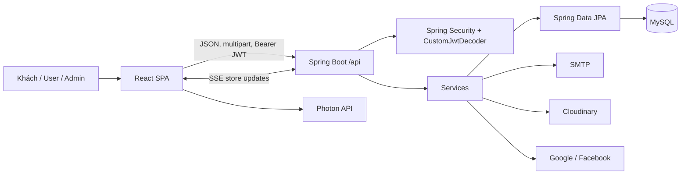

# Project Context — Cần Giuộc Food Tour

> Cập nhật theo phân tích tĩnh ngày 15/10/2026. Tài liệu ưu tiên implementation hiện tại hơn README. Quy ước: **Đã xác minh** = có bằng chứng trực tiếp trong repository; **Suy luận** = có căn cứ nhưng chưa chạy xác minh; **Chưa xác định** = thiếu bằng chứng/môi trường.

## 1. Mục đích và người dùng

**Đã xác minh:** Cần Giuộc Food Tour là SPA khám phá địa điểm ăn uống tại Cần Giuộc. Hệ thống phục vụ ba nhóm:

- Khách: xem quán đã duyệt, tìm kiếm/lọc, xem thực đơn, vòng quay chọn quán, bảng xếp hạng.
- Người dùng đã đăng nhập/chủ quán: lưu, đánh giá, báo quán đóng cửa, quản lý hồ sơ, đề xuất và quản lý quán/món thuộc quán.
- Quản trị viên: duyệt/từ chối/ẩn/khôi phục/xóa quán, quản lý user, role/permission và danh mục.

Bằng chứng chính: `frontend/src/App.jsx`, `frontend/src/pages/**`, `backend/src/main/java/com/cangiuoc/cgfoodtour/controller/**`, `StoreService.java`.

## 2. Stack thực tế

| Khu vực | Đã xác minh |
|---|---|
| Backend | Java 17 target; Spring Boot 3.5.9; Spring Web, Data JPA, Validation, Security OAuth2 Resource Server, Mail; MapStruct 1.5.5; Lombok; springdoc; Cloudinary |
| Frontend | React 19.2.8, Vite 8.2.2, React Router DOM 7.18.2, Tailwind CSS 4.3.3, Lucide, Leaflet |
| Database | MySQL runtime/production; H2 chỉ test scope. Không có migration/schema SQL trong repository |
| Auth | JWT HS512 tự phát hành, BCrypt, blacklist JTI; Google ID token; Facebook Graph API; xác minh email; OTP reset password |
| External | Cloudinary, Gmail/SMTP, Google JWK, Facebook Graph, Photon geocoding, browser Geolocation, Google/Facebook browser SDK |
| Realtime | Server-Sent Events trong bộ nhớ tiến trình |

Nguồn: `backend/pom.xml`, `frontend/package.json`, `application*.yaml`, `SecurityConfig.java`, `AuthenticationService.java`, `MapPicker.jsx`.

## 3. Kiến trúc tóm tắt

Backend là layered architecture theo package `controller → service → repository/entity`, DTO và MapStruct đứng ở biên. Frontend không dùng Redux/Context/API module; `App.jsx` giữ phần lớn state, HTTP wrapper và action handler rồi truyền props xuống pages/components. URL được ánh xạ thủ công sang `activeTab`, không khai báo `<Routes>/<Route>`.

## 4. Module và chức năng chính

- Identity: đăng ký, kích hoạt email, login, Google/Facebook login, introspect/logout/refresh, quên mật khẩu OTP.
- User: xem/sửa hồ sơ, avatar, đổi mật khẩu; admin liệt kê/sửa role/xóa user.
- Category: public read; admin create/update/delete.
- Store: đề xuất, kiểm duyệt, public discovery, owner update/hide/recover, admin moderation, recovery request, hard delete, SSE.
- Food item: public read; owner/admin mutation.
- Community: một rating/user/store, báo đóng cửa trong 100 m một lần/ngày, mốc cảnh báo 3 báo cáo, bookmark.
- Discovery UI: tìm kiếm/lọc category, gần tôi, đang mở, ranking, random và CS2-style spinner.
- Media/map: upload Cloudinary; client Photon geocoding; backend mở rộng Google Maps short link.

Chi tiết: [BUSINESS_FLOWS.md](BUSINESS_FLOWS.md), [API_REFERENCE.md](API_REFERENCE.md), [FRONTEND_REFERENCE.md](FRONTEND_REFERENCE.md).

## 5. Quy tắc nghiệp vụ trọng yếu

- Store mới luôn `PENDING`, `isVerified=false`; owner sửa store không ẩn sẽ đưa lại `PENDING`; admin sửa không tự đổi trạng thái (`StoreService.createStore/updateStore`).
- Public chỉ thấy `APPROVED`; admin thấy tất cả; owner thấy store của mình mọi trạng thái (`getStores/getStore`).
- Chỉ `APPROVED` được hide. Store do admin hide chỉ admin recover; owner phải gửi recovery request có reason (`hideStore/recoverStore/requestStoreRecovery`).
- Admin hide/hard-delete/reject recovery cần reason; reject store dùng DTO `@NotBlank`.
- Mỗi user có tối đa một rating/store; rating mới hoặc thay thế rating cũ và backend tính lại counter.
- Báo đóng cửa cần tọa độ cách store không quá 100 m, tối đa một báo cáo/user/store/ngày; `isReportedClosed=true` khi đủ 3 báo cáo.
- Ranking chỉ lấy store `APPROVED` có ít nhất 10 vote.
- Token truy cập mặc định production 30 phút; cùng token có thể refresh trong 30 ngày tính từ `issueTime`; không có refresh-token entity/response riêng.

## 6. Authentication và authorization

- `SecurityConfig`: Swagger whitelist; POST/GET auth và đăng ký public; toàn bộ GET category/store/food-item public; phần còn lại authenticated.
- `CustomJwtDecoder` gọi `AuthenticationService.introspect`, kiểm chữ ký/expiry/JTI blacklist, sau đó Nimbus decode HS512.
- Claim `scope` chứa `ROLE_<name>` và permission; converter bỏ authority prefix để `hasRole('ADMIN')` khớp `ROLE_ADMIN`.
- Method security bảo vệ admin operations và owner/admin checks được thực hiện trong `StoreService`/`FoodItemService`.
- Client lưu JWT trong `localStorage`, gắn Bearer qua `makeRequest`, thử refresh khi 401 và refresh nền mỗi 10 phút.
- CSRF tắt; CORS cho localhost và origin cấu hình; password dùng BCrypt.

Không được xem việc ẩn admin UI là bảo mật; backend method/service mới là ranh giới tin cậy.

## 7. Data overview

Entity: `User`, `Role`, `Permission`, `VerificationToken`, `PasswordResetOtp`, `InvalidatedToken`, `Category`, `Store`, `FoodItem`, `StoreRating`, `StoreDailyReport`, `UserSavedStore`, `StoreAuditLog`. Quan hệ và constraint xem [DATABASE_REFERENCE.md](DATABASE_REFERENCE.md).

**Giới hạn:** schema chỉ được suy ra từ JPA annotations. Production dùng `ddl-auto=validate`; repository không có Flyway/Liquibase/SQL migration, nên không thể dựng DB production rỗng chỉ từ source hiện tại.

## 8. Trạng thái và phát hiện ưu tiên

1. **High — đăng ký frontend hỏng:** UI gọi `POST /auth/register`, backend chỉ có `POST /users`; payload UI còn thiếu `dateOfBirth`, và frontend chấp nhận password 6 ký tự trong khi backend yêu cầu 8.
2. **High — SSRF:** public `GET /v1/stores/parse-gmaps` cho server gọi URL do client cung cấp, không allowlist host/IP/scheme.
3. **High — OTP không có rate limit/attempt limit:** OTP 6 chữ số, các endpoint public; có thể brute-force hoặc abuse gửi mail nếu không có lớp ngoài repository.
4. **High — không có migration:** production `validate` cần schema có sẵn; dev mặc định thiếu `application-dev.yaml` nên checkout sạch không đủ cấu hình chạy.
5. **Medium — rò rỉ chi tiết DB:** handler trả nguyên root-cause của `DataIntegrityViolationException` cho client.
6. **Medium — public DTO lộ `ownerEmail`:** response store công khai map email owner.
7. **Medium — hard delete xóa cả audit:** service tạo log `HARD_DELETE` rồi `deleteByStoreId`, làm mất log vừa tạo.
8. **Medium — public food-item read không kiểm status store:** có thể đọc món của pending/hidden store nếu biết ID.
9. **Medium — validation thiếu ở user update/change-password:** controller không gắn `@Valid`; quy tắc tuổi/password DTO không chạy ở các endpoint này.
10. **Medium — hiệu năng N+1:** mỗi store response query riêng food items/report/save/user; owner/category lazy mapping cũng có nguy cơ thêm query.
11. **Medium — upload generic thiếu limit/type/folder allowlist rõ ràng.**
12. **Medium — refresh contract/rotation không nhất quán; nhánh 401 có thể giữ token đã blacklist.**
13. **Low/Medium — frontend dev console giữ request body gồm password/OTP/token trong memory và render cho admin hiện tại.**

Toàn bộ bằng chứng, điều kiện và mức chắc chắn: [KNOWN_ISSUES.md](KNOWN_ISSUES.md).

## 9. Mâu thuẫn tài liệu cũ

- `backend/README.md` mô tả `/api/v1/auth/*`, `/v1/dishes`, PATCH status, `/hard`, POST parse-gmaps và role `STORE_OWNER`; code thực tế không có các contract đó.
- README nói access/refresh token riêng; response chỉ có `token` và `isAuthenticated`.
- README nói MySQL 8.0 nhưng version server không được pin/chứng minh bằng deployment artifact.
- `ORACLE_CLOUD_DEPLOYMENT_PLAN.md` là kế hoạch, không phải hạ tầng đã tồn tại; repository chưa có Docker/Terraform/CI workflow.

## 10. Trước khi sửa code

- Auth/user: đọc `SecurityConfig`, `CustomJwtDecoder`, `AuthenticationService`, `UserService`, request/response DTO, `App.jsx` auth handlers và `AuthModal`.
- Store: đọc `StoreController`, toàn bộ `StoreService`, tất cả store child repositories/entities, `StoreMapper`, `App.jsx`, `MyStoresSection`, `AdminSection`, `StoreDetailDrawer`.
- API contract: cập nhật đồng thời controller/DTO/service, `App.jsx` call sites và [API_REFERENCE.md](API_REFERENCE.md).
- Database: không đổi entity/constraint trước khi có chiến lược migration và schema production đã kiểm tra.
- Security: mọi mutation phải giữ backend authorization; không dựa vào route/UI.
- Chạy checklist trong [DEVELOPMENT_GUIDE.md](DEVELOPMENT_GUIDE.md) và tuân thủ [AGENT_GUIDELINES.md](AGENT_GUIDELINES.md).

## 11. Độ bao phủ

| Khu vực | Đã kiểm tra | Chưa kiểm tra | Trạng thái |
|---|---|---|---|
| Backend source | Toàn bộ class trực tiếp quản lý | Runtime behavior/external calls | Hoàn tất tĩnh |
| Frontend source | Toàn bộ file và luồng chính; chi tiết sâu các trang trọng yếu | Trình duyệt/E2E/accessibility thực thi | Hoàn tất tĩnh |
| API/routes | Tất cả mappings/call sites | Response runtime/OpenAPI sinh ra | Hoàn tất tĩnh |
| Database | Entity/repository/config | Schema/data production thật | Một phần |
| Security | Config/JWT/method checks/client storage | Pen-test, proxy/WAF/rate limit ngoài repo | Một phần |
| Tests/build | `npm run lint` thành công với cảnh báo | Maven test và frontend/backend build bị sandbox từ chối | Một phần |
| Deployment | Config và kế hoạch | Hạ tầng thực, Docker/CI vì chưa tồn tại | Một phần |

