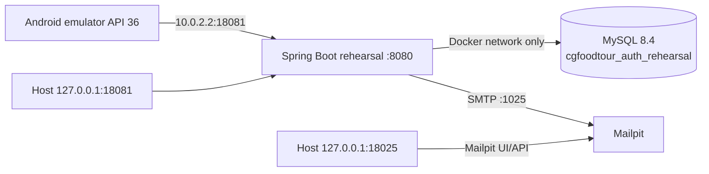

# F1.1D — Báo cáo dựng Authentication Rehearsal

**Ngày kiểm tra:** 2026-10-26  
**Branch / HEAD:** `feature/flutter-admin-application` / `1ec600e`  
**Kết luận:** **F1.1D READY — F1.1 vẫn PARTIAL**

Môi trường rehearsal độc lập đã được dựng và giữ lại để chạy F1.1E. Lượt này không chạy toàn bộ Authentication E2E matrix, không triển khai F1.2 và không thay đổi database phát triển.

## 1. Sơ đồ rehearsal stack

Compose project là `cgft-auth-rehearsal`; cả ba container chỉ nằm trên network `cgft-auth-rehearsal-network`. MySQL không publish port ra host. Backend và Mailpit UI chỉ bind loopback host; emulator đi qua alias host `10.0.2.2`.

## 2. Docker resources và tính cô lập

| Resource | Trạng thái | Exposure / storage |
|---|---|---|
| `cgft-auth-rehearsal-backend` | healthy | `127.0.0.1:18081 -> 8080`, không mount dữ liệu dev |
| `cgft-auth-rehearsal-mysql` | healthy | Không publish 3306/33060; volume riêng `cgft-auth-rehearsal-mysql-data` |
| `cgft-auth-rehearsal-mailpit` | healthy | `127.0.0.1:18025 -> 8025`; volume riêng `cgft-auth-rehearsal-mailpit-data` |
| `cgft-auth-rehearsal-network` | active | Chỉ có đúng 3 container của project |

Mọi resource có Compose project label `cgft-auth-rehearsal` và purpose label `auth-rehearsal`. Không tái sử dụng volume MySQL hiện hữu, không kết nối SMTP production và không dùng JWT key production.

Đối chiếu read-only sau provisioning cho thấy database dev `cgfoodtour` vẫn giữ baseline: 5 user, 7 store, 5 food item, 147 invalidated token, 2 active ADMIN và 3 active USER. Rehearsal dùng database khác và không có đường mount tới dữ liệu dev.

## 3. Backend profile, datasource và schema

- Active profile: `rehearsal`.
- Datasource runtime: `jdbc:mysql://mysql:3306/cgfoodtour_auth_rehearsal...` trên service MySQL nội bộ.
- Mail host runtime: `mailpit` port 1025; Mailpit đã capture 3 email, không relay ra SMTP thật.
- Health: `GET /api/actuator/health` trả `UP`.
- Flyway: V1 và V2 đều `success=1`, đúng thứ tự.
- Hibernate: `ddl-auto=validate`; backend chỉ đạt healthy sau khi schema validation thành công.
- Schema: 18 bảng, gồm các bảng auth hiện hành `user`, `role`, `user_roles`, `verification_token`, `invalidated_token`.

Migration chỉ được chạy sau preflight xác nhận database name là `cgfoodtour_auth_rehearsal`, schema ban đầu có 0 bảng, MySQL không publish port và các resource đều thuộc đúng Compose project.

## 4. Provisioning tài khoản disposable

Credentials ngẫu nhiên được inject từ file runtime ngoài repository, ACL chỉ cho user hiện tại đọc/ghi; không có giá trị nào được ghi vào source, Markdown hoặc log. File này được giữ lại cho F1.1E và phải xóa sau khi kết thúc spike.

Provisioning dùng đúng API/business flow:

1. bootstrap một ADMIN từ cấu hình rehearsal trên database trắng;
2. đăng ký USER qua `/auth/register`, nhận email trong Mailpit và xác minh qua `/auth/verify-email`;
3. đăng ký/xác minh account thứ hai, dùng Admin API cấp role ADMIN rồi gọi Admin API disable;
4. không cập nhật trực tiếp bảng user/role và không bypass validation.

Kết quả aggregate không chứa PII:

| Fixture | Trạng thái | Login smoke check |
|---|---|---|
| ADMIN | active, verified, ADMIN | HTTP 200 |
| USER | active, verified, chỉ USER | HTTP 200 |
| ADMIN disabled | disabled, verified, ADMIN | HTTP 403 |

Tổng cộng đúng 3 account. Đây chỉ là provisioning/smoke check; chưa phải full F1.1 Android auth matrix.

## 5. Origin và cookie profile

- Exact allowlist runtime: `http://localhost:5173` qua `APP_CORS_ALLOWED_ORIGINS`.
- `app.cors.include-local-origins=false`, nên không tự cộng thêm local Origin.
- Positive preflight: HTTP 200 và `Access-Control-Allow-Origin: http://localhost:5173`.
- Origin giả ngoài allowlist: HTTP 403, không có allow-origin header.
- Local rehearsal cookie: `cgft_refresh` là HttpOnly, `cgft_csrf` đọc được; cả hai `SameSite=Strict`, `Secure=false` vì đây là HTTP debug cô lập.
- `Secure=false` không áp dụng staging/production. Harness khóa cookie theo API origin; không bỏ TLS validation.

Origin là allowlist chống cross-origin abuse, không được coi là credential hoặc bằng chứng xác thực native client.

## 6. Android connectivity và backup

AVD `Pixel_9`, Android API 36, chạy dưới `emulator-5554`. QA headless phải dùng tùy chọn emulator chính thức `-skip-adb-auth` do AVD hiện trả `unauthorized` khi không có UI xác nhận; không wipe hoặc reset AVD.

Từ emulator:

- ping `10.0.2.2`: PASS;
- TCP `10.0.2.2:18081`: PASS;
- `GET /api/actuator/health`: HTTP 200.

Chính sách BACKUP-01 đã áp dụng:

- `android:allowBackup="false"`;
- `android:fullBackupContent="false"` cho legacy backup;
- `android:dataExtractionRules="@xml/data_extraction_rules"`;
- loại trừ `root`, `file`, `database`, `sharedpref`, `external` cho cả cloud backup và device-to-device transfer.

README local của `flutter_secure_storage` 10.3.4 cảnh báo Auto Backup có thể gây `Failed to unwrap key` và khuyến nghị tắt backup hoặc exclude secure preferences. Debug APK merged manifest giữ đủ ba thuộc tính trên và đóng gói resource `xml/data_extraction_rules`; unit test bảo vệ cấu hình này.

Ảnh hưởng được chấp nhận: dữ liệu cục bộ của Admin app không tự restore qua cloud/chuyển thiết bị; người dùng phải đăng nhập lại. Đây phù hợp với session secret và không thay đổi session lifecycle F1.2.

## 7. Kết quả kiểm thử F1.1D

| Kiểm tra | Kết quả |
|---|---|
| Compose config / resource labels / isolation | PASS |
| Backend rehearsal startup + health | PASS — healthy / `UP` |
| Flyway + Hibernate schema validation | PASS — V1/V2, 18 bảng |
| Mailpit connectivity / email capture | PASS — 3 email nội bộ |
| Account provisioning checks | PASS — 3 trạng thái đúng, login 200/200/403 |
| Origin positive / negative | PASS — 200 / 403 |
| Dev database baseline read-only comparison | PASS — không thay đổi aggregate |
| Android API 36 → rehearsal | PASS — ping/TCP/HTTP 200 |
| `dart format lib test integration_test test_driver` | PASS — 48 file, 0 thay đổi |
| `flutter pub get` | PASS |
| `flutter analyze` | PASS — no issues found |
| `flutter test` | PASS — 29/29 |
| `flutter build apk --debug` | PASS |
| APK manifest/resource inspection | PASS — ID `vn.cgfoodtour.admin`, min SDK 24, backup disabled/rules packaged |
| Secret scan Git diff/untracked/container logs | PASS — 0 match trên 17 trường nhạy cảm |
| Full Android Authentication E2E matrix | **NOT RUN — ngoài phạm vi F1.1D** |
| iOS | **NOT RUN — Windows không có macOS/Xcode** |

`flutter doctor -v` nhận Flutter 3.35.1, Dart 3.9.0, Android SDK 36.1/API 36 và Java 21. Android license status vẫn `unknown` do mismatch giữa Flutter 3.35.1 và cmdline-tools revision hiện có; build APK và emulator QA không bị chặn. Thiếu Visual Studio C++ chỉ ảnh hưởng Windows desktop, không thuộc Android rehearsal.

## 8. Teardown an toàn

Không teardown trong F1.1D vì môi trường còn cần cho F1.1E. Trước teardown phải:

1. liệt kê container/volume/network theo label `com.docker.compose.project=cgft-auth-rehearsal`;
2. xác nhận chỉ đúng ba container, hai volume và một network nêu trong báo cáo;
3. dùng đúng Compose file, project name và env file runtime để chạy `down --volumes --remove-orphans`;
4. xóa file credential runtime và debug/test artifacts sau khi thu đủ evidence.

Không dùng `docker system prune`, `docker volume prune` hoặc xóa resource không có project label đúng.

## 9. Điều kiện còn lại trước F1.1E

- Giữ stack, file credential runtime và AVD cho đến khi chạy xong F1.1E.
- Chạy full Android matrix bằng harness: login/me, cookie/CSRF/Origin negatives, refresh rotation, process-restart session restore, logout/revocation và role checks.
- Phân biệt rõ process restart thật với secure-storage read trong cùng process.
- Sau F1.1E: gỡ test APK, xóa credential runtime và teardown đúng project resources.
- Chỉ xem xét F1.1 PASS sau khi matrix thực tế đạt acceptance criteria; hiện **F1.1 vẫn PARTIAL** và không bắt đầu F1.2.
