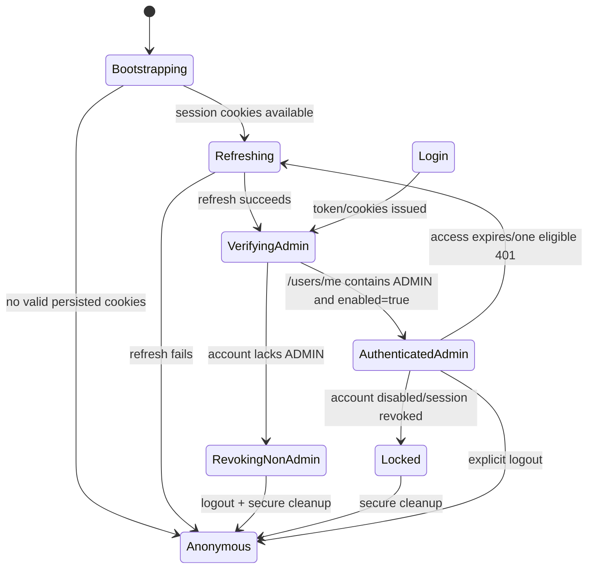
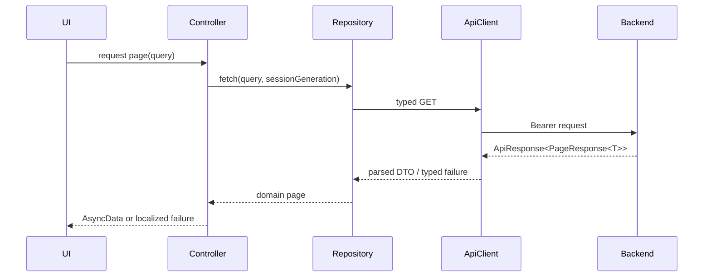

# CG FoodTour Admin — Flutter Master Architecture & Implementation Blueprint

> **Document status:** Planning only — implementation has not started  
> **Audited repository HEAD:** `dd236ea7de8ea65591d8c28a7afd39f29cdb7630`  
> **Audited branch:** `feature/frontend-desktop-redesign`  
> **Audit date:** 2026-10-25  
> **Product:** CG FoodTour Admin for Android and iOS  
> **Authority:** Single Source of Truth for the independent Flutter Admin workstream

## Evidence legend

| Label | Meaning |
|---|---|
| **VERIFIED FROM CODE** | Directly confirmed in current Java/React/config source at the audited HEAD. |
| **VERIFIED BY TEST** | An existing automated test asserts the behavior. This label does not imply the test was rerun during this blueprint task unless explicitly stated. |
| **PROPOSED DESIGN** | Flutter-side architecture or UX to be implemented; it is not current application behavior. |
| **NOT VERIFIED** | Runtime/provider/device behavior still needs an integration test. |
| **REQUIRES PRODUCT OWNER DECISION** | The implementation must stop until the stated choice is approved. |

---

# 1. Executive Summary

CG FoodTour already exposes enough administration APIs to build an Admin MVP covering authentication, dashboard counts, store moderation, user moderation, category management, profile editing and password changes. The Flutter application must remain a separate client: it does not replace the React website and must not reproduce Explore, Saved Stores, owner workflows or marketing pages.

The recommended Flutter architecture is feature-first, with pragmatic presentation/domain/data boundaries, Riverpod for state and dependency ownership, `go_router` for guarded navigation, Dio for HTTP, generated JSON serializers, and a session subsystem that keeps the access token only in memory. The current backend does **not** serialize its refresh token; it sends it only as an `HttpOnly` cookie. Therefore the first authentication milestone is an integration spike proving that a native cookie jar can preserve the two session cookies, read only the non-HttpOnly CSRF cookie, supply `X-CSRF-Token` and the required allowlisted `Origin`, rotate the refresh cookie, and restore the session after restart.

This is feasible without a new endpoint in principle, but it is **NOT VERIFIED on Android/iOS**. The server explicitly rejects refresh/logout calls without an allowed `Origin`, while native clients do not naturally have a browser origin. If the spike cannot meet the contract safely, a mobile-specific authentication contract becomes a proposed backend change and requires separate approval. No such endpoint is described here as already existing.

Two material API gaps are recorded:

1. There is no dedicated `GET /v1/stores/admin/{id}`. An Admin detail screen can initially use the full `StoreResponse` returned by the paginated Admin list, but it cannot independently reload a deep-linked record.
2. Category deletion relies on database constraints and may return generic `DATA_CONFLICT`; there is no preflight “category in use” endpoint.

The blueprint maps **26 existing API operations** used by the proposed app and **one proposed Admin store-detail operation** that is explicitly marked non-existent. The route design contains **14 route-level screens** plus reusable confirmation/action sheets. Implementation is divided into F0–F6 and must pause after each approved batch.

## Recommended MVP verdict

**Architecture-ready, authentication compatibility validation required before feature implementation.** F0 may initialize the project, but F1 must not be declared complete until real-cookie login/refresh/logout/session-restore tests pass against the Spring Boot backend.

---

# 2. Verified Repository Baseline

## 2.1 Git and workspace state

- Branch: `feature/frontend-desktop-redesign`.
- HEAD: `dd236ea7de8ea65591d8c28a7afd39f29cdb7630`.
- The repository was dirty before this document was created. Pre-existing modified/untracked project-audit, responsive-audit, Playwright and PNG files were preserved.
- This blueprint does not assume historic Markdown reports are current when they conflict with source.

## 2.2 Current stack relevant to Flutter integration

| Area | Verified implementation | Evidence |
|---|---|---|
| Web frontend | React 19, React Router, Vite, Tailwind CSS, Lucide icons | `frontend/package.json` |
| Backend | Java 17 baseline, Spring Boot 3.5, Spring Security resource server, Spring Data JPA | `backend/pom.xml` |
| Database | MySQL in runtime; Flyway migrations are enabled in rehearsal/production | `backend/pom.xml`, `application-prod.yaml` |
| API context | `/api` | `backend/src/main/resources/application.yaml:19` |
| API envelope | `{code, message, result}`; null fields omitted | `dto/request/ApiResponse.java` |
| Authentication | short-lived JWT access token plus rotating refresh token in cookie | `AuthenticationController`, `AuthenticationService`, `AuthCookieService` |
| Production cookies | `__Host-cgft_refresh` HttpOnly and readable `__Host-cgft_csrf`; Secure, SameSite Strict, Path `/` | `application-prod.yaml`, `AuthCookieService.addCookie` |
| Authorization | URL authentication plus method-level `@PreAuthorize` | `SecurityConfig.java`, service methods |
| Admin web | One large `AdminSection` with dashboard/stores/users/categories | `frontend/src/pages/Admin/AdminSection.jsx` |
| UI identity | Plus Jakarta Sans, warm canvas, red brand, black borders, hard shadows | `frontend/src/index.css` |

## 2.3 Existing Admin web inventory

**VERIFIED FROM CODE:** `AdminSection.jsx` exposes four primary tabs:

- Dashboard: pending/recovery/approved counts, total users, urgent moderation list.
- Stores: query/status/category filters, server-side pagination, detail drawer, approve/reject/hide/recover/reject recovery/hard delete.
- Users: query/role filtering, server-side pagination, edit identity/roles, disable/enable, permanent deletion.
- Categories: list, icon catalogue, create/edit/delete.

The web uses `StoreActionModal`, `AccountStatusModal`, `ConfirmActionModal`, `CategoryIconPicker`, `ImageViewerModal` and shared input/select/skeleton primitives. Flutter should preserve business meaning, not port the desktop DOM layout.

## 2.4 Test evidence and limitations

Existing relevant tests include:

- `AuthCookieServiceTest`: hardened attributes and CSRF cookie/header/origin checks.
- `AuthenticationControllerTest`: refresh token is not serialized and logout reads header/cookie.
- `StoreTransitionPolicyTest`: pending-only approval, owner-edit state behavior, admin-hidden recovery protection.
- `UserServiceAuthorizationTest`: regular user cannot read another user; Admin can.
- `UserDeletionServiceTest`: related data deletion, audit anonymization and media cleanup queue.
- Playwright Admin tests and screenshot captures exist for the React UI; they are not Flutter tests.

The targeted Maven run attempted while producing this document was **not completed**: the wrapper failed in the PowerShell wrapper script and the system Maven process could not create its configured `C:\.m2\repository`. Therefore no behavior is newly marked runtime-PASS by this audit. Source and test definitions were inspected; native cookie behavior, device storage and real API integration remain **NOT VERIFIED**.

---

# 3. Flutter Admin Product Scope

## 3.1 Product objective

Provide an authenticated, touch-first operational console for authorized CG FoodTour administrators to review system status, moderate stores, manage accounts and maintain store categories from Android and iOS.

## 3.2 In scope for MVP

- Admin email/password login.
- Session bootstrap, refresh rotation, expiration handling and logout.
- Strict verification that the authenticated account has role `ADMIN`.
- Dashboard using existing real counts only.
- Store moderation list/detail/actions.
- Recovery-request queue using the Admin store list filter.
- User list/detail/edit role and identity/disable/enable/delete.
- Category list/create/edit/delete.
- Admin profile view/edit, password change, app/environment version display.
- Vietnamese UI strings with centralized English fallback; backend JSON remains unchanged.
- Loading, skeleton, empty, error, offline and permission states.

## 3.3 Out of scope

- Explore, store discovery, ratings, bookmarks, GPS closed-store reports.
- Owner store creation/editing/dishes/history.
- General user registration, email verification, forgot/reset password UI.
- Google/Facebook login for Admin MVP.
- Role/permission schema creation or deletion.
- Store content editing by Admin.
- Admin audit-log browser; no current React equivalent/API was verified.
- New analytics/KPI APIs.
- Push notifications, background sync, biometrics or certificate pinning in MVP.
- Any React redesign, backend change, migration or database change during Flutter batches unless separately approved.

## 3.4 Deferred optional capabilities

- Admin avatar upload (`PATCH /users/me/avatar`) after image-handling UX is approved.
- Tablet split-view details.
- Deep links into Admin store/user records after a dedicated Admin detail contract exists.
- Biometric gate as a local convenience layer; it must never replace server authentication.

---

# 4. Current Admin Business Rules

## 4.1 Store status model

`StoreStatus` contains `PENDING`, `APPROVED`, `REJECTED`, `HIDDEN`.

```mermaid
stateDiagram-v2
    [*] --> PENDING: owner submits
    PENDING --> APPROVED: Admin approves
    PENDING --> REJECTED: Admin rejects + reason
    APPROVED --> HIDDEN: Admin/owner hides; Admin reason required
    HIDDEN --> APPROVED: Admin recovers
    APPROVED --> PENDING: owner edits/resubmits
    REJECTED --> PENDING: owner edits/resubmits
    HIDDEN --> HIDDEN: owner edits hidden store
```



Rules confirmed in `StoreTransitionPolicy.java:11-72` and `StoreService`:

| Action | Preconditions | Reason | Result | Side effects |
|---|---|---|---|---|
| Approve | Admin; status `PENDING` | Not accepted/required | `APPROVED`, verified=true | Store audit + SSE. No approval email was found. |
| Reject | Admin; status `PENDING` | Required, nonblank | `REJECTED`, verified=false | Stores rejection reason, audit + SSE. No rejection email was found. |
| Hide | Admin or owner; status `APPROVED` | Required for Admin | `HIDDEN`; records who hid/reason | Audit + SSE; Admin hide schedules owner email after commit. |
| Recover | Admin or owner; status `HIDDEN` | Optional in current DTO/service for Admin | `APPROVED`; clears hide/recovery fields | Owner cannot recover Admin-hidden store; audit + SSE. |
| Request recovery | Owner of Admin-hidden `HIDDEN` store | Required | status remains `HIDDEN`, request flag=true | Audit + SSE. Not an Admin app action. |
| Reject recovery | Admin; pending recovery flag=true | Required | remains `HIDDEN`, clears request, stores decline reason | Audit + SSE; owner email after commit. |
| Hard delete | Admin or owner | Required for Admin | Store and related graph deleted | Audit snapshot before delete, media cleanup after commit, owner email after commit for Admin action. |

Every Flutter action must refresh affected summary/list/detail state only after a successful response. A failure must leave the local item unchanged.

## 4.2 Account rules

- Admin list supports `query`, `enabled`, `role`, sorting and zero-based pagination.
- Admin can edit another account's username, first name, last name, birth date and roles.
- At least one valid server role is required.
- Any role change increments `tokenVersion`, invalidating all old JWTs for that account.
- Disable and enable also revoke all sessions.
- An Admin cannot disable or permanently delete their own account.
- An unverified account cannot be administratively enabled/disabled via the current status methods; UI must explain the distinct “chưa xác thực” state.
- The last active Admin cannot be disabled, deleted or demoted.
- Other Admin accounts can be managed subject to those safeguards.
- Deletion requires the exact current username plus a nonblank reason; it deletes the user's owned stores and personal relations, preserves/anonymizes audit evidence and queues media cleanup.
- Disable and enable send account notification emails after database commit. User deletion has deletion audit; a generic role/status audit feed was not verified.

Evidence: `UserService.updateUser` at line 147, `disableUser` at 233, `enableUser` at 262; `UserDeletionService.deleteUser` at line 35.

## 4.3 Category rules

- Name is trimmed, required and 2–50 characters.
- Name uniqueness is case-insensitive.
- `iconUrl` is nullable and is not server-validated against the web icon catalogue.
- New category display order is `count + 1`; no reorder API exists.
- Delete is supported, but an in-use category is expected to fail through referential integrity and the global `DATA_CONFLICT` response.
- Flutter should offer the same 24 semantic icon IDs used by `CategoryIcon.jsx`, while accepting/displaying unknown legacy values with a fallback icon.

## 4.4 Audit and email consequences

| Operation | Audit verified | Email verified |
|---|---:|---:|
| Approve/reject store | Yes (`StoreAuditLog`) | No email call found |
| Hide store as Admin | Yes | Yes, after commit |
| Recover store | Yes | No email call found |
| Reject recovery | Yes | Yes, after commit |
| Hard delete store as Admin | Yes, deletion snapshot | Yes, after commit |
| Change user role | Session revocation; no general moderation audit verified | No |
| Disable/enable user | State records disabling Admin ID; no general audit list verified | Yes, after commit |
| Delete user | `UserDeletionAudit` and anonymized store audit | Not verified |

Flutter must not show “email sent” unless the backend contract explicitly confirms delivery. Mutation success means the server accepted/committed the business action; asynchronous mail can still fail later.

## 4.5 Admin feature inventory and implementation priority

| Feature ID | Current web location | Backend/DTO | Permission and key rule | Error/test evidence | Flutter adaptation | Priority |
|---|---|---|---|---|---|---|
| AF-AUTH | Global Auth modal/App session | `/auth/token|refresh|logout`; Authentication DTOs | Login public; protected data requires valid bearer; refresh/logout require cookie+CSRF+Origin | Auth controller/cookie tests exist; native path not tested | Dedicated Admin login, encrypted cookie transport, role gate | F1 / Blocker |
| AF-DASH | Admin `dashboard` tab | Admin store summary/list, paged users, category list | ADMIN for store/user data; no invented KPI | No dedicated Flutter/API aggregation test | Parallel section providers and partial errors | F2 / High |
| AF-STORE-LIST | Admin `stores` tab | `GET /v1/stores/admin`; `PageResponse<StoreResponse>` | ADMIN; server filters/pagination | Page/filter errors 1056; React E2E exists | Card list, status chips, preserved query | F3 / High |
| AF-STORE-MOD | Store row/detail drawer/modals | Approve/reject/hide/recover/recovery-reject/delete DTOs | Status machine, Admin reasons, no blind retry | `StoreTransitionPolicyTest`; service behavior | Detail-first bottom sheets, reconciliation reads | F3 / Critical |
| AF-RECOVERY | Dashboard/store recovery filter | Admin store list synthetic status plus recover/reject APIs | HIDDEN + request flag; reject reason required | Policy/service tests are partial | Dedicated preset queue reusing store components | F3 / High |
| AF-USER-LIST | Admin `users` tab | `GET /users`; `PageResponse<UserResponse>` | ADMIN, query/role/state pagination | Authorization test covers detail access; list rules in service | Card list, status distinction, session isolation | F4 / High |
| AF-USER-EDIT | User edit modal | GET/PUT user + GET roles | At least one valid role; demotion protects last Admin; role change revokes sessions | Authorization coverage is partial | Full-screen form and explicit revocation warning | F4 / Critical |
| AF-USER-STATE | Account status modal | disable/enable DTOs | No self action; verified target; last Admin protected | Service source; dedicated full matrix not verified | Reason sheet/enable confirmation and cross-session test | F4 / Critical |
| AF-USER-DELETE | ConfirmActionModal | DELETE user; AdminDeleteUserRequest | Exact username + reason; cascade/anonymize audit | `UserDeletionServiceTest` exists | Large destructive sheet; refresh store/user dashboards | F4 / Critical |
| AF-CATEGORY | Admin `categories` tab | Category CRUD DTOs | ADMIN mutations; duplicate blocked; in-use delete may conflict | Service rules; no dedicated category suite found | Touch icon grid, unknown icon fallback, 1027 UX | F5 / Medium |
| AF-PROFILE | Web profile/account UI | `/users/me`, PUT me, change password | Current principal; password change revokes all sessions | Password service tests exist | Minimal Admin settings; forced local logout on success | F5 / High |

---

# 5. Role & Permission Matrix

| Capability | Unauthenticated | Authenticated USER | ADMIN | Backend enforcement |
|---|---:|---:|---:|---|
| Login/refresh/logout | Login public; refresh/logout cookie+CSRF | Same | Same | Controller/service/session validation |
| Read own profile/change password | No | Yes | Yes | Authenticated route/current principal |
| Open Flutter Admin application | Login view only | Must be rejected and logged out | Yes | Flutter guard **and** server method security |
| Read Admin store list/summary | No | No | Yes | `@PreAuthorize("hasRole('ADMIN')")` |
| Approve/reject/reject recovery | No | No | Yes | Controller/service method security |
| Hide/recover/delete store | No | Owner under owner rules | Yes | Authenticated controller + service ownership/Admin checks |
| List/read/update users | No | Self via `/users/me` only | Yes | `UserService @PreAuthorize` for Admin methods |
| Disable/enable/delete accounts | No | No | Yes, with last/self rules | Service method security and transactional locks |
| List categories | Yes on web API | Yes | Yes | Public GET |
| Create/update/delete categories | No | No | Yes | `CategoryService @PreAuthorize` |
| List roles for assignment | No | No | Yes | `RoleService @PreAuthorize` |

**Important:** hiding buttons is never authorization. Every repository mutation must accept server `403` as authoritative, invalidate affected UI state, and show a Vietnamese business-safe message.

---

# 6. Authentication & Session Architecture

## 6.1 Existing web contract

1. `POST /auth/token` accepts email/password.
2. Response JSON contains access token, token type, expiry and `isAuthenticated`; refresh token fields are `@JsonIgnore`.
3. Server emits a refresh cookie (`HttpOnly`) and CSRF cookie (readable).
4. API calls use `Authorization: Bearer <access>`.
5. `POST /auth/refresh` requires both cookies, matching `X-CSRF-Token`, and an `Origin` exactly in the server allowlist; it rotates cookies and returns a new access token.
6. `POST /auth/logout` requires the same CSRF/origin proof, blacklists/revokes available tokens and clears cookies.

Evidence: `AuthenticationResponse.java`, `AuthenticationController.java:59-121`, `AuthCookieService.java:53-91`.

## 6.2 Compatibility decision table

| Question | Finding | Decision/status |
|---|---|---|
| Can Flutter use the current API unchanged? | Likely yes with a native cookie jar and explicit headers, but not yet proven. | **Preferred; NOT VERIFIED.** Mandatory F1 spike. |
| Can native HTTP retain HttpOnly cookies? | A native client can receive/re-send `Set-Cookie`; HttpOnly restricts script/browser access, not the HTTP stack. | Use a cookie manager. Do not expose refresh value to feature code. |
| How is persistence secured? | Ordinary file-backed cookie jars may be plaintext. | Persist session-cookie material only through platform secure storage or an encrypted cookie-storage adapter. Never SharedPreferences. |
| How is CSRF sent? | Read the non-HttpOnly CSRF cookie from the cookie jar; send identical value in `X-CSRF-Token`. | Central auth interceptor only. |
| What about `Origin`? | Backend requires an exact allowlisted Origin even for native clients. Native requests do not naturally supply one. | Configure one explicit admin-client origin value and send it only to the configured API host; validate end to end. This is a deployment setting, not a secret. |
| Does SameSite protect native traffic? | Browser SameSite semantics may not be enforced by the native jar. | Treat exact-host cookie scoping and TLS as mandatory; never forward cookies across hosts/redirects. |
| Is HTTPS required? | Secure production cookies and credentials require HTTPS. | Mandatory for staging/production. Debug-only HTTP exceptions are allowed for local emulator/device builds. |
| Is backend work already required? | Not proven. | No backend change in F0/F1 until the compatibility spike fails or PO selects another contract. |
| If unchanged flow fails? | A mobile-specific refresh contract may be necessary. | **PROPOSED CHANGE — REQUIRES APPROVAL**, with rotation/revocation preserved and web compatibility tests. |

## 6.3 Recommended session state machine



## 6.4 Token and cookie rules

- Access token lives in process memory only.
- Refresh and CSRF cookie records may persist only in an OS-protected store; feature layers receive no raw token/cookie API.
- Password is never persisted or auto-filled by application code.
- On account switch/logout/refresh failure: cancel in-flight calls, increment session generation, clear all providers/caches/navigation history, erase cookie storage and access token.
- Validate Admin role via `/users/me`; do not trust JWT payload parsing as the authorization source.
- If login succeeds for a non-Admin, immediately call logout where possible, then purge local state and show “Ứng dụng chỉ dành cho quản trị viên.”
- One refresh mutex/single-flight operation serves concurrent requests. Waiting calls must be associated with the current session generation.
- Automatically retry an API request at most once after a confirmed 401 and successful refresh. Never retry a non-idempotent action after timeout/connection loss because the server may have committed it.
- Do not treat every 403 as session expiry. `1008` role loss, `1013` disabled account and refresh/logout `1057` require session handling; business 403s remain screen errors.
- After successful password change, clear the client session and return to login because the backend increments token version and invalidates all sessions.

## 6.5 App lifecycle

- Cold start: load environment → open secure session store → attempt refresh → fetch `/users/me` → role check → route.
- Resume after more than a configurable short interval (proposed 5 minutes): fetch `/users/me`; refresh first if access is near expiry.
- Background: do not refresh periodically; cancel nonessential polling.
- Network reconnect: refresh visible GET data only after user action or app resume. Do not replay mutations.
- Clock skew: rely on server 401 and `expiresIn`; schedule refresh slightly before expiry but never assume device JWT decoding is authoritative.

---

# 7. Complete API Contract Matrix

## 7.1 Transport conventions

- Base URL includes `/api`, for example `https://admin-api.example.vn/api`.
- JSON request header: `Content-Type: application/json`.
- Authenticated header: `Authorization: Bearer <memory access token>`.
- Refresh/logout additionally: refresh and CSRF cookies, `X-CSRF-Token`, and configured allowed `Origin`.
- Correlation header returned by server may be captured for support, but never display tokens or raw internal errors.
- Success envelope: `{ "code": 1000, "message": "...", "result": ... }`.
- Error envelope uses the same shape without a useful `result`. Flutter maps numeric code to Vietnamese copy; it must not render backend English directly as the primary message.
- Pagination is zero-based. `PageResponse<T>` contains `content`, `totalElements`, `totalPages`, `size`, `page`, `first`, `last`.
- Current list constraints: page >= 0; size 1–100. Web uses size 20.

## 7.2 Matrix — 26 existing operations + one proposed gap

| ID | Feature | Method and endpoint | Auth | Request / query | Response result | Important errors | Flutter surface |
|---|---|---|---|---|---|---|---|
| AUTH-01 | Login | `POST /auth/token` | Public | `AuthenticationRequest` | `AuthenticationResponse` + cookies | 1023, 1026, 1011, 1013 | Login |
| AUTH-02 | Refresh/bootstrap | `POST /auth/refresh` | Cookie + CSRF + Origin | No body | `AuthenticationResponse` + rotated cookies | 1007, 1013, 1057 | Bootstrap/interceptor |
| AUTH-03 | Logout | `POST /auth/logout` | CSRF + Origin; bearer when available | No body | null | 1057; network ambiguity | Settings/global |
| PROF-01 | Current Admin | `GET /users/me` | Bearer | — | `UserResponse` | 1007, 1006 | Bootstrap/Profile |
| PROF-02 | Edit profile | `PUT /users/me` | Bearer | `MyInfoUpdateRequest` | `UserResponse` | 1003, 1009, 1041 | Profile edit |
| PROF-03 | Change password | `PUT /users/me/change-password` | Bearer | `ChangePasswordRequest` | `UserResponse` | 1017, 1004 | Change password |
| STORE-01 | Summary | `GET /v1/stores/admin/summary` | ADMIN | — | map of five counts | 1007, 1008 | Dashboard |
| STORE-02 | Admin list/search | `GET /v1/stores/admin` | ADMIN | status/categoryId/query/sort/page/size | `PageResponse<StoreResponse>` | 1056 | Dashboard/Store list/Recovery |
| STORE-03 | Approve | `POST /v1/stores/{id}/approve` | ADMIN | no meaningful body | `StoreResponse` | 1031, 1058 | Store detail/action sheet |
| STORE-04 | Reject | `POST /v1/stores/{id}/reject` | ADMIN | `RejectStoreRequest` | `StoreResponse` | validation, 1031, 1058 | Rejection sheet |
| STORE-05 | Hide | `POST /v1/stores/{id}/hide` | ADMIN path through service | `StoreActionRequest` | `StoreResponse` | 1035, 1058 | Visibility sheet |
| STORE-06 | Recover | `POST /v1/stores/{id}/recover` | ADMIN path through service | optional `StoreActionRequest` | `StoreResponse` | 1031, 1058 | Visibility sheet |
| STORE-07 | Reject recovery | `POST /v1/stores/{id}/reject-recovery-request` | ADMIN | `StoreActionRequest` reason | `StoreResponse` | 1039/1040/1058 | Recovery detail |
| STORE-08 | Hard delete | `DELETE /v1/stores/{id}` | ADMIN path through service | `StoreActionRequest` reason | null | 1035, 1031 | Destructive sheet |
| STORE-GAP-01 | Admin detail reload | `GET /v1/stores/admin/{id}` | — | — | — | **MISSING / PROPOSED** | Store detail |
| USER-01 | User list/count | `GET /users` | ADMIN | query/enabled/role/sort/page/size | `PageResponse<UserResponse>` | 1056 | Dashboard/User list |
| USER-02 | User detail | `GET /users/{userId}` | ADMIN | path ID | `UserResponse` | 1006 | User detail |
| USER-03 | Role choices | `GET /roles` | ADMIN | — | `List<RoleResponse>` | 1008 | User edit |
| USER-04 | Edit user/roles | `PUT /users/{userId}` | ADMIN | `UserUpdateRequest` | `UserResponse` | 1029, 1041, 1047 | User edit |
| USER-05 | Disable | `POST /users/{userId}/disable` | ADMIN | `AccountDisableRequest` | `UserResponse` | 1045–1048 | Account action sheet |
| USER-06 | Enable | `POST /users/{userId}/enable` | ADMIN | no body | `UserResponse` | 1046–1048 | Account action sheet |
| USER-07 | Hard delete user | `DELETE /users/{userId}` | ADMIN | `AdminDeleteUserRequest` | string | 1045–1050 | Destructive sheet |
| CAT-01 | Category list | `GET /v1/categories` | Public but app session required by policy | — | `List<CategoryResponse>` | generic network | Dashboard/Category list |
| CAT-02 | Category detail | `GET /v1/categories/{id}` | Public | path ID | `CategoryResponse` | 1030 | Category edit fallback |
| CAT-03 | Create | `POST /v1/categories` | ADMIN via service | `CategoryRequest` | `CategoryResponse` | 1042–1044 | Category form |
| CAT-04 | Update | `PUT /v1/categories/{id}` | ADMIN via service | `CategoryRequest` | `CategoryResponse` | 1030, 1042–1044 | Category form |
| CAT-05 | Delete | `DELETE /v1/categories/{id}` | ADMIN via service | — | null | 1030, 1027 | Category list confirmation |

## 7.3 Request and response schemas

### Authentication

```json
// AUTH-01 request
{"email":"admin@example.test","password":"not-a-real-password"}

// AUTH-01/AUTH-02 result; refreshToken is intentionally absent
{
  "code":1000,
  "message":"Authentication successful",
  "result":{"accessToken":"<redacted>","tokenType":"Bearer","expiresIn":900,"isAuthenticated":true}
}
```

`email`: required, valid email. `password`: required. Rate-limit/account-state responses must remain generic enough not to expose credentials.

### Store list and summary

Valid Admin status filters are blank/all (omit), `PENDING`, `APPROVED`, `REJECTED`, `HIDDEN`, plus synthetic `RECOVERY_REQUESTED`. Supported sort values come from the shared store page resolver; Flutter MVP must use verified `newest` unless additional values are confirmed in the implementation batch.

```json
// STORE-01 result
{"pending":4,"approved":38,"rejected":2,"hidden":3,"recoveryRequested":1}

// Representative StoreResponse (fake values)
{
  "id":"store-demo-01","categoryId":2,"categoryName":"Món Việt","name":"Quán Minh họa",
  "phoneNumber":"0900000000","addressLine":"Địa chỉ minh họa","landmarkNote":null,
  "latitude":10.0,"longitude":106.0,"mapUrl":"https://maps.google.com/...",
  "openTime":"06:00:00","closeTime":"21:00:00","priceMin":20000.0,"priceMax":90000.0,
  "bannerImageUrl":null,"isVerified":false,"ownerId":"user-demo-01",
  "ownerEmail":"owner@example.test","ownerUsername":"owner_demo","ownerFirstname":"An","ownerLastname":"Nguyễn",
  "status":"PENDING","rejectionReason":null,"hiddenByAdmin":false,"hideReason":null,
  "recoveryRequested":false,"recoveryRequestReason":null,"recoveryDeclineReason":null,
  "countVerySatisfied":0,"countNormal":0,"countNotSatisfied":0,"totalVotes":0,
  "satisfactionRate":0.0,"savedCount":0,"isSaved":false,"foodItems":[],
  "isReportedClosed":false,"createdAt":"2026-01-01T10:00:00","updatedAt":"2026-01-01T10:00:00"
}
```

Action bodies:

```json
// Reject, hide, reject recovery, hard delete
{"reason":"Lý do quản trị minh họa"}

// Recover: current backend permits an omitted/null/optional reason
{"reason":"Ghi chú khôi phục tùy chọn"}
```

### User and role

```json
// USER-04 request
{
  "username":"admin_demo","firstname":"An","lastname":"Nguyễn",
  "dateOfBirth":"1990-01-01","roles":["ADMIN","USER"]
}

// USER-05 request
{"reason":"Lý do khóa tài khoản minh họa"}

// USER-07 request; confirmation must equal the current target username exactly
{"reason":"Lý do xóa minh họa","confirmation":"target_username"}
```

`UserResponse` fields: `id`, `username`, `firstname`, `lastname`, `email`, `dateOfBirth`, `avatarUrl`, `facebookId`, `enabled`, `emailVerified`, `disabledReason`, `disabledAt`, and roles. A role contains `name`, `description`, and permission objects (`name`, `description`).

### Category

```json
// CAT-03/CAT-04 request
{"name":"Món Việt","iconUrl":"utensils"}

// result
{"id":2,"name":"Món Việt","iconUrl":"utensils","displayOrder":2}
```

## 7.4 Error code presentation policy

At minimum map these codes centrally:

| Codes | Vietnamese product copy / behavior |
|---|---|
| 1007, 1026 | “Phiên đăng nhập không hợp lệ” / invalid credentials on login; do not expose detail. |
| 1008 | “Bạn không có quyền thực hiện thao tác này.” Re-check role if returned by an Admin endpoint. |
| 1011 | “Tài khoản chưa xác thực email.” Admin app cannot resolve this flow. |
| 1013 | “Tài khoản đã bị khóa.” Purge session. |
| 1017 | “Mật khẩu hiện tại không đúng.” Keep session. |
| 1023 | “Thao tác đăng nhập quá nhiều lần. Vui lòng thử lại sau.” |
| 1027 | “Dữ liệu đang được sử dụng hoặc xung đột với thay đổi hiện tại.” |
| 1029 | “Vai trò được chọn không hợp lệ.” Reload role options. |
| 1030/1031 | Resource no longer exists; close detail and refresh list. |
| 1035, 1039, 1045 | Focus the reason field and show the corresponding required message. |
| 1040 | Recovery request was already handled; refresh item. |
| 1041/1042 | Username/category already exists. |
| 1046 | Self-action forbidden. |
| 1047 | Last active Admin protected. |
| 1048 | Unverified account cannot use this administrative status action. |
| 1050 | Typed deletion confirmation does not match. |
| 1056 | Invalid pagination/filter; reset to safe defaults and report. |
| 1057 | Refresh/logout CSRF/origin contract failed; clear session if recovery cannot be performed safely. |
| 1058 | State changed concurrently/transition invalid; refresh detail before another action. |
| 9999 | Generic safe error plus correlation ID; no raw server message. |

---

# 8. Backend Compatibility & Required Decisions

| Gap ID | Feature | Existing API compatible? | Flutter adaptation | Backend change needed? | Release impact |
|---|---|---|---|---|---|
| GAP-AUTH-01 | Login/access token | Yes | JSON login; memory access token | No | F1 |
| GAP-AUTH-02 | Persistent refresh/bootstrap | Plausible, not device-tested | Encrypted cookie persistence; CSRF cookie/header; exact API host | Not initially | **F1 blocker until proven** |
| GAP-AUTH-03 | Native `Origin` | Contract accepts only configured strings | Send configured origin solely on refresh/logout | Deployment config required; contract change only if spike fails | **Blocking decision** |
| GAP-STORE-01 | Admin store detail reload | No dedicated endpoint | Pass list DTO into detail; refresh list after mutation | Optional proposed endpoint | Pre-release quality gap, not F3 MVP blocker |
| GAP-DASH-01 | User/category metrics | Existing APIs expose `totalElements` and category list | Query users with small page and reuse list response | No | Compatible |
| GAP-DASH-02 | Attention feed | No single combined feed | Two Admin list queries: PENDING and RECOVERY_REQUESTED | No | Compatible; more requests |
| GAP-USER-01 | Dynamic role choices | `GET /roles` exists | Load/cache role names and permissions | No | Compatible |
| GAP-CAT-01 | Category-in-use preflight | No | Confirm, delete, translate 1027 | Optional future preflight | UX limitation |
| GAP-AUDIT-01 | Admin audit browser | No Admin audit API verified | Omit from MVP | Would require approved API | Out of scope |

## 8.1 Blocking Product Owner decisions

### DEC-01 — Native authentication path

Approve this sequence:

1. F1 first implements and tests current cookie contract unchanged.
2. The test must cover Android emulator, iOS simulator when available, app restart, rotation, logout and account revocation.
3. If it passes, no backend endpoint is added.
4. If it fails due to platform cookie/Origin behavior, implementation stops and presents evidence before proposing a mobile session contract.

**Recommended decision: approve.**

### DEC-02 — Admin store detail MVP behavior

- Option A (recommended MVP): detail requires navigation from a loaded list item; pull-to-refresh reloads the containing query/page; no external deep link.
- Option B: approve a new `GET /v1/stores/admin/{id}` returning `StoreResponse`, ADMIN-only, with controller/service tests.

Option A avoids backend work but must display a clear “Dữ liệu vừa được cập nhật” after action/list refresh.

### DEC-03 — Admin role assignment policy

Current backend accepts any existing role returned by `/roles`, while React exposes only `USER` and `ADMIN`. Decide whether Flutter:

- shows only `USER`/`ADMIN` to match current product (recommended until other roles are formally supported), or
- exposes every server role.

No role should be hardcoded as valid at the API layer; server remains authoritative.

### DEC-04 — Profile avatar in MVP

Recommendation: display current avatar but defer upload. If approved later, add multipart validation, preview/cancel semantics and upload tests as a separate batch.

## 8.2 Proposed backend contract only if DEC-01 fallback is triggered

**PROPOSED CHANGE — REQUIRES APPROVAL. Not an existing API.** A native session contract would need to preserve refresh rotation, token-version revocation, disabled-account enforcement, rate limiting, hashed/trackable session invalidation and web cookie behavior. It must be additive, must not expose JWT signing secrets, and must return refresh credentials only to the authenticated native client for OS secure storage. Exact paths and DTOs must be designed in a separate backend blueprint and security review; this document intentionally does not name them as implemented endpoints.

---

# 9. Flutter Technology Decisions

No dependency version is pinned in this planning document. F0 must select mutually compatible stable versions, commit the generated lockfile, and document platform minimums.

| Concern | Decision | Why | Rejected/deferred alternative |
|---|---|---|---|
| State/DI | Riverpod with generated providers where useful | Scoped state, async lifecycle, overrides for tests, one mechanism for DI and state | Bloc is robust but adds event/state boilerplate for this MVP; Provider alone is less explicit for async invalidation. |
| Navigation | `go_router` | Declarative guarded routing, nested shell routes, restoration/deep-link readiness | Raw Navigator 2.0 adds avoidable complexity. |
| HTTP | Dio | Interceptors, cancellation, multipart support, timeout/error normalization | `http` is simpler but requires more infrastructure for refresh synchronization. |
| Cookies | `cookie_jar` + Dio adapter, with secure persistence adapter | Preserves `Set-Cookie` semantics; supports central sending | Plain file-based persistent jar is rejected because Admin refresh credentials must not be plaintext. |
| Secret storage | `flutter_secure_storage` behind `SecureSessionStore` | Keychain/Keystore abstraction | SharedPreferences is prohibited. |
| JSON | `json_serializable` with immutable hand-written models | Typed contract with moderate complexity | Freezed is deferred unless sealed unions/copy ergonomics demonstrably reduce code; avoid duplicate codegen layers initially. |
| DI | Riverpod providers | Avoids a second service locator | `get_it` is unnecessary duplication. |
| Forms | Flutter `Form`/`TextFormField` + feature validators | Transparent, testable, enough for current forms | Heavy form framework not justified. |
| Localization | `flutter_localizations` + ARB/`intl` | Central Vietnamese strings and future English fallback | Hardcoded screen strings rejected. |
| Logging | Small structured/redacting logger wrapper | Release-safe, testable, no credentials | Unfiltered Dio logging and raw `print` rejected. |
| Icons | Material/Lucide-compatible Flutter icon set selected in F0 | Match web semantics without copying SVG assets blindly | Icon fonts/IDs from web are data values, not a reason to embed web runtime. |
| Images | Standard network image wrapper with cache limits/fallback | Consistent error/loading behavior | Unbounded caching rejected. |

Maintenance rules:

- Minimize code generation: only serializers/providers approved in F0.
- Depend on interfaces in features, concrete implementations in data composition roots.
- Do not import Dio, secure storage or raw JSON into widgets.
- One source of truth for API origin, timeouts, cookie names and error-code translations.

---

# 10. Proposed Project Architecture

## 10.1 Practical clean architecture

```text
Presentation (screens/controllers/widgets)
              ↓ depends on
Domain (entities, repository contracts, use-case policies)
              ↑ implemented by
Data (API DTOs, remote sources, repository implementations)
              ↓ uses
Core (network, auth session, errors, config, logging)
```

Do not create a use-case class for trivial one-line reads. Use feature repository interfaces and controller/notifier methods; introduce a domain service only where orchestration is meaningful (session bootstrap, moderation action availability, destructive confirmation).

## 10.2 Cross-cutting boundaries

- `SessionCoordinator` owns access token, cookie lifecycle, refresh mutex, generation ID and logout cleanup.
- `ApiClient` owns base URL, headers, timeouts and normalized response parsing.
- `ApiErrorMapper` maps HTTP/envelope codes to typed failures; presentation maps failures to localized messages.
- `CurrentAdminRepository` is separate from managed-user repository to prevent accidental cache collision.
- Every feature repository is session-scoped. Providers are invalidated on logout/account switch.
- Route guards observe `AuthState`, never decode JWT for permission decisions.

---

# 11. Folder & File Responsibilities

```text
lib/
  main.dart                         # selects compiled environment and launches app
  app/
    app.dart                        # MaterialApp.router, localization, theme
    bootstrap.dart                  # ProviderScope and startup error boundary
    router.dart                     # route definitions and auth/admin redirects
  core/
    config/
      app_environment.dart          # local/staging/prod immutable config
      api_origins.dart              # exact API + CSRF Origin mapping
    network/
      api_client.dart               # configured Dio facade
      api_envelope.dart             # generic envelope model
      page_response.dart            # generic zero-based page model
      auth_interceptor.dart         # bearer + single-flight refresh
      cookie_transport.dart         # exact-host cookie handling
      network_failure.dart          # typed failures
    security/
      session_coordinator.dart      # session state machine
      secure_session_store.dart     # interface; no feature access to raw cookies
      secure_cookie_storage.dart    # encrypted persistence adapter
    errors/
      api_error_codes.dart
      error_localizer.dart
    logging/
      safe_logger.dart              # mandatory field redaction/release policy
    theme/
      app_colors.dart
      app_typography.dart
      app_spacing.dart
      app_theme.dart
    widgets/
      admin_scaffold.dart
      async_state_view.dart
      brutalist_button.dart
      brutalist_card.dart
      status_badge.dart
      paged_list_footer.dart
      confirmation_sheet.dart
      app_error_panel.dart
      app_skeleton.dart
  features/
    auth/
      data/                          # auth DTO/source/repository implementation
      domain/                        # AuthState/AuthRepository contract
      presentation/                 # bootstrap/login controllers/screens
    dashboard/
      data/ domain/ presentation/
    stores/
      data/ domain/ presentation/    # list/detail/moderation sheets
    users/
      data/ domain/ presentation/    # managed user and role data
    categories/
      data/ domain/ presentation/
    profile/
      data/ domain/ presentation/
  l10n/
    app_vi.arb
    app_en.arb
test/
  core/ features/ fixtures/
integration_test/
  auth/ stores/ users/ categories/
```

Each feature's `data` folder owns API DTOs and mappings; domain models must not expose raw envelope fields. Screens should generally stay below roughly 300 lines by extracting sections and action sheets based on responsibility, not arbitrary line count.

---

# 12. Navigation & Route Structure

## 12.1 Route tree

```text
/bootstrap                         S00
/login                             S01
/admin (guard: AuthenticatedAdmin)
  /dashboard                       S10
  /stores                          S20
  /stores/recovery                 S23
  /stores/:id                      S21 (list-backed until GAP-STORE-01 is solved)
  /users                           S30
  /users/:id                       S31
  /users/:id/edit                  S32
  /categories                      S40
  /categories/new                  S41
  /categories/:id/edit             S41
  /profile                         S50
  /profile/edit                    S51
  /profile/change-password         S52
```

This is **14 route-level screens** (`S41` is one reusable screen for create/edit). Action confirmation/reason entry uses modal bottom sheets, not additional routes.

## 12.2 Primary navigation

- Phone: four-destination bottom navigation — Tổng quan, Quán, Người dùng, Danh mục. Profile is opened from the AppBar avatar/menu so five crowded destinations are avoided.
- Tablet/landscape: `NavigationRail` with the same four destinations; Profile remains in account menu.
- Nested details hide bottom navigation only when more space/focus is required; system back returns to preserved list filters/scroll.
- Logout requires confirmation when a mutation form has unsaved input; otherwise one confirmation sheet.
- Route guard outcomes: bootstrapping → splash; anonymous → login; authenticated non-Admin → revoke/logout then login with explanation; disabled/expired → login.

## 12.3 Navigation state preservation

Store/user filters, current page and scroll position survive detail push/pop within the session. Logout discards the entire shell and all restoration data. A route containing an ID must not render stale data from another account/session generation.

---

# 13. Design System & Theme Tokens

## 13.1 Verified brand source and mobile adaptation

Web source tokens (`frontend/src/index.css`) are:

- `canvas #F7F6F2`, `surface #FFFFFF`, `ink #111111`, muted ink `#525252`.
- Brand red `#FF3E3E`, brand hover `#E11D48`.
- Accessible action red `#C92A2A`, action pressed/dark `#A61E1E`.
- Focus blue `#2563EB`.
- Plus Jakarta Sans with system sans fallback.
- Hard black shadows at 2, 4 and 6 px.

The prompt's `#111827` dark border is not the current CSS token; Flutter should use verified `#111111` unless Product Owner approves a brand change.

## 13.2 Proposed Flutter tokens

| Token group | Values/rules |
|---|---|
| Color | Mirror verified colors above. Add semantic success `#096C4A/#E6FCF5`, warning `#92400E/#FFF7D6`, danger `#B42318/#FEF3F2`. |
| Typography | Display 28/34 w900; H1 24/30 w900; H2 20/26 w800; title 16/22 w800; body 14/21 w500; label 12/16 w800; caption 11/15 w600. Use text scaling; never clamp globally. |
| Spacing | 4, 8, 12, 16, 20, 24, 32, 40. Phone horizontal page padding 16; compact 12 only at <=360 px. |
| Radius | 8 controls, 12 cards, 16 sheets/dialogs, pill only badges/primary compact actions. |
| Border | 2 px standard; 3 px emphasized cards; black. Avoid 4 px around dense list rows. |
| Shadow | 2x2 compact, 4x4 normal, 6x6 hero; shadow disappears or reduces on pressed state. |
| Touch target | Minimum 48x48 logical px; destructive controls never icon-only without label/tooltip. |
| Focus | 3 px blue visible ring for keyboard/switch access; semantic focus order. |
| Motion | 150–250 ms; respect reduce-motion/accessibility settings; no essential information conveyed only by motion. |

## 13.3 Component specifications

- **Buttons:** primary action red/white; secondary white/black; neutral black/white; destructive danger background; disabled retains readable label and removes shadow/press motion. Loading locks width and ignores duplicate taps.
- **Inputs:** persistent label, helper/error line, 2 px border, 48 px minimum height, correct keyboard type and autofill hints. Password reveal button has accessible name.
- **Status badges:** pair text + color/icon; never color only. Mappings: PENDING warning, APPROVED success, REJECTED danger, HIDDEN neutral/dark, RECOVERY_REQUESTED indigo accent.
- **Cards/list rows:** hard shadow but reduced density; whole row may open detail, while trailing actions use explicit menus to prevent accidental moderation.
- **Skeletons:** approximate final geometry; no pulsing under reduce-motion.
- **Bottom sheets:** use for contextual actions and short reason forms; support keyboard inset, scrolling, drag handle plus explicit close.
- **Dialogs:** reserve for irreversible final confirmation and session expiration. Destructive user/store deletion requires typed/name confirmation where specified by UX/backend.
- **Tables:** not used on phone. Phone uses cards/list tiles; tablet may use compact data table only when width >=840 and accessibility remains usable.
- **Empty/error:** explain state and next action; retry only for safe reads.

---

# 14. Screen Inventory

| ID | Route/surface | Name | Primary data |
|---|---|---|---|
| S00 | `/bootstrap` | Splash / Session Bootstrap | secure session + AUTH-02 + PROF-01 |
| S01 | `/login` | Admin Login | AUTH-01 |
| S10 | `/admin/dashboard` | Tổng quan | STORE-01, STORE-02, USER-01, CAT-01 |
| S20 | `/admin/stores` | Quản lý quán | STORE-02 |
| S21 | `/admin/stores/:id` | Chi tiết quán | list-backed `StoreResponse`; mutation responses |
| S22 | bottom sheets | Store moderation actions | STORE-03–08 |
| S23 | `/admin/stores/recovery` | Yêu cầu khôi phục | STORE-02 status `RECOVERY_REQUESTED` |
| S30 | `/admin/users` | Quản lý người dùng | USER-01 |
| S31 | `/admin/users/:id` | Chi tiết người dùng | USER-02 |
| S32 | `/admin/users/:id/edit` | Chỉnh sửa người dùng/vai trò | USER-02/03/04 |
| S33 | bottom sheets | Account actions | USER-05–07 |
| S40 | `/admin/categories` | Quản lý danh mục | CAT-01/05 |
| S41 | create/edit routes | Category Create/Edit | CAT-02/03/04 |
| S50 | `/admin/profile` | Tài khoản quản trị | PROF-01, AUTH-03 |
| S51 | `/admin/profile/edit` | Chỉnh sửa hồ sơ | PROF-02 |
| S52 | `/admin/profile/change-password` | Đổi mật khẩu | PROF-03 |

---

# 15. Screen-by-Screen UI/UX Specifications

The specifications below are mandatory. “Retry” always means an explicit user action for safe reads; mutations are never blindly retried.

## S00 — Splash / Session Bootstrap

| Field | Specification |
|---|---|
| Purpose/role | Establish a trustworthy session before rendering any Admin data; role is unknown until verified. |
| Layout | Full canvas, compact brand mark, “Đang kiểm tra phiên quản trị”, non-determinate progress. No navigation chrome. |
| Components | Brand lockup, progress indicator, accessible status text, fatal-startup panel when config/storage initialization fails. |
| Data/state | `Bootstrapping → Refreshing → VerifyingAdmin → AuthenticatedAdmin/Anonymous/Locked`. AUTH-02 then PROF-01. |
| Navigation | Admin → S10; no session → S01; non-Admin/disabled → purge and S01 with one explanatory banner. |
| Validation | Environment must have a valid absolute API URL; production must be HTTPS. |
| Loading/skeleton | Static status, not fake dashboard skeleton. Announce changes with polite live region. |
| Empty/error/retry | Missing cookies is normal, not an error. Network failure offers “Thử lại” and “Đăng nhập lại”; secure-store failure blocks entry. |
| Permissions | No Admin surface is built before PROF-01 proves `ADMIN`. |
| Edge cases | Refresh rotation response received but persistence fails: clear session and return login; old session generation results are ignored. |
| Accessibility | Logo is decorative or named once; progress has text; no flashing animation. |
| Acceptance | No cached Admin content flashes before authorization; restart restore and invalid-cookie paths are integration-tested. |

## S01 — Admin Login

| Field | Specification |
|---|---|
| Purpose/role | Authenticate an Admin account only. |
| Layout | Centered single card; compact brand header; email/password; primary login; short Admin-only notice. On tablets max width 440. |
| Components | Email field, password/reveal, submit button, rate-limit/error banner, environment label only in debug builds. |
| Data/state | Local form + `LoginController`; AUTH-01 → PROF-01 role verification. |
| Navigation | Success S10; forgotten password links to the existing web recovery URL only if PO supplies/approves it—no incomplete native flow. |
| Validation | Trim/lowercase email for request; valid email; password nonblank; never log either. |
| Loading | Button spinner with “Đang đăng nhập”; fields temporarily locked; duplicate submit blocked. |
| Empty/error/retry | 1026 generic invalid credentials; 1011 unverified; 1013 disabled; 1023 rate-limited. Network error preserves email, clears password only if security policy selects it. |
| Permissions | Successful USER login is immediately revoked/cleared and never enters Admin shell. |
| Edge cases | Cookies issued but `/users/me` fails; app attempts safe logout then clears local store. |
| Accessibility | Autofill hints, keyboard next/done, labels persist, error summary receives focus. |
| Acceptance | Password never persisted; Admin happy path, non-Admin denial, disabled, rate limit and offline states pass tests. |

## S10 — Dashboard / Tổng quan

| Field | Specification |
|---|---|
| Purpose/role | Show verified operational workload and shortcuts, ADMIN only. |
| Layout | App bar + responsive 2-column metric grid on phone, 4 columns on wider tablet; “Cần xử lý” sections below. |
| Components | Pending, recovery, approved, users, categories cards; pending/recovery preview lists; pull-to-refresh. |
| Data/state | STORE-01; STORE-02 twice for pending/recovery previews; USER-01 with small page for total; CAT-01 length. Independent subrequest states. |
| Navigation | Metric cards open filtered S20/S23/S30/S40. Preview row opens S21. |
| Validation | Never derive global total from current content length except categories, whose API returns the complete list. |
| Loading | Card-specific skeletons; show available sections while another fails. |
| Empty/error/retry | “Không có tác vụ chờ xử lý” is success. Section-level retry; global offline banner. |
| Permissions | Any role-loss 403 triggers current-user recheck and shell exit if confirmed. |
| Edge cases | Summary count > preview page; label preview as newest items, not full queue. |
| Accessibility | Metrics include label and value; cards are buttons with destination names; logical traversal. |
| Acceptance | No invented KPI; counts match response; filter shortcuts open correct server query. |

## S20 — Store List / Quản lý quán

| Field | Specification |
|---|---|
| Purpose/role | Search, filter and page through all stores, ADMIN only. |
| Layout | Search at top; horizontally scrollable status chips; category filter sheet; sort menu; vertical cards. Tablet may use dense two-column master list. |
| Components | Debounced search, status/category chips, result count, store row with status/owner/category, pagination/load-more control, refresh. |
| Data/state | Query object `{status, categoryId, query, sort, page, size}`; STORE-02. Cancel superseded reads. |
| Navigation | Row → S21 carrying full StoreResponse and query key; recovery chip may open S23. |
| Validation | Query max 100; omit `ALL`; zero-based API page hidden behind one-based visual copy. |
| Loading | First-page skeleton; subsequent page footer spinner that keeps current content. |
| Empty/error/retry | Filter-aware empty copy + reset filters. Page failure does not erase previous page. |
| Permissions | Actions are not performed on list-row swipe; use detail/menu and server checks. |
| Edge cases | Item deleted or state changed on detail return: update/remove by ID, refresh summary. |
| Accessibility | Chip selected semantics, result count announcement, 48px row/menu targets. |
| Acceptance | Server-side filters/pagination exactly match query; stale debounced response cannot overwrite newer query. |

## S21 — Store Detail

| Field | Specification |
|---|---|
| Purpose/role | Review the complete moderation context before action. |
| Layout | Banner with fixed aspect ratio; status/name; owner/contact/address; moderation reasons; hours/prices; menu preview; sticky safe-area action bar. |
| Components | Safe network image, badges, map external-link button only when URL passes Google Maps allowlist, info sections, food list, action overflow. |
| Data/state | Initially list-backed StoreResponse. After mutation use returned StoreResponse. Pull refresh reloads source query until STORE-GAP-01 exists. |
| Navigation | Back preserves list. Action → S22 sheet. Owner ID may navigate to S31 only after USER-02 fetch. |
| Validation | Action availability derives from status policy, but server remains final authority. |
| Loading | Image placeholder; whole-page skeleton only if future detail endpoint is used. |
| Empty/error/retry | Missing/deleted item closes route after acknowledgement and refreshes list. |
| Permissions | Owner email/IDs are Admin-only and never copied/logged by default. |
| Confirmation | Every mutation uses explicit sheet; delete requires name confirmation in Flutter even though backend only requires reason. |
| Edge cases | Null owner/banner/times/food/reasons; malformed map URL is rendered as text/address only. |
| Accessibility | Sections use headings; image alt semantics; sticky actions remain reachable with text scaling. |
| Acceptance | All StoreResponse fields relevant to moderation are represented; stale state transition 1058 refreshes instead of guessing. |

## S22 — Store Moderation Action Sheets

| Field | Specification |
|---|---|
| Purpose/role | Safely approve, reject, hide, recover, reject recovery or hard-delete. |
| Layout | Keyboard-safe bottom sheet; action title/impact; store name/status; reason when applicable; cancel and confirm. Hard delete adds typed store-name confirmation. |
| Components | Multiline reason with counter (client max proposed 1000 pending server consistency), confirmation field, destructive button, progress state. |
| Data/state | One pending mutation per store/action. STORE-03–08. |
| Navigation | Success closes sheet, updates S21/list/dashboard, announces outcome. Failure stays open with values. |
| Validation | Reject/hide/reject-recovery/delete reason required. Recover note optional. Approve has no reason. Trim input. |
| Loading | Confirm button locks; close/back asks before abandoning an in-flight action. |
| Error/retry | 1058/1040 prompts refresh. Timeout says result unknown and offers “Kiểm tra trạng thái”, not immediate resubmit. |
| Permissions | UI visibility is advisory; 403 is authoritative. |
| Edge cases | App background during mutation; retain pending UI until response or explicit reconciliation read. |
| Accessibility | Initial focus on explanation/reason; destructive nature in accessible label; errors announced. |
| Acceptance | No duplicate requests; correct endpoint/body per action; unknown outcome never shown as success. |

## S23 — Recovery Queue

| Field | Specification |
|---|---|
| Purpose/role | Focus Admin on owner recovery requests. |
| Layout | Same list primitive as S20 with fixed `RECOVERY_REQUESTED` chip, request reason preview and submitted/updated time where available. |
| Components | Search, category filter, recovery badge, view detail. No independent duplicate card implementation. |
| Data/state | STORE-02 with status `RECOVERY_REQUESTED`; paginated. |
| Navigation | Row → S21; approve recovery invokes STORE-06; reject invokes STORE-07. |
| Loading/empty/error | Queue skeleton; celebratory empty state; safe read retry. |
| Validation | A store must still be HIDDEN and recoveryRequested=true; server enforces. |
| Edge cases | Request handled elsewhere disappears after refresh; preserve user context with toast. |
| Accessibility | Reason preview is readable text, not tooltip-only. |
| Acceptance | Queue count/list reconcile with STORE-01; actions clear the item after success. |

## S30 — User List

| Field | Specification |
|---|---|
| Purpose/role | Search/filter accounts and understand state, ADMIN only. |
| Layout | Search, role filter, account-state filter (all/enabled/disabled/unverified), paged vertical cards. |
| Components | Avatar/fallback, username/email, roles, status badge, trailing menu. |
| Data/state | USER-01; debounced query; dynamic roles from USER-03 may populate filter. |
| Navigation | Row → S31. No destructive swipe. |
| Validation | query max 100; server sort options only (`newest`, `usernameAsc`, `emailAsc`). |
| Loading/empty/error | Same page-state rules as S20. |
| Permissions | Current Admin shows “Tài khoản của bạn”; self disable/delete actions omitted/disabled with reason. |
| Edge cases | `enabled=false,emailVerified=false` is “Chưa xác thực”, not “Đã khóa”. |
| Accessibility | Status conveyed in text; email truncation has accessible full value; menus named per user. |
| Acceptance | Server-side paging/filtering; session-generation guard prevents previous Admin data flash. |

## S31 — User Detail

| Field | Specification |
|---|---|
| Purpose/role | Review identity, status, roles and consequences before management actions. |
| Layout | Profile header, account state, identity fields, roles/permissions, disabled reason/time, action section. |
| Components | Status/role badges, edit button, enable/disable action, delete action, current-account notice. |
| Data/state | USER-02; mutation response updates detail. |
| Navigation | Edit → S32; account actions → S33; back preserves list. |
| Loading | Detail skeleton; do not display carried list data as fresh without a “đang cập nhật” state if USER-02 fetch is underway. |
| Empty/error/retry | 1006 closes after notice; safe GET retry. |
| Permissions | Self and last-Admin restrictions explained; final enforcement server-side. |
| Edge cases | Roles null/empty legacy data; Facebook ID must not be prominent or copied—display only if operationally justified, otherwise omit. |
| Accessibility | Definition-list semantics, heading hierarchy, descriptive action labels. |
| Acceptance | Correct distinction among active/disabled/unverified; no action contradicts backend rules. |

## S32 — Edit User and Roles

| Field | Specification |
|---|---|
| Purpose/role | Update a managed user's identity and roles. |
| Layout | Scrollable form; identity section; role multi-select; persistent bottom save bar. |
| Components | Username, first/last name, date picker/manual accessible date input, role checkboxes, session-revocation warning when roles change. |
| Data/state | USER-02 + USER-03; USER-04 on submit; dirty-state tracking. |
| Validation | username 3–20; names required max100; age >=18; at least one verified role. |
| Loading/error | Load roles and user independently; field errors remain; conflict 1041 targets username, 1047 targets roles. |
| Confirmation | If roles changed, confirm “Các phiên hiện tại của tài khoản sẽ bị thu hồi.” Demotion of Admin gets explicit warning. |
| Edge cases | Role catalogue changes while form open; reload/validate before submit. Self-demotion allowed only under server's last-Admin rule—warn strongly. |
| Accessibility | Checkbox labels include descriptions; date validation announced; back prompts on dirty form. |
| Acceptance | Sends full UserUpdateRequest, not a partial patch; response replaces cached user everywhere. |

## S33 — Account Action Sheets

| Field | Specification |
|---|---|
| Purpose/role | Disable, enable or permanently delete a user safely. |
| Layout | Bottom sheet/dialog based on severity. Disable includes reason; enable explains welcome email; delete uses full-screen/large destructive sheet. |
| Components | Impact summary, reason max1000, exact username confirmation for delete, checkbox acknowledging owned stores will be deleted (UX-only). |
| Data/state | USER-05–07; lock per target. |
| Validation | Disable/delete reason required; delete confirmation exact and case-sensitive as backend comparison; enable has no body. |
| Loading/error | Prevent close/double tap; preserve fields on known failure; timeout requires detail refresh before resubmit. |
| Permissions | Never allow self disable/delete; handle 1047 last Admin and 1048 unverified distinctly. |
| Side effects | Explain session revocation and verified email notification without promising delivery. Deletion is irreversible and cascades owned public stores. |
| Accessibility | Destructive button last in focus order; typed confirmation instructions associated with field. |
| Acceptance | Correct body, explicit consequences, success invalidates user/store/dashboard caches. |

## S40 — Category List

| Field | Specification |
|---|---|
| Purpose/role | Maintain the complete category catalogue. |
| Layout | App bar with Add; ordered list showing icon, name, display order, edit/delete menu. |
| Components | Category icon fallback, pull-to-refresh, confirmation dialog. |
| Data/state | CAT-01; local filtering allowed because list is complete. |
| Navigation | Add/edit → S41. |
| Loading/empty/error | List skeleton; empty CTA “Tạo danh mục”; safe read retry. |
| Validation | Unknown icon IDs display fallback and raw label in edit. |
| Confirmation | Delete states that stores may block deletion; no claim that related stores will be deleted. |
| Edge cases | 1027 leaves item intact and explains it is in use; concurrent delete 1030 removes stale item after refresh. |
| Accessibility | Icon is decorative beside category name; menu identifies category. |
| Acceptance | Order matches API; successful changes refresh Dashboard category count. |

## S41 — Category Create/Edit

| Field | Specification |
|---|---|
| Purpose/role | Create or edit name/icon using one reusable form. |
| Layout | Name field; searchable/touch icon grid; live preview; save bar. |
| Components | 24 verified icon choices from web catalogue, search, unknown-icon fallback, submit. |
| Data/state | Create: blank local state → CAT-03. Edit: carried item or CAT-02 → CAT-04. |
| Validation | Trimmed name 2–50; icon optional; duplicate 1042 targets name. |
| Loading/error | Edit skeleton only if fetch needed; submit lock; preserve input on failure. |
| Edge cases | Backend accepts arbitrary icon strings; Flutter must not erase an unknown legacy value unless Admin changes it. |
| Accessibility | Icon buttons have localized names and selected state; grid is keyboard/switch navigable. |
| Acceptance | Exact CategoryRequest sent; returned entity replaces/enters list in server order after refresh. |

## S50 — Admin Profile / Settings

| Field | Specification |
|---|---|
| Purpose/role | Show current Admin identity and security actions. |
| Layout | Profile card, roles, Edit, Change Password, About/version, Logout. No general settings clutter. |
| Components | Avatar display/fallback, version/build, environment label only debug/staging, logout confirmation. |
| Data/state | PROF-01 and package metadata. |
| Navigation | S51/S52; logout → S01 after server attempt and mandatory local cleanup. |
| Loading/error | Cached current Admin may render with refresh indicator; failure that proves invalid session exits. |
| Edge cases | Logout network failure: clear local credentials regardless, report that remote revocation could not be confirmed. |
| Accessibility | Version selectable only if useful; actions have clear names; logout not adjacent to edit accidentally. |
| Acceptance | No access/refresh token, endpoint URL or internal IDs are displayed. |

## S51 — Edit Admin Profile

| Field | Specification |
|---|---|
| Purpose/role | Edit current Admin non-security identity fields. |
| Layout/components | Same validated identity primitives as S32 without role controls/email edit. |
| Data/state | PROF-01/02; form dirty tracking. |
| Validation | username 3–20, names required/max100, age >=18. |
| Loading/error | Field-specific 1041; retain values; disable double submit. |
| Permissions | Cannot alter roles through `/users/me`. |
| Accessibility | Labeled fields, accessible date input, dirty-back confirmation. |
| Acceptance | Current-user provider updates atomically and header/profile reflect response. |

## S52 — Change Password

| Field | Specification |
|---|---|
| Purpose/role | Change current Admin password and intentionally terminate all sessions. |
| Layout/components | Current password, new password, confirm new password, requirements, submit. |
| Data/state | Local form + PROF-03. |
| Validation | Current nonblank; new 8–72; confirmation equal; new different from current as client guidance. |
| Loading/error | 1017 targets current password; other failures safe/localized. Never log fields. |
| Confirmation | Copy explicitly states all devices, including this one, will be signed out. |
| Success | Immediately purge access/cookies/providers and navigate to S01 with success banner. |
| Accessibility | Password reveal per field; requirements linked; error summary focused. |
| Acceptance | Old access token cannot fetch after server revocation; no Admin data remains locally visible. |

---

# 16. Mobile Wireframes

## 16.1 Login

```text
┌─────────────────────────────┐
│         [ C ]               │
│   CG FOODTOUR ADMIN         │
│   Chỉ dành cho quản trị viên│
│                             │
│  Email                      │
│  ┌───────────────────────┐  │
│  │ admin@...             │  │
│  └───────────────────────┘  │
│  Mật khẩu              (👁) │
│  ┌───────────────────────┐  │
│  │ ••••••••              │  │
│  └───────────────────────┘  │
│  [ error / rate-limit ]      │
│  ┌───────────────────────┐  │
│  │      ĐĂNG NHẬP        │  │
│  └───────────────────────┘  │
└─────────────────────────────┘
```

Error is placed above the CTA and receives focus. Keyboard scrolling must keep the active field/CTA visible.

## 16.2 Dashboard

```text
┌─────────────────────────────┐
│ Tổng quan            [avatar]│
├─────────────────────────────┤
│ ┌ Chờ duyệt ┐ ┌ Khôi phục ┐ │
│ │     4     │ │     1     │ │
│ └───────────┘ └───────────┘ │
│ ┌ Đã duyệt ┐ ┌ Người dùng┐ │
│ │    38    │ │    120    │ │
│ └──────────┘ └───────────┘ │
│ CẦN XỬ LÝ                  > │
│ ┌ Quán A · PENDING        ┐ │
│ │ Chủ quán · xem chi tiết│ │
│ └────────────────────────┘ │
│ YÊU CẦU KHÔI PHỤC         > │
│ ┌ Quán B · lý do...       ┐ │
│ └────────────────────────┘ │
├─────────────────────────────┤
│ 🏠 Tổng │ 🏪 Quán │ 👥 │ ▦ │
└─────────────────────────────┘
```

Metric cards navigate; they are not decorative. A section failure occupies only that region.

## 16.3 Store Management

```text
┌─────────────────────────────┐
│ Quản lý quán        [lọc]   │
│ [🔎 Tìm tên/chủ quán...]    │
│ [Tất cả][Chờ][Duyệt][Ẩn] → │
│ 42 kết quả · Mới nhất       │
│ ┌────┬────────────────────┐ │
│ │img │ Quán Minh họa      │ │
│ │    │ PENDING · Món Việt │ │
│ │    │ owner@example.test │ │
│ └────┴────────────────────┘ │
│ ...                         │
│ [‹] Trang 1 / 3 [›]        │
├─────────────────────────────┤
│ Bottom navigation           │
└─────────────────────────────┘
```

No phone table or horizontal content scroll. Filter chips may scroll horizontally as a control row.

## 16.4 Store Detail and action sheet

```text
┌─────────────────────────────┐
│ ‹ Chi tiết quán        [⋮]  │
│ ┌──── banner 16:9 ───────┐ │
│ └────────────────────────┘ │
│ Quán Minh họa [PENDING]    │
│ Chủ quán / liên hệ          │
│ Địa chỉ / Bản đồ            │
│ Giờ mở cửa / Giá            │
│ Lý do kiểm duyệt (nếu có)   │
│ Món ăn                      │
│ ...                         │
│ [TỪ CHỐI]      [DUYỆT]      │
└─────────────────────────────┘

       ┌ bottom sheet ───────┐
       │ Từ chối Quán ...    │
       │ Tác động...         │
       │ Lý do *             │
       │ [textarea]          │
       │ [Hủy] [Xác nhận]    │
       └─────────────────────┘
```

CTA pair depends on state; dangerous actions live in overflow plus explicit confirmation.

## 16.5 User Management

```text
┌─────────────────────────────┐
│ Người dùng          [role ▾]│
│ [🔎 username/email...]      │
│ [Tất cả][Hoạt động][Khóa] →│
│ ┌─────────────────────────┐ │
│ │ (A) an_demo   HOẠT ĐỘNG│ │
│ │ an@example.test         │ │
│ │ [USER] [ADMIN]       ⋮  │ │
│ └─────────────────────────┘ │
│ ...                         │
│ [‹] Trang 1 / 6 [›]        │
└─────────────────────────────┘
```

Self account is labelled; status uses text and color. Delete is never a swipe action.

## 16.6 Category Management

```text
┌─────────────────────────────┐
│ Danh mục             [+ Tạo]│
│ ┌─────────────────────────┐ │
│ │ 🍴  Món Việt     #1  ⋮ │ │
│ └─────────────────────────┘ │
│ ┌─────────────────────────┐ │
│ │ ☕  Cà phê       #2  ⋮ │ │
│ └─────────────────────────┘ │
│                             │
├─────────────────────────────┤
│ Bottom navigation           │
└─────────────────────────────┘
```

---

# 17. State Management & Data Flow

## 17.1 Provider ownership

| Provider/controller | Lifetime | Responsibility |
|---|---|---|
| `environmentProvider` | app | Immutable environment/base URL/origin/timeouts. |
| `sessionCoordinatorProvider` | app | Auth state, access token, refresh mutex, generation, secure cleanup. |
| `currentAdminProvider` | authenticated session | PROF-01 response and role enforcement. |
| `dashboardProvider` | Admin shell | Parallel summary/preview counts with section errors. |
| `storeQueryProvider` | store shell | Filters/page/sort; serializable state. |
| `storePageProvider(query)` | auto-dispose/cache short | Page fetch and cancellation. |
| `storeMutationController` | action sheet | One mutation and reconciliation. |
| `userQueryProvider` / `userPageProvider` | user shell | Filters/page and safe fetch. |
| `userDetailProvider(id)` | detail | USER-02; overwritten by successful mutation response. |
| `rolesProvider` | session | USER-03 cached; invalidated after role-related conflict. |
| `categoriesProvider` | session | Complete catalogue; invalidated after mutation. |

## 17.2 Read flow



Responses from cancelled/superseded query or old session generation are dropped.

## 17.3 Mutation flow

1. Validate locally.
2. Capture target ID, expected status and session generation.
3. Lock only the action surface; do not globally freeze unrelated tabs.
4. Send exactly one request.
5. On success, apply returned entity (if any), invalidate list/summary/dependent caches and announce success.
6. On known business failure, keep form and focus actionable field.
7. On ambiguous network failure, mark “chưa xác định kết quả”, fetch current detail/list, then decide whether retry is offered.
8. Never optimistic-update destructive actions.

## 17.4 Pagination and search

- Debounce text search 350 ms, matching current web behavior.
- Reset page to zero whenever query/filter/sort changes.
- Cancel old request where supported and also guard with request sequence.
- Prefer explicit previous/next and page status for predictable Admin operation; infinite scroll may be added only with robust error recovery.
- Keep last good data during background refresh and expose a refresh indicator.

## 17.5 Cache invalidation map

| Mutation | Invalidate/update |
|---|---|
| Store approve/reject/hide/recover/recovery reject | target detail, all store pages containing ID, dashboard summary/previews |
| Store hard delete | remove target, store pages, dashboard; user pages unchanged unless owner data is separately affected |
| User update/role | user detail/pages; if target is current Admin, current session/profile and route guard |
| User disable/enable | user detail/pages, dashboard user total unchanged; store list may need refresh only if product visibility changes are confirmed |
| User hard delete | user pages, dashboard user count, store pages/summary/categories unaffected except deleted owned stores → refresh stores/summary |
| Category create/update/delete | categories, dashboard category count, store filter options; store page labels may need refresh |

---

# 18. Models / DTO Mapping

## 18.1 Required transport models

- `ApiEnvelope<T>`: code, message?, result?.
- `PageDto<T>`: exact PageResponse fields.
- `AuthenticationRequestDto`, `AuthenticationResultDto` (no refresh token field in serialized model).
- `UserDto`, `RoleDto`, `PermissionDto`.
- `UserUpdateRequestDto`, `MyInfoUpdateRequestDto`, `ChangePasswordRequestDto`, `AccountDisableRequestDto`, `AdminDeleteUserRequestDto`.
- `StoreDto`, `FoodItemDto`, `StoreActionRequestDto`, `RejectStoreRequestDto`, `AdminStoreSummaryDto`.
- `CategoryDto`, `CategoryRequestDto`.

## 18.2 Mapping rules

- Parse Java `LocalDate` as date-only; do not UTC-shift birthdays.
- Parse `LocalTime` as time-of-day value; display in Vietnamese locale without timezone conversion.
- Current `LocalDateTime` fields have no offset. Treat them as backend business-zone local time (`Asia/Ho_Chi_Minh` per production config) and label consistently; do not append `Z`.
- Preserve nullable moderation fields. Absence is distinct from empty reason.
- Roles are objects, not plain strings in current UserResponse. Domain model may expose role names plus permission set.
- Store status parsing must have `unknown(raw)` fallback so a future backend enum does not crash the app.
- Money remains numeric and is formatted as VND for display; do not perform business calculations in UI.
- Map URL must pass the same supported Google Maps hostname/HTTPS policy before launching. Invalid URL is not opened.
- Never serialize absent optional fields as misleading empty values when omission has contract meaning.

## 18.3 Domain models

Use smaller domain views where useful:

- `AdminIdentity` for current session.
- `ManagedUser` for Admin user management.
- `AdminStore`, retaining all moderation/owner/menu fields required for detail.
- `StoreModerationCapabilities` computed from status/current action, never used as security authorization.
- `Category`.
- `PagedResult<T>`.
- Sealed `AppFailure`: unauthenticated, forbidden, disabled, validation, conflict, notFound, rateLimited, offline, timeout, server, unknownOutcome.

---

# 19. Error Handling & Loading UX

## 19.1 Layers

1. Dio converts transport/timeout/TLS errors without leaking raw payload.
2. Envelope parser accepts non-2xx error JSON and extracts numeric code/correlation ID.
3. Repository maps API DTO errors to typed domain failures.
4. Presentation selects Vietnamese message and recovery action.

## 19.2 Rules

- Backend `message` may be recorded only after redaction for development diagnosis; it is not direct toast copy.
- Toast/snackbar is used for transient mutation outcome. Persistent read failures render inline panels.
- Form validation appears beside fields; do not rely only on toast.
- 401: one synchronized refresh where eligible; then clear session.
- 403: distinguish business permission, role loss, disabled account and CSRF failure by code/context.
- 404 on open detail: close stale route and refresh origin list.
- 409/1058: explain concurrency/state change and refresh.
- 429: disable login submit until a conservative cooldown or explicit retry; backend response currently does not guarantee `Retry-After`.
- 5xx: generic message and correlation ID; never table/SQL/stack trace.
- Offline: retain last non-sensitive in-memory view during the same foreground session, but purge it on logout/account switch.

## 19.3 Skeleton policy

Skeletons show only for first load without data. Pull-to-refresh and background refresh retain data. A skeleton must use final-card geometry to prevent layout shifts and include one screen-reader status, not one announcement per placeholder.

---

# 20. Mobile Security Requirements

## 20.1 Mandatory controls

- No hardcoded Admin credentials, JWT secret, OAuth secret or production API secret.
- No SSL bypass, permissive trust manager or release cleartext traffic.
- Production/staging base URL must be HTTPS; block startup otherwise.
- Access token memory-only; session cookies encrypted at rest using Keychain/Keystore-backed storage.
- Do not store any token in SharedPreferences, analytics, crash breadcrumbs or clipboard.
- Dio/body logs are off in release and redacted in debug: password, oldPassword, newPassword, token, accessToken, refreshToken, cookie, authorization, CSRF and OTP keys.
- Cookie transport sends session cookies only to exact configured scheme/host/port; cross-host redirects do not receive credentials.
- Timeouts are finite and environment-configured (proposed starting point: connect 10s, receive 20s, send 20s; verify against real API).
- Server remains the permission authority. Client action-capability calculations are UX only.
- On logout/role loss/disabled/secure-store corruption: erase all session data and session-scoped caches.
- Screenshots/recents protection for sensitive Admin detail is a Product Owner/platform UX decision; do not globally block screenshots without approval.
- Jailbreak/root detection is not an authentication control and is deferred.

## 20.2 Environment matrix

| Environment | API example | Transport | Cookie expectation | Required platform handling |
|---|---|---|---|---|
| Android emulator local | `http://10.0.2.2:8080/api` | HTTP debug only | non-Secure local cookie profile | Debug network-security exception only; never merged into release. Origin must be allowlisted for refresh/logout. |
| iOS simulator local | `http://127.0.0.1:8080/api` or host-resolvable equivalent | HTTP debug only | non-Secure local cookie profile | Debug ATS exception only. Verify host mapping. |
| Physical local device | `http://<LAN-IP>:8080/api` | HTTP debug only on trusted LAN | non-Secure local cookie profile | Backend bind/firewall + explicit debug exception/origin; no credentials from real users. |
| Staging | `https://<staging-host>/api` | TLS | Secure `__Host-` cookies | Real certificate; separate secrets/data; exact Origin configuration. |
| Production | `https://<production-host>/api` | TLS only | Secure `__Host-` cookies | No debug menu/logging/cleartext; release signing and secure store. |

Native clients are not subject to browser CORS enforcement, but the backend's explicit CSRF Origin check still applies.

## 20.3 Destructive-action security

- Require fresh visible context: target name, current status and consequence.
- Typed confirmation for permanent user/store deletion; user deletion must send exact username as backend confirmation.
- Never queue destructive actions offline.
- Never auto-retry them after timeout.
- Refresh target before offering a second attempt after ambiguous failure.
- Re-authentication is **not currently required by backend**. Flutter must not pretend a local password prompt adds server assurance. Any future step-up auth is a backend security feature requiring approval.

---

# 21. Testing Strategy

No test may be marked PASS before execution. Mocked tests and real-backend tests are reported separately.

## 21.1 Unit tests

- Envelope and every DTO serialize/deserialize representative/null/unknown-enum fixtures.
- Date/time and numeric formatting.
- Email, age, username, name, reason and password validators.
- Error-code mapping and message redaction.
- Session state transitions, refresh single-flight, generation cancellation and logout cleanup.
- Store action availability for every status/recovery combination.
- Pagination/filter query encoding.
- Exact-host cookie forwarding policy.

## 21.2 Widget tests

- S00 bootstrap outcomes.
- S01 validation, loading, generic errors and non-Admin denial.
- Dashboard partial loading/error/empty states.
- Store/user/category list loading/empty/error/pagination.
- Store moderation sheets: required reason, duplicate tap, ambiguous timeout.
- User disable/enable/delete safeguards and exact confirmation.
- Category unknown icon and conflict state.
- Profile/logout/change-password session cleanup.
- Large text, focus order, semantics labels and minimum touch targets.

## 21.3 Mocked integration tests

- Login → role verify → Admin shell.
- Login USER → server logout → local purge.
- Expired access → one refresh → original safe request succeeds.
- Concurrent GET 401s → one refresh call.
- Refresh failure → all feature state purged.
- Filter/detail/action/back retains list context.
- Mutation response updates item and invalidates summary.
- Account switch never renders prior Admin data.

## 21.4 Real backend integration tests

Use disposable test Admin/users/stores/categories on a rehearsal database:

- AUTH-01/02/03 cookie attributes, CSRF, Origin, rotation and restart restoration.
- Non-Admin/disabled Admin access denied by backend.
- Approve/reject only from PENDING.
- Hide requires Admin reason; recover from HIDDEN.
- Recovery approve/reject concurrency.
- Hard delete store and list/summary reconciliation.
- Role change revokes target sessions.
- Disable/enable revokes sessions; last Admin/self rules.
- User delete cascades test-owned stores and preserves audit as designed.
- Category duplicate and in-use delete conflict.
- Pagination page 0/last/out-of-range and query cancellation.

Never run destructive integration tests against production or a database containing user data.

## 21.5 Security tests

- Secure store contains no access token/password and cookie persistence is not plaintext.
- Release logs contain no credentials, cookies or sensitive bodies.
- Production build refuses HTTP and does not include debug cleartext exceptions.
- Cookies do not follow redirects to another host.
- 401/403 handling does not loop refresh.
- App resume detects revoked/disabled role.
- Screenshot/clipboard behavior reviewed if enabled.
- Tampered local role state cannot call an Admin endpoint successfully.

## 21.6 Device QA matrix

| Target | Required checks |
|---|---|
| Small Android phone | 320–360 logical width equivalent, keyboard, scroll, bottom sheets, text 200%. |
| Modern/large Android | portrait/landscape, gesture insets, background/resume, network switch. |
| iPhone small/current | Keychain restore, safe areas, keyboard, back gesture, dynamic type. |
| Tablet | NavigationRail, list/detail width, rotation; no stretched phone layout. |
| All | Offline/slow network, process kill/restart, logout cleanup, destructive confirmation, Vietnamese diacritics. |

## 21.7 Quality gates

- `flutter analyze` clean.
- Unit/widget suite pass.
- Generated files/lockfile consistent.
- Debug and release builds for approved platforms succeed.
- Real backend auth compatibility suite passes before F2.
- No secrets in repository/binary configuration.
- Accessibility manual checklist and device QA evidence attached to F6 report.

---

# 22. Implementation Batch Plan

Each batch ends with a report and proposed Git checkpoint. Agents must not commit or start the next batch without approval.

## F0 — Project Foundation

**Goal:** Create a maintainable, buildable Flutter shell without business mutations.

**Prerequisites:** PO approves app identifier/display name, supported OS minimums, package namespace and DEC-01 spike sequence.

**Scope/modules:** project initialization; environments; theme/tokens; localization; Riverpod; router shell; Dio envelope/failure parsing; redacting logger; shared primitives; test structure.

**Expected paths:** `lib/app`, `lib/core/config|network|theme|widgets`, `lib/l10n`, base `test/`; native debug/release network configuration separated.

**Risks:** dependency compatibility; accidental release cleartext; font licensing/bundling; overbuilding abstractions.

**Tests:** config URL validation, envelope/error parsing, theme token test, router anonymous guard, logger redaction, debug/release configuration inspection.

**Acceptance:** Android debug app boots to placeholder login; iOS project builds where toolchain available; production environment rejects HTTP; no real endpoint mutation; design primitives meet touch/focus rules.

**Definition of Done:** analyze/tests/build evidence; dependency decisions recorded; no secrets; PO review.

**Checkpoint proposal:** `feat(flutter-admin): establish mobile admin foundation`

## F1 — Authentication and Session

**Goal:** Prove and implement secure current-backend authentication.

**Prerequisites:** F0; disposable Admin/USER/disabled Admin; local/rehearsal backend; approved Origin values; Android emulator and ideally iOS simulator.

**Scope:** AUTH-01–03, PROF-01; secure cookie adapter; memory access token; CSRF/origin interceptor; single-flight refresh; bootstrap; Admin role guard; login/logout; session purge; resume validation.

**Sequence:**

1. Write cookie/CSRF integration spike and record raw cookie names/attributes without token values.
2. Prove login → Admin check → refresh rotation → restart bootstrap → logout.
3. Prove USER/disabled/role-revoked rejection.
4. Only then finish UI and interceptors.
5. If step 2 fails for structural reasons, stop for DEC-01 backend decision.

**Risks:** plaintext cookie jar, Origin rejection, secure-cookie local mismatch, refresh loops, concurrent rotation race.

**Tests:** full auth unit/widget/mocked suite plus real backend matrix above.

**Acceptance:** one refresh for concurrent 401s; restart restored; all logout paths purge data; non-Admin never reaches shell; no token logs/storage leak.

**Rollback:** remove Flutter client artifacts only; no backend contract change is allowed in this batch.

**Checkpoint proposal:** `feat(flutter-admin): implement secure admin session lifecycle`

## F2 — Dashboard

**Goal:** Deliver accurate operational overview with existing APIs.

**Prerequisites:** F1 real integration PASS.

**Scope:** STORE-01/02, USER-01 totals, CAT-01; S10; section-level async state; filter shortcuts; pull-to-refresh.

**Risks:** extra requests, inconsistent snapshot across endpoints, deriving totals from partial pages.

**Tests:** metric mapping, partial failure, empty queues, navigation filter intent, refresh cancellation.

**Acceptance:** all displayed numbers trace to real responses; no fabricated trend/KPI; section failures do not blank full dashboard.

**Checkpoint proposal:** `feat(flutter-admin): add verified operations dashboard`

## F3 — Store Management

**Goal:** Complete safe store moderation on mobile.

**Prerequisites:** F2; DEC-02 selected; test stores in every status/recovery state.

**Scope:** S20–S23; STORE-02–08; typed Store/Food models; filters/pagination/detail; action sheets; state reconciliation; safe maps/image presentation.

**Implementation sequence:** list/query → detail read → approve/reject → hide/recover → recovery queue/reject → hard delete → concurrency/ambiguous-failure handling.

**Risks:** missing Admin detail reload; wrong state transitions; duplicate destructive request; stale list item; email/audit assumptions.

**Tests:** every status/action matrix, reason rules, 1058/1040 reconciliation, timeout unknown outcome, hard-delete confirmation and real backend audit side effects.

**Acceptance:** action endpoints/bodies exact; returned state reflected once; deleted item removed; summary reconciles; no action is optimistic or automatically retried.

**Rollback:** feature flag/routes can be removed without changing backend data model; test fixtures cleaned only in test environment.

**Checkpoint proposal:** `feat(flutter-admin): deliver store moderation workflow`

## F4 — User Management

**Goal:** Safely manage accounts and roles.

**Prerequisites:** F3 stable; DEC-03; at least two active test Admins for last-admin tests.

**Scope:** S30–S33; USER-01–07; roles; full edit form; enable/disable/delete; session revocation UX.

**Sequence:** list/detail → roles/edit → disable/enable → hard delete → cross-session verification.

**Risks:** self/last-admin lockout, user deletion cascade, current-session role mutation, stale role catalogue.

**Tests:** regular/Admin targets, self restrictions, last Admin, unverified state, role revocation in second client, deletion of test owner graph.

**Acceptance:** backend guards visibly handled; deletion requires exact username/reason; caches and store summary refresh after cascade; no old-session data leak.

**Checkpoint proposal:** `feat(flutter-admin): add protected user administration`

## F5 — Category Management and Profile

**Goal:** Finish remaining verified Admin maintenance and account security workflows.

**Prerequisites:** F4; icon mapping approved; DEC-04 avatar remains deferred unless separately expanded.

**Scope:** S40/S41/S50–S52; CAT-01–05; PROF-02/03; logout polish; app version.

**Risks:** deleting in-use category, unknown legacy icon, password-change immediate revocation.

**Tests:** duplicate/in-use/not-found category; unknown icons; profile conflicts; password incorrect; all-session revocation and local purge.

**Acceptance:** categories and counts refresh; 1027 explained safely; password success always returns to login with zero session data.

**Checkpoint proposal:** `feat(flutter-admin): complete categories and admin profile`

## F6 — Final QA and Release Readiness

**Goal:** Validate security, usability and platform builds; no new feature scope.

**Prerequisites:** F0–F5 approved; staging HTTPS environment for final authentication/device validation.

**Scope:** full regression; accessibility; performance sanity; offline/background; secure storage; release configuration; documentation; store-signing preparation (not credential creation in source).

**Risks:** platform differences, iOS cookie/Keychain behavior, release-only TLS/config errors, destructive test safety.

**Tests:** all section 21 gates, physical-device smoke, staging integration, dependency/security review, log inspection.

**Acceptance:** zero blocker/high security defects; all critical flows have real-backend evidence; rollback/support notes; PO release sign-off.

**Checkpoint proposal:** `test(flutter-admin): complete mobile admin release validation`

---

# 23. Acceptance Criteria & Definition of Done

## 23.1 Product-level acceptance

- Only a currently enabled server-authorized Admin can enter protected routes.
- Access token is never persisted; refresh-cookie persistence is encrypted and host-scoped.
- Login, rotation, restart restore, logout and remote session revocation are verified on real backend.
- All 26 used existing operations match method/path/query/body/envelope.
- Dashboard contains no metric without an existing data source.
- Every destructive action displays target and consequence, blocks duplicates and handles unknown network outcome.
- Lists use server pagination and preserve filters across detail navigation.
- Loading, empty, inline error, unauthorized and offline states exist for every screen.
- Vietnamese UI does not expose backend English/technical strings directly.
- Text scaling, screen reader semantics, focus and 48px targets are verified.
- Release build contains no dev endpoint, cleartext allowance, credentials or verbose network logger.

## 23.2 Per-batch Definition of Done template

- [ ] Approved scope only.
- [ ] Blueprint/API source rechecked at current backend HEAD.
- [ ] Unit and widget tests added and passing.
- [ ] Required mocked/real integration tests distinguished and reported.
- [ ] `flutter analyze` and relevant builds pass.
- [ ] No sensitive logs/storage.
- [ ] Accessibility states reviewed.
- [ ] Git status before/after documented; unrelated changes preserved.
- [ ] Progress/decisions documented.
- [ ] No commit/push unless Product Owner explicitly asks.
- [ ] Agent stops before next batch.

---

# 24. Risks & Dependencies

| Risk | Probability/impact | Mitigation/owner |
|---|---|---|
| Native cookie/Origin incompatibility | Medium / Critical | F1 spike before features; PO/backend review if failure. |
| Plaintext cookie persistence | Medium / Critical | Secure-storage adapter and at-rest inspection test. |
| Missing Admin store detail GET | Certain / Medium | DEC-02 list-backed MVP or approved endpoint. |
| Admin self/last-account lockout | Low / Critical | Backend locks already present; real multi-session tests and UI warnings. |
| Destructive timeout causes duplicate attempt | Medium / High | No auto-retry; reconcile target first. |
| Dashboard request fan-out | Medium / Medium | Parallel section requests, caching, cancel on logout; no fake aggregate. |
| User deletion cascade expensive | Medium / High | Loading/timeout/unknown outcome; run only test data in QA. |
| Category delete generic conflict | High / Low | Translate 1027 and keep record; optional future preflight. |
| Local HTTP settings leak to release | Medium / Critical | flavor separation and release config tests. |
| `LocalDateTime` timezone ambiguity | Medium / Medium | Treat as business-zone local time; future API offset migration requires contract change. |
| Large StoreResponse/menu payload | Medium / Medium | Paginated list currently carries details; monitor payload, do not invent endpoint. |
| Package/API version drift | Medium / Medium | Lockfile, ADR updates, minimal dependencies. |

External dependencies: functioning Spring Boot API, MySQL/rehearsal data, SMTP side effects for selected actions, Cloudinary URLs for images, TLS staging for secure-cookie tests, Android SDK and iOS toolchain/macOS for iOS build/signing.

---

# 25. Open Questions / Blocking Decisions

| ID | Decision | Needed before | Recommendation |
|---|---|---|---|
| DEC-01 | Approve current-cookie compatibility spike and stop-on-failure rule | F1 | Approve. |
| DEC-02 | List-backed store detail vs new Admin detail API | F3 | Use list-backed MVP; add endpoint before deep links. |
| DEC-03 | Expose only USER/ADMIN vs every server role | F4 | Match current React: USER/ADMIN only, while validating server role list. |
| DEC-04 | Avatar upload in MVP | F5 | Defer. |
| DEC-05 | Minimum Android/iOS versions and tablet support level | F0 | Select based on available QA devices and secure-storage package support. |
| DEC-06 | App ID/bundle ID, display name, icons and signing owner | F0/F6 | PO supplies organization identifiers; do not use temporary IDs for release. |
| DEC-07 | Stable native CSRF Origin string per environment | F1/staging | Configure explicit HTTPS Admin origin; document backend allowlist. |
| DEC-08 | Whether Admin store/user detail may copy email/IDs | F3/F4 | Email copy only when operationally necessary; hide internal IDs from routine UI. |
| DEC-09 | Screenshot protection for Admin screens | F6 | Decide after usability/security review; do not globally block by default. |

No implementation Agent may silently decide DEC-01, DEC-02 or any backend contract change.

---

# 26. Development Environment Setup

## 26.1 Prerequisites

- Flutter stable and Dart included by Flutter.
- Android Studio/SDK/emulator; Xcode/CocoaPods on macOS for iOS.
- Existing CG FoodTour backend and its required local environment values.
- Disposable Admin plus non-Admin test accounts; never place credentials in repository.
- Local/rehearsal MySQL only for destructive integration tests.

## 26.2 Environment definitions

Use compile-time environment selection/flavors with non-secret values:

- `localAndroid`: `http://10.0.2.2:8080/api`.
- `localIos`: locally resolvable host API.
- `localDevice`: developer-supplied LAN URL.
- `staging`: required HTTPS URL.
- `production`: required HTTPS URL.

Each environment also defines the explicit CSRF Origin string, request timeouts and release/debug logging mode. Production values must be supplied by CI/release configuration and validated at startup. API origins are not secrets; credentials and signing material are.

## 26.3 F1 local checklist

1. Start backend in a local profile whose cookies are not Secure.
2. Add only the chosen debug Origin to backend local allowed origins.
3. Confirm `/api/actuator/health/readiness` if available.
4. Login with disposable Admin.
5. Inspect cookie names/flags without printing values.
6. Refresh, kill/restart app, refresh again, logout.
7. Repeat with USER and disabled Admin.
8. Remove test data through safe test setup/teardown—not manual production-like deletion.

Debug HTTP allowances must live in debug-only Android/iOS configuration. Staging is required to verify Secure `__Host-` cookies and real TLS behavior.

---

# 27. AI Coding Agent Handoff Instructions

An implementing Agent must:

1. Read this entire blueprint first.
2. Read current implementation-progress notes (when created) and `git status`.
3. Re-open backend controller/service/DTO/test source for the approved batch; line numbers may drift.
4. Treat code as authoritative over this dated snapshot and report discrepancies before changing behavior.
5. Implement only the explicitly approved batch.
6. Never infer or invent an endpoint, field, permission or notification.
7. Never modify Backend, React, migrations or database unless a separately approved task explicitly authorizes it.
8. Preserve current web authentication and business rules.
9. Do not expose secrets, raw cookies, JWTs, credentials or sensitive response bodies.
10. Run and report tests; distinguish mocked, real-backend and not-run.
11. Check Git status before and after; preserve unrelated user work.
12. Do not commit/push or continue to another batch without Product Owner approval.

Suggested onboarding prompt:

> Read `docs/flutter-admin/FLUTTER_ADMIN_MASTER_BLUEPRINT.md`, identify current Flutter Admin implementation progress, re-verify the backend source relevant to the approved batch, and execute only that batch without changing backend business rules.

---

# 28. AI CODING AGENT EXECUTION CONTRACT

This contract is mandatory for all later agents:

- The Master Blueprint is the planning baseline, not permission to implement all phases.
- Current source wins when evidence differs; discrepancy must be recorded.
- No guessed API and no mock-only claim of completion.
- No backend, React or database edits under a Flutter-only batch.
- No business-rule, status-transition, email-trigger or permission change without approval.
- Server authorization is final; UI checks are usability only.
- Authentication compatibility must be proven before dashboard/features.
- Mutations are never silently retried.
- Destructive tests use disposable data and a non-production database.
- Every batch includes tests, security review and progress documentation.
- No automatic next batch, commit, push, merge or deployment.
- Secrets and personal data must not appear in fixtures, screenshots, logs or Markdown reports.

If blocked by an API gap, environment, account, device or Product Owner decision, stop and report the exact evidence and smallest decision required.

---

# 29. Source Evidence Index

| Evidence ID | Claim | Source path / symbol | Confidence |
|---|---|---|---|
| E-GIT-01 | Audited branch/HEAD and dirty baseline | `git branch --show-current`, `git rev-parse HEAD`, `git status --short` on 2026-10-25 | VERIFIED FROM CODE/command |
| E-AUTH-01 | Login/refresh/logout endpoints and cookie writes | `backend/.../controller/AuthenticationController.java:59-121` | VERIFIED FROM CODE |
| E-AUTH-02 | Refresh token excluded from JSON | `backend/.../dto/response/AuthenticationResponse.java` | VERIFIED FROM CODE; existing controller test |
| E-AUTH-03 | CSRF cookie/header/origin exact match | `backend/.../service/AuthCookieService.java:53-113` | VERIFIED FROM CODE; existing service test |
| E-AUTH-04 | Production Secure/Strict/Host cookie names and JWT durations | `backend/src/main/resources/application-prod.yaml` | VERIFIED FROM CODE/config |
| E-SEC-01 | Resource server and method security enabled | `backend/.../configuration/SecurityConfig.java` | VERIFIED FROM CODE |
| E-STORE-01 | Admin summary/list endpoints | `StoreController.java:99-203`, `StoreService.getAdminSummary/getAdminStores` | VERIFIED FROM CODE |
| E-STORE-02 | Store action endpoints | `StoreController.java:247-341` | VERIFIED FROM CODE |
| E-STORE-03 | Status transitions | `StoreTransitionPolicy.java:11-72` | VERIFIED FROM CODE; existing policy test |
| E-STORE-04 | Audit/email/deletion effects | `StoreService.hideStore`, `recoverStore`, `rejectRecoveryRequest`, `hardDeleteStore`, `approveStore`, `rejectStore` | VERIFIED FROM CODE |
| E-STORE-05 | No Admin detail endpoint | Controller route inventory; `/mine/{id}` enforces ownership | VERIFIED FROM CODE |
| E-USER-01 | List/detail/update/account endpoints | `UserController.java:29-127` | VERIFIED FROM CODE |
| E-USER-02 | Role change revocation/last Admin lock | `UserService.java:147-178` | VERIFIED FROM CODE |
| E-USER-03 | Disable/enable rules and email | `UserService.java:233-292` | VERIFIED FROM CODE |
| E-USER-04 | User deletion cascade/audit/anonymization | `UserDeletionService.java:35+` | VERIFIED FROM CODE; existing service test |
| E-ROLE-01 | Role list endpoint and Admin authorization | `RoleController.java`, `RoleService.getAll` | VERIFIED FROM CODE |
| E-CAT-01 | Category CRUD/rules | `CategoryController.java:24-64`, `CategoryService.java:28-73`, `CategoryRequest.java` | VERIFIED FROM CODE |
| E-DTO-01 | Envelope/pagination fields | `ApiResponse.java`, `PageResponse.java` | VERIFIED FROM CODE |
| E-DTO-02 | Store fields | `dto/response/StoreResponse.java` | VERIFIED FROM CODE |
| E-DTO-03 | User/role fields | `UserResponse.java`, `RoleResponse.java`, `PermissionResponse.java` | VERIFIED FROM CODE |
| E-ERROR-01 | Numeric errors/status | `backend/.../exception/ErrorCode.java` | VERIFIED FROM CODE |
| E-WEB-01 | Current Admin tabs/actions/API usage | `frontend/src/pages/Admin/AdminSection.jsx`; `frontend/src/App.jsx:2000-2190` | VERIFIED FROM CODE |
| E-DESIGN-01 | Verified web design tokens | `frontend/src/index.css:1-65` | VERIFIED FROM CODE |
| E-ICON-01 | 24 category icon IDs | `frontend/src/components/common/CategoryIcon.jsx` | VERIFIED FROM CODE |
| E-TEST-01 | Existing auth/store/user tests | `backend/src/test/java/...` listed in section 2.4 | VERIFIED FROM TEST SOURCE, not rerun here |
| E-RUNTIME-01 | Targeted Maven execution limitation | Wrapper PowerShell error; system Maven local repo `C:\.m2\repository` not writable in audit environment | NOT VERIFIED at runtime |

## Final blueprint verification checklist

- [x] Current Admin features inventoried from React and Backend.
- [x] Business rules, destructive actions, audit/email consequences recorded.
- [x] 26 existing API operations mapped; proposed operation explicitly marked missing.
- [x] JWT/HttpOnly cookie/CSRF/native compatibility analyzed with stop condition.
- [x] Architecture, folders, lifecycle and technology decisions defined.
- [x] Mobile Neo-Brutalist design system and navigation defined.
- [x] All route-level screens and action sheets specify loading/error/empty/permission/accessibility states.
- [x] Wireframes supplied for required major screens.
- [x] Security, testing and device QA requirements defined.
- [x] F0–F6 batches include prerequisites, scope, risks, tests, acceptance and checkpoints.
- [x] Blocking Product Owner decisions are explicit.
- [x] AI execution contract included.
- [x] No Flutter project, Dart code, React code, backend code, migration or API was implemented by this task.

**STOP CONDITION:** Wait for Product Owner review and approval. Do not initialize Flutter Admin F0 automatically.

